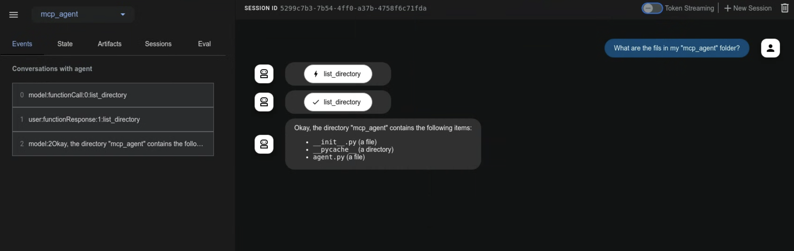
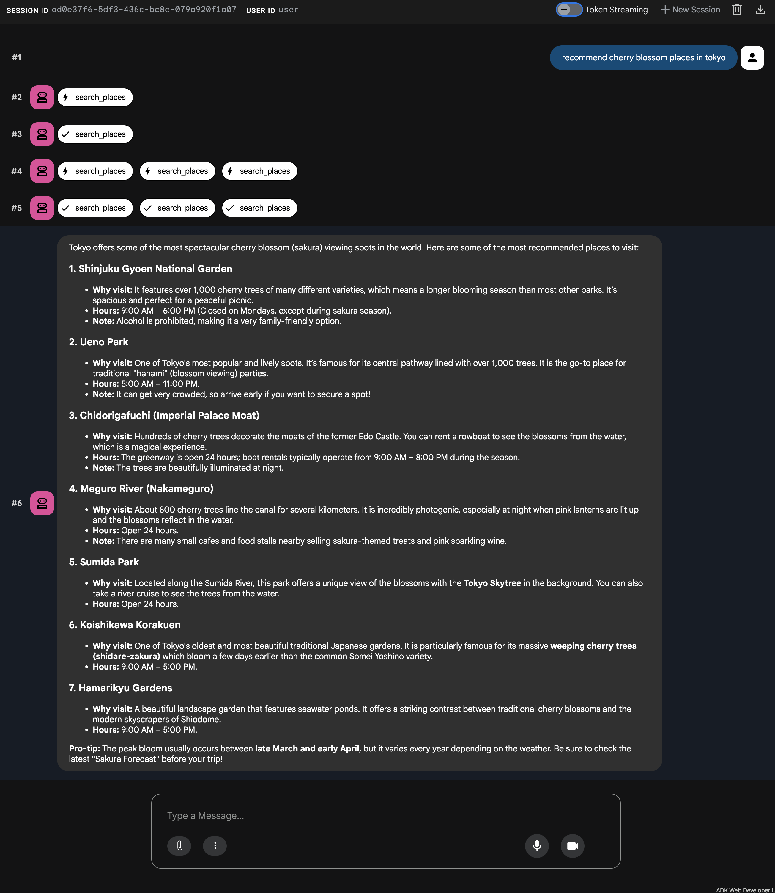

 [ Python](https://github.com/google/adk-python "adk-python on GitHub")[ JS ](https://github.com/google/adk-js "adk-js on GitHub")[ Go ](https://github.com/google/adk-go "adk-go on GitHub")[ Java ](https://github.com/google/adk-java "adk-java on GitHub")[ Kotlin](https://github.com/google/adk-kotlin "adk-kotlin on GitHub")

-   [Home](../..)
-    Build Agents
    
    Build Agents
    
    -   [Get Started](../../get-started/)
        
        Get Started
        
        -   [Python](../../get-started/python/)
        -   [TypeScript](../../get-started/typescript/)
        -   [Go](../../get-started/go/)
        -   [Java](../../get-started/java/)
        -   [Kotlin](../../get-started/kotlin/)
        -   [Agents CLI](../../get-started/agents-cli/)
        -   [Installation](../../get-started/installation/)
        -   [Google Cloud](../../get-started/google-cloud/)
        -   [Migrate to ADK](../../get-started/migrate/)
        
    -   [Build your Agent](../../tutorials/)
        
        Build your Agent
        
        -   [Multi-tool agent](../../tutorials/multi-tool-agent/)
        -   [Agent team](../../tutorials/agent-team/)
        -   [Code with AI](../../tutorials/coding-with-ai/)
        -   [Agent Config](../../agents/config/)
        
    -   [Agents](../../agents/)
        
        Agents
        
        -   [Simple agents](../../agents/llm-agents/)
        -   [Managed agents](../../agents/managed-agents/)
        
    -   [Graph Workflows](../../graphs/)
        
        Graph Workflows
        
        -   [Graph routes](../../graphs/routes/)
        -   [Data handling](../../graphs/data-handling/)
        -   [Human input](../../graphs/human-input/)
        -   [Dynamic workflows](../../graphs/dynamic/)
        
    -   [Multi-Agent Workflows](../../workflows/)
        
        Multi-Agent Workflows
        
        -   [Collaborative workflows](../../workflows/collaboration/)
        -   [Template workflows](../../agents/workflow-agents/)
            
            Template workflows
            
            -   [Sequential workflow](../../agents/workflow-agents/sequential-agents/)
            -   [Loop workflow](../../agents/workflow-agents/loop-agents/)
            -   [Parallel workflow](../../agents/workflow-agents/parallel-agents/)
            -   [Custom template workflows](../../agents/custom-agents/)
            
        -   [Agent routing](../../agents/routing/)
        -   [Workflow patterns](../../workflows/patterns/)
        
    -   [Models for Agents](../../agents/models/)
        
        Models for Agents
        
        -   [Gemini](../../agents/models/google-gemini/)
            
            Gemini
            
            -   [Deferred scheduling](../../agents/models/google-gemini/deferred-schedule/)
            
        -   [Gemma](../../agents/models/google-gemma/)
        -   [Claude](../../agents/models/anthropic/)
        -   [Agent Platform hosted](../../agents/models/agent-platform/)
        -   [Apigee AI Gateway](../../agents/models/apigee/)
        -   [Model routing](../../agents/models/routing/)
        -   [OpenAI](../../agents/models/openai/)
        -   [Ollama](../../agents/models/ollama/)
        -   [vLLM](../../agents/models/vllm/)
        -   [LiteLLM](../../agents/models/litellm/)
        -   [LiteRT-LM](../../agents/models/litert-lm/)
        
    
-    Run Agents
    
    Run Agents
    
    -   [Agent Runtime](../../runtime/)
        
        Agent Runtime
        
        -   [Web Interface](../../runtime/web-interface/)
            
            Web Interface
            
            -   [Visual Builder](../../visual-builder/)
            
        -   [Command Line](../../runtime/command-line/)
        -   [API Server](../../runtime/api-server/)
        -   [Ambient Agents](../../runtime/ambient-agents/)
        -   [Resume Agents](../../runtime/resume/)
        -   [Cancel Agent Runs](../../runtime/cancel/)
        -   [Runtime Config](../../runtime/runconfig/)
        -   [Event Loop](../../runtime/event-loop/)
        
    -   [Deployment](../../deploy/)
        
        Deployment
        
        -   [Agent Runtime](../../deploy/agent-runtime/)
            
            Agent Runtime
            
            -   [Standard deployment](../../deploy/agent-runtime/deploy/)
            -   [agents-cli](../../deploy/agent-runtime/agents-cli/)
            -   [Test deployed agents](../../deploy/agent-runtime/test/)
            
        -   [Cloud Run](../../deploy/cloud-run/)
        -   [GKE](../../deploy/gke/)
        
    -   [Observability](../../observability/)
        
        Observability
        
        -   [Logging](../../observability/logging/)
        -   [Metrics](../../observability/metrics/)
        -   [Traces](../../observability/traces/)
        
    -   [Evaluation](../../evaluate/)
        
        Evaluation
        
        -   [Criteria](../../evaluate/criteria/)
        -   [User Simulation](../../evaluate/user-sim/)
        -   [Environment Simulation](../../evaluate/environment_simulation/)
        -   [Custom Metrics](../../evaluate/custom_metrics/)
        -   [Optimization](../../optimize/)
        
    -   [Safety and Security](../../safety/)
        
        Safety and Security
        
    
-    Components
    
    Components
    
    -   [Technical Overview](../../get-started/about/)
    -   [Custom Tools](../)
        
        Custom Tools
        
        -    Function tools
            
            Function tools
            
            -   [Overview](../function-tools/)
            -   [Tool performance](../performance/)
            -   [Action confirmations](../confirmation/)
            
        -   [MCP tools](./)
            
            MCP tools
            
            -   [Advanced configuration](advanced/)
            -   [Deployment](deployment/)
            -   [Agent as MCP server](agent-as-server/)
            -   [Sub-agent delegation](agent-managed/)
            
        -   [OpenAPI tools](../openapi-tools/)
        -   [Authentication](../authentication/)
        -   [Tool limitations](../../tools/limitations/)
        
    -   [Artifacts](../../artifacts/)
        
        Artifacts
        
    -   [Skills for Agents](../../skills/)
        
        Skills for Agents
        
    -   [App management](../../apps/)
        
        App management
        
        -   [Callbacks](../../callbacks/)
            
            Callbacks
            
            -   [Types of callbacks](../../callbacks/types-of-callbacks/)
            -   [Callback patterns](../../callbacks/design-patterns-and-best-practices/)
            
        -   [Plugins](../../plugins/)
        
    -   [Agent context](../../context/)
        
        Agent context
        
        -   [Conversational context](../../sessions/)
        -   [Sessions](../../sessions/session/)
            
            Sessions
            
            -   [Rewind sessions](../../sessions/session/rewind/)
            -   [Migrate sessions](../../sessions/session/migrate/)
            
        -   [State](../../sessions/state/)
        -   [Events](../../events/)
        -   [Memory](../../sessions/memory/)
        -   [Context compression](../../context/compaction/)
        -   [Model context caching](../../context/caching/)
        
    -   [A2A Protocol](../../a2a/)
        
        A2A Protocol
        
        -   [Introduction to A2A](../../a2a/intro/)
        -    A2A Quickstart (Exposing)
            
            A2A Quickstart (Exposing)
            
            -   [Python](../../a2a/quickstart-exposing/)
            -   [Go](../../a2a/quickstart-exposing-go/)
            -   [Java](../../a2a/quickstart-exposing-java/)
            
        -    A2A Quickstart (Consuming)
            
            A2A Quickstart (Consuming)
            
            -   [Python](../../a2a/quickstart-consuming/)
            -   [Go](../../a2a/quickstart-consuming-go/)
            -   [Java](../../a2a/quickstart-consuming-java/)
            -   [Kotlin](../../a2a/quickstart-consuming-kotlin/)
            
        -   [A2A Extension](../../a2a/a2a-extension/)
        
    -   [Live and Voice Agents](../../live/)
        
        Live and Voice Agents
        
        -   [Get started](../../live/get-started/)
            
            Get started
            
            -   [Python](../../live/get-started/streaming-python/)
            -   [Java](../../live/get-started/streaming-java/)
            
        -    Building
            
            Building
            
            -   [Workflows](../../live/workflows/)
            -   [Tools](../../live/tools/)
            -   [Sessions](../../live/sessions/)
            -   [Events](../../live/events/)
            -   [Audio and video](../../live/audio-video/)
            -   [Configuration](../../live/configuration/)
            
        -    Production
            
            Production
            
            -   [Guardrails](../../live/guardrails/)
            -   [Evaluation](../../live/evaluation/)
            -   [Build a custom server](../../live/custom-server/)
            
        -   [Supported models](../../live/models/)
        
    -   [Grounding](../../grounding/)
        
        Grounding
        
        -   [Google Search Grounding](../../grounding/google_search_grounding/)
        -   [Grounding with Search](../../grounding/grounding_with_search/)
        
    
-   [Integrations](../../integrations/)
    
    Integrations
    
-    Reference
    
    Reference
    
    -   [API Reference](../../api-reference/)
        
        API Reference
        
        -   [Python ADK](../../api-reference/python/)
        -   [TypeScript ADK](../../api-reference/typescript/)
        -    Go ADK
            
            Go ADK
            
            -   [Go v2.x](https://pkg.go.dev/google.golang.org/adk/v2)
            -   [Go v1.x](https://pkg.go.dev/google.golang.org/adk)
            
        -   [Java ADK](../../api-reference/java/)
        -   [Kotlin ADK](../../api-reference/kotlin/)
        -   [CLI Reference](../../api-reference/cli/)
        -   [Agent Config Reference](../../api-reference/agentconfig/)
        -   [REST API](../../api-reference/rest/)
        
    -   [Release Notes](../../release-notes/)
    
-   [Community](../../community/)
    
    Community
    
    -   [Contributing Guide](../../community/contributing-guide/)
    
-   [ADK 2.0](../../2.0/)
    
    ADK 2.0
    

Table of contents

-   [Core architecture and concepts](#core-architecture-and-concepts)
-   [Prerequisites and setup rules](#prerequisites-and-setup-rules)
-   [Understand uses and integrations](#understand-uses-and-integrations)
-   [MCP Implementation options](#mcp-implementation-options)
    
    -   [Direct MCP Tool integration (McpToolset)](#direct-mcp-tool-integration-mcptoolset)
        
        -   [Example: Local Stdio Transport (FileSystem MCP)](#example-local-stdio-transport-filesystem-mcp)
        -   [Example: Remote HTTP / SSE Transport (Google Maps Grounding Lite)](#example-remote-http-sse-transport-google-maps-grounding-lite)
        
    
-   [Remote MCP Authentication and resource access](#remote-mcp-authentication-and-resource-access)
    
    -   [Key authentication parameters](#key-authentication-parameters)
    -   [Configure authentication](#configure-authentication)
    
-   [Accessing MCP Resources](#accessing-mcp-resources)
    
    -   [Core Methods](#core-methods)
        
        -   [Try it out](#try-it-out)
        
    
-   [Troubleshooting & Best Practices Checklist](#troubleshooting-best-practices-checklist)
    
    -   [Configure the environment-aware connection](#configure-the-environment-aware-connection)
    
-   [Further resources](#further-resources)

1.  [Home](../..)
2.  [Components](../../get-started/about/)
3.  [Custom Tools](../)
4.  [MCP tools](./)

[](https://github.com/google/adk-docs/edit/main/docs/tools-custom/mcp-tools/index.md "Edit this page on GitHub")[](./index.md "View this page as Markdown")

# Model Context Protocol tools[¶](#model-context-protocol-tools "Permanent link")

Supported in ADKPython v0.1.0Typescript v0.2.0Go v0.1.0Java v0.1.0Kotlin v0.1.0

The **Model Context Protocol (MCP)** is an open standard for connecting generative AI models to external data sources, tools, and systems. Think of it as a universal connection mechanism that simplifies how LLMs obtain context, execute actions, and interact with various systems.

* * *

## Core architecture and concepts[¶](#core-architecture-and-concepts "Permanent link")

MCP follows a client-server architecture, defining how data or resources, interactive templates or prompts, and actionable functions or tools are exposed by an MCP server and consumed by an MCP client, which could be an LLM host application or an AI agent. In ADK, you use the McpToolset class as an interface between MCP Servers and ADK agents. It is also possible to configure an ADK server as an MCP server for use by other client systems.

```
sequenceDiagram
    autonumber
    participant Agent as ADK LlmAgent (Client)
    participant Toolset as McpToolset
    participant Server as MCP Server

    Agent->>Toolset: Initialize connection
    Toolset->>Server: Protocol Handshake & Tool Discovery (list_tools)
    Server-->>Toolset: Available Tool Schemas
    Toolset-->>Agent: Adapted ADK Tools

    Agent->>Toolset: Call Tool (arguments)
    Toolset->>Server: Execute Tool (call_tool via Stdio/HTTP)
    Server-->>Toolset: Execution Result (Text/JSON)
    Toolset-->>Agent: Result returned to LLM
```

## Prerequisites and setup rules[¶](#prerequisites-and-setup-rules "Permanent link")

Before you begin, ensure you have the following set up:

-   **ADK Installed**: Complete standard ADK setup in your project environment with the MCP extra: `pip install "google-adk[mcp]"`.
-   **Runtime Requirements**: Python 3.10+ or Java 17+.
-   **Node.js & `npx`** *(Python/TS only)*: Required to run npm-packaged community MCP servers.
-   **Verify installations**: Confirm `adk` and `npx` are in your PATH in the activated virtual environment:

MacOS / LinuxWindows PowerShell

`[](#__codelineno-0-1)# Both commands should print the path to the executables. [](#__codelineno-0-2)which adk [](#__codelineno-0-3)which npx`

`[](#__codelineno-1-1)# Both commands should print the path to the executables. [](#__codelineno-1-2)Get-Command adk [](#__codelineno-1-3)Get-Command npx`

Deployment rule

Agents deployed to production **must define `McpToolset` synchronously** in `agent.py`. Dynamic asynchronous agent initialization is only supported for local debugging or custom standalone runners.

* * *

## Understand uses and integrations[¶](#understand-uses-and-integrations "Permanent link")

There are three main integration patterns. The direct integration is covered in this page and the other implementations are covered in their specific pages.

1.  **Direct MCP Tool Integration**: When an ADK agent acts as an MCP client using `McpToolset`.
2.  **Agent-Exposed MCP Server**: When you build an MCP server that wraps ADK Tools using `to_mcp_server`.
3.  **Specialized Sub-Agent Delegation**: When an agent delegates to a sub-agent using `AgentTool`.

## MCP Implementation options[¶](#mcp-implementation-options "Permanent link")

When you start building with the Model Context Protocol (MCP) and ADK, these key architectural differences will help you design more stable and efficient agents. The following table works as a comparative guide to help you construct those agents.

Dimension

[**Direct MCP Tool Integration** (`McpToolset`)](#direct-mcp-tool-integration-mcptoolset)

[**Agent-Exposed MCP Server** (`to_mcp_server`)](agent-as-server/)

[**Specialized Sub-Agent Delegation** (`AgentTool`)](agent-managed/)

**Architecture**

External server process or remote service providing deterministic endpoints adapted into the primary `LlmAgent` tool list.

An autonomous ADK agent compiled into an MCP server, callable by external clients (Claude Code, IDEs, external hosts).

In-process, hierarchical agent encapsulation where a parent agent invokes a child `LlmAgent` as a callable tool.

**Context Window Impact**

**High Context Bloat**: Every tool definition and raw output, for example: database rows or file blobs, enters the primary agent's history.

**Isolated**: The external caller only receives the final aggregated response text/blocks.

**Zero Context Bloat**: Intermediate exploratory reasoning, failed tool calls, and large raw outputs remain isolated in the sub-agent loop.

**AI Model Load and Tiering**

Single model must understand all tool schemas, validation constraints, and workflow state simultaneously.

Independent model reasoning dedicated solely to the wrapped task.

Enables **model tiering**, for example: `gemini-2.5-pro` for orchestrator, and `gemini-2.5-flash` for sub-agent tool execution with dedicated system instructions.

**Latency & Token Cost**

**Lower Cost & Predictable Latency**: 1 LLM turn + 1 deterministic tool invocation + 1 response generation turn.

Client-driven; latency depends on internal agent execution depth.

**Higher Cost & Variable Latency**: Multiple LLM calls, sub-agent reasoning turns before returning to parent.

**Ideal Use Cases**

-   Deterministic API integrations: Postgres, BigQuery, GitHub, Google Maps.
-   File system operations & static resource reading.
-   Reusing standard pre-built community MCP servers.

-   Exposing complex ADK multi-agent capabilities to external MCP-compliant ecosystems.
-   Integrating ADK agents into IDEs, editors, or A2A pipelines.

-   Multi-step autonomous workflows requiring trial-and-error. For example: code debugging or research synthesis.
-   Tasks needing isolated personas or specialized instructions.
-   Scenarios with >20 tools where schema overload harms accuracy.

State restoration

While ADK agents preserve session state during lifecycle events, they do not automatically re-establish active MCP connections upon restoration. Agents re-initialize connections as needed.

### Direct MCP Tool integration (McpToolset)[¶](#direct-mcp-tool-integration-mcptoolset "Permanent link")

The `McpToolset` class can be directly added to your agent's tools list; this class enables seamless connection to an MCP server, discovery of its tools, and making them available for your agent to use. On initialization, `McpToolset` establishes and manages the connection to the MCP server. It also handles graceful connection shutdown when the agent or process terminates. Use `McpToolset` to import tools from an external MCP server into your ADK `LlmAgent`.

#### Example: Local Stdio Transport (FileSystem MCP)[¶](#example-local-stdio-transport-filesystem-mcp "Permanent link")

This example sets up an ADK agent that connects to a local MCP file system server; it instantiates the McpToolset directly within the agent's tools list to enable file management capabilities.

**Step 1**. Define your agent with `McpToolset`:

PythonTypeScriptJavaGo

`[](#__codelineno-2-1)import os [](#__codelineno-2-2)from google.adk.agents import LlmAgent [](#__codelineno-2-3)from google.adk.tools.mcp_tool import McpToolset [](#__codelineno-2-4)from google.adk.tools.mcp_tool.mcp_session_manager import StdioConnectionParams [](#__codelineno-2-5)from mcp import StdioServerParameters [](#__codelineno-2-6)[](#__codelineno-2-7)TARGET_FOLDER = os.path.abspath("./accessible_files") [](#__codelineno-2-8)[](#__codelineno-2-9)root_agent = LlmAgent(     [](#__codelineno-2-10)    model="gemini-flash-latest",    [](#__codelineno-2-11)    name="filesystem_assistant",    [](#__codelineno-2-12)    instruction="Help users manage local files.",    [](#__codelineno-2-13)    tools=[        [](#__codelineno-2-14)        McpToolset(            [](#__codelineno-2-15)            connection_params=StdioConnectionParams(                [](#__codelineno-2-16)                server_params=StdioServerParameters(                    [](#__codelineno-2-17)                    command="npx",                    [](#__codelineno-2-18)                    args=["-y", "@modelcontextprotocol/server-filesystem", TARGET_FOLDER],                [](#__codelineno-2-19)                ),            [](#__codelineno-2-20)            ),            [](#__codelineno-2-21)            # Optional: Select specific tools exposed to the agent            [](#__codelineno-2-22)            tool_filter=["list_directory", "read_file"],        [](#__codelineno-2-23)        )    [](#__codelineno-2-24)    ], [](#__codelineno-2-25))`

**Step 2**: Package and Run your Agent to make your agent discoverable to ADK and start interacting with it, follow this workflow:

-   Initiate your package: Create an `__init__.py` file in the same directory as your agent.py. This step is required for ADK to recognize your agent.
-   Launch the Web Interface:
    
    `[](#__codelineno-3-1)cd ./adk_agent_samples  [](#__codelineno-3-2)adk web`
    
-   Interact with the Agent: select `filesystem_assistant` from the drop-down menu and prompt the Agent with commands: *List files in the current directory* or *What is the content of another\_file.md?*
    

 \`\`\`

`[](#__codelineno-4-1)import { LlmAgent, MCPToolset } from "@google/adk"; [](#__codelineno-4-2)import path from "path"; [](#__codelineno-4-3)[](#__codelineno-4-4)const TARGET_FOLDER = path.resolve("./accessible_files"); [](#__codelineno-4-5)[](#__codelineno-4-6)export const rootAgent = new LlmAgent({     [](#__codelineno-4-7)    model: "gemini-flash-latest",    [](#__codelineno-4-8)    name: "filesystem_assistant",    [](#__codelineno-4-9)    instruction: "Help users manage local files.",    [](#__codelineno-4-10)    tools: [        [](#__codelineno-4-11)        new MCPToolset({            [](#__codelineno-4-12)            type: "StdioConnectionParams",            [](#__codelineno-4-13)            serverParams: {                [](#__codelineno-4-14)                command: "npx",                [](#__codelineno-4-15)                args: ["-y", "@modelcontextprotocol/server-filesystem", TARGET_FOLDER],            [](#__codelineno-4-16)            },        [](#__codelineno-4-17)        }, ["list_directory", "read_file"]) // Optional tool filter array    [](#__codelineno-4-18)    ], [](#__codelineno-4-19)});`

`[](#__codelineno-5-1)package agents; [](#__codelineno-5-2)[](#__codelineno-5-3)import com.google.adk.agents.LlmAgent; [](#__codelineno-5-4)import com.google.adk.tools.mcp.McpToolset; [](#__codelineno-5-5)import com.google.adk.tools.mcp.StdioServerParameters; [](#__codelineno-5-6)import java.util.List; [](#__codelineno-5-7)[](#__codelineno-5-8)public class FileSystemAgentCreator {     [](#__codelineno-5-9)    public static void main(String[] args) throws Exception {        [](#__codelineno-5-10)        StdioServerParameters serverParams = StdioServerParameters.builder()                [](#__codelineno-5-11)                .command("npx")                [](#__codelineno-5-12)                .args(List.of("-y", "@modelcontextprotocol/server-filesystem", "/absolute/path/to/folder"))                [](#__codelineno-5-13)                .build(); [](#__codelineno-5-14)        [](#__codelineno-5-15)        try (McpToolset toolset = new McpToolset(serverParams.toServerParameters())) {            [](#__codelineno-5-16)            LlmAgent agent = LlmAgent.builder()                    [](#__codelineno-5-17)                    .model("gemini-flash-latest")                    [](#__codelineno-5-18)                    .name("filesystem_assistant")                    [](#__codelineno-5-19)                    .instruction("Help users access their file systems.")                    [](#__codelineno-5-20)                    .tools(toolset)                    [](#__codelineno-5-21)                    .build(); [](#__codelineno-5-22)            [](#__codelineno-5-23)            System.out.println("Agent initialized: " + agent.name());        [](#__codelineno-5-24)        }    [](#__codelineno-5-25)    } [](#__codelineno-5-26)}`

`[](#__codelineno-6-1)package main [](#__codelineno-6-2)[](#__codelineno-6-3)import (     [](#__codelineno-6-4)    "context"    [](#__codelineno-6-5)    "fmt"    [](#__codelineno-6-6)    "os/exec" [](#__codelineno-6-7)    [](#__codelineno-6-8)    "github.com/modelcontextprotocol/go-sdk/mcp"    [](#__codelineno-6-9)    "google.golang.org/adk/v2/agent"    [](#__codelineno-6-10)    "google.golang.org/adk/v2/agent/llmagent"    [](#__codelineno-6-11)    "google.golang.org/adk/v2/model/gemini"    [](#__codelineno-6-12)    "google.golang.org/adk/v2/tool"    [](#__codelineno-6-13)    "google.golang.org/adk/v2/tool/mcptoolset" [](#__codelineno-6-14)) [](#__codelineno-6-15)[](#__codelineno-6-16)func createFilesystemAgent(ctx context.Context) (agent.Agent, error) {     [](#__codelineno-6-17)    // 1. Initialize MCP Toolset with CommandTransport and AllowedToolsPredicate    [](#__codelineno-6-18)    mcpTools, err := mcptoolset.New(mcptoolset.Config{        [](#__codelineno-6-19)        Transport: &mcp.CommandTransport{            [](#__codelineno-6-20)            Command: exec.Command("npx", "-y", "@modelcontextprotocol/server-filesystem", "./accessible_files"),        [](#__codelineno-6-21)        },        [](#__codelineno-6-22)        ToolFilter: tool.AllowedToolsPredicate([]string{"list_directory", "read_file"}),    [](#__codelineno-6-23)    })    [](#__codelineno-6-24)    if err != nil {        [](#__codelineno-6-25)        return nil, fmt.Errorf("failed to create mcp toolset: %w", err)    [](#__codelineno-6-26)    } [](#__codelineno-6-27)    [](#__codelineno-6-28)    // 2. Initialize Gemini model.LLM instance    [](#__codelineno-6-29)    llm, err := gemini.NewModel(ctx, "gemini-2.0-flash", nil)    [](#__codelineno-6-30)    if err != nil {        [](#__codelineno-6-31)        return nil, fmt.Errorf("failed to create gemini model: %w", err)    [](#__codelineno-6-32)    } [](#__codelineno-6-33)    [](#__codelineno-6-34)    // 3. Create the LLM agent returning agent.Agent    [](#__codelineno-6-35)    return llmagent.New(llmagent.Config{        [](#__codelineno-6-36)        Name:        "filesystem_assistant",        [](#__codelineno-6-37)        Model:       llm,        [](#__codelineno-6-38)        Instruction: "Help users manage local files.",        [](#__codelineno-6-39)        Toolsets:    []tool.Toolset{mcpTools},    [](#__codelineno-6-40)    }) [](#__codelineno-6-41)} [](#__codelineno-6-42)[](#__codelineno-6-43)func main() {     [](#__codelineno-6-44)    ctx := context.Background()    [](#__codelineno-6-45)    ag, err := createFilesystemAgent(ctx)    [](#__codelineno-6-46)    if err != nil {        [](#__codelineno-6-47)        panic(err)    [](#__codelineno-6-48)    }    [](#__codelineno-6-49)    fmt.Printf("Successfully created agent: %s\n", ag.Name()) [](#__codelineno-6-50)}`

* * *

#### Example: Remote HTTP / SSE Transport (Google Maps Grounding Lite)[¶](#example-remote-http-sse-transport-google-maps-grounding-lite "Permanent link")

Before starting, follow the instructions for [Google Maps Grounding Lite](https://developers.google.com/maps/ai/grounding-lite) to enable the service on your Google Cloud project and generate your Maps Platform API Key. Unlike the previous local process example, this pattern connects your agent to a remote, cloud-hosted MCP server using Server-Sent Events (SSE). It uses the Google Maps Grounding Lite service to demonstrate how to pass authentication headers, such as an API key, to a scalable endpoint.

**Step 1**: Define your agent with `McpToolset`.

PythonTypeScript

`[](#__codelineno-7-1)import os [](#__codelineno-7-2)from google.adk.agents import LlmAgent [](#__codelineno-7-3)from google.adk.tools.mcp_tool import McpToolset [](#__codelineno-7-4)from google.adk.tools.mcp_tool.mcp_session_manager import StreamableHTTPConnectionParams [](#__codelineno-7-5)[](#__codelineno-7-6)API_KEY = os.getenv("GOOGLE_MAPS_API_KEY") [](#__codelineno-7-7)[](#__codelineno-7-8)root_agent = LlmAgent(     [](#__codelineno-7-9)    model="gemini-flash-latest",    [](#__codelineno-7-10)    name="travel_planner",    [](#__codelineno-7-11)    instruction="Plan travel routes and search locations using Google Maps.",    [](#__codelineno-7-12)    tools=[        [](#__codelineno-7-13)        McpToolset(            [](#__codelineno-7-14)            connection_params=StreamableHTTPConnectionParams(                [](#__codelineno-7-15)                url="https://mapstools.googleapis.com/mcp",                [](#__codelineno-7-16)                headers={                    [](#__codelineno-7-17)                    "X-Goog-Api-Key": API_KEY,                    [](#__codelineno-7-18)                    "Content-Type": "application/json",                    [](#__codelineno-7-19)                    "Accept": "application/json, text/event-stream",                [](#__codelineno-7-20)                },                [](#__codelineno-7-21)                timeout=5,                [](#__codelineno-7-22)                sse_read_timeout=300            [](#__codelineno-7-23)            )        [](#__codelineno-7-24)        )    [](#__codelineno-7-25)    ], [](#__codelineno-7-26))`

**Step 2**: Set environment variable before running `adk web`, set you Google API key in your terminal

`[](#__codelineno-8-1)export GOOGLE_MAPS_API_KEY="YOUR_ACTUAL_GOOGLE_MAPS_API_KEY"`

**Step 3**: Run `adk web`: Navigate to the parent directory of `mcp_agent` and launch the web Interface. **Step 4**: Interact with the UI: - Select `travel_planner` from the drop-down. - Try prompts such as: *I will be in San Francisco tomorrow. What's the weather like* or *Find coffee shops near Golden Gate Park*



\`\`\`typescript import { LlmAgent, MCPToolset } from "@google/adk";

export const rootAgent = new LlmAgent({ model: "gemini-flash-latest", name: "travel\_planner", instruction: "Plan travel routes and search locations using Google Maps.", tools: \[ new MCPToolset({ type: "StreamableHTTPConnectionParams", url: "https://mapstools.googleapis.com/mcp", transportOptions: { requestInit: { headers: { "X-Goog-Api-Key": process.env.GOOGLE\_MAPS\_API\_KEY!, "Content-Type": "application/json", "Accept": "application/json, text/event-stream", }, }, }, timeout: 5, sseReadTimeout: 300, }), \], }); \`\`\`

* * *

## Remote MCP Authentication and resource access[¶](#remote-mcp-authentication-and-resource-access "Permanent link")

This section shows you how to connect to remote MCP servers using authentication and how to read data **Resources** exposed by an MCP server. When an MCP server requires authentication, such as over Server-Sent Events `SseConnectionParams` or Streamable HTTP, `McpToolset` handles credential injection and token management automatically.

### Key authentication parameters[¶](#key-authentication-parameters "Permanent link")

Parameter

Type

Description

`auth_scheme`

`AuthScheme`

The authentication strategy (e.g., `Bearer`, `Basic`, `APIKey`, `OAuth2`).

`auth_credential`

`AuthCredential`

The secret credential payload, for example, API token, OAuth access token, username/password.

ADK automatically constructs the required `Authorization` HTTP headers and manages OAuth 2.0 token refreshes during client requests.

### Configure authentication[¶](#configure-authentication "Permanent link")

When an MCP server requires authentication, `McpToolset` handles credential injection and token management automatically. Use the native `auth_scheme` and `auth_credential` parameters rather than manually injecting HTTP headers.

*For general ADK authentication patterns, see our [Custom Tools Authentication Guide](../authentication/)*

PythonTypeScript

`[](#__codelineno-9-1)import os [](#__codelineno-9-2)from google.adk.tools.mcp_tool import McpToolset [](#__codelineno-9-3)from google.adk.tools.mcp_tool.mcp_session_manager import SseConnectionParams [](#__codelineno-9-4)[](#__codelineno-9-5)# Configure Bearer Token Authentication via headers [](#__codelineno-9-6)toolset = McpToolset(     [](#__codelineno-9-7)    connection_params=SseConnectionParams(        [](#__codelineno-9-8)        url="https://mcp-server.example.com/sse",        [](#__codelineno-9-9)        headers={"Authorization": f"Bearer {os.getenv('MCP_AUTH_TOKEN')}"},        [](#__codelineno-9-10)        timeout=5,    [](#__codelineno-9-11)    ) [](#__codelineno-9-12))`

``[](#__codelineno-10-1)import { MCPToolset } from "@google/adk"; [](#__codelineno-10-2)[](#__codelineno-10-3)// Configure Bearer Token Authentication via headers [](#__codelineno-10-4)const toolset = new MCPToolset({     [](#__codelineno-10-5)    type: "StreamableHTTPConnectionParams",    [](#__codelineno-10-6)    url: "https://mcp-server.example.com/sse",    [](#__codelineno-10-7)    transportOptions: {        [](#__codelineno-10-8)        requestInit: {            [](#__codelineno-10-9)            headers: {                [](#__codelineno-10-10)                "Authorization": `Bearer ${process.env.MCP_AUTH_TOKEN}`,            [](#__codelineno-10-11)            },        [](#__codelineno-10-12)        },    [](#__codelineno-10-13)    },    [](#__codelineno-10-14)    timeout: 5, [](#__codelineno-10-15)});``

* * *

## Accessing MCP Resources[¶](#accessing-mcp-resources "Permanent link")

In addition to executable **Tools**, MCP servers can expose **Resources** data files, database records, or API context blobs.

`McpToolset` provides two core methods to discover and read these data resources:

### Core Methods[¶](#core-methods "Permanent link")

-   **`list_resources()`**: Returns a list of all available data resources exposed by the MCP server.
-   **`read_resource(name)`**: Retrieves the raw content blocks, text or binary data, for a specific resource by its name or URI.
-   **`use_mcp_resources=True` (Configuration)**: When initializing `McpToolset`, setting this flag automatically equips the LLM agent with the `LoadMcpResourceTool`. This allows the agent to dynamically discover and read resources on its own without requiring manual programmatic fetching.

#### Try it out[¶](#try-it-out "Permanent link")

PythonTypeScript

  `[](#__codelineno-11-1)  import asyncio [](#__codelineno-11-2)  [](#__codelineno-11-3)  async def fetch_mcp_data(toolset):      [](#__codelineno-11-4)      # 1. Discover available resources on the server      [](#__codelineno-11-5)      resources = await toolset.list_resources()      [](#__codelineno-11-6)      print("Available Resources:", resources) [](#__codelineno-11-7)      [](#__codelineno-11-8)      # 2. Read content from a specific resource      [](#__codelineno-11-9)      if resources:          [](#__codelineno-11-10)          resource_name = resources[0]          [](#__codelineno-11-11)          content_blocks = await toolset.read_resource(name=resource_name)          [](#__codelineno-11-12)          print(f"Content of {resource_name}:", content_blocks)`

  ``[](#__codelineno-12-1)  async function fetchMcpData(toolset: any) {      [](#__codelineno-12-2)      // 1. Discover available resources      [](#__codelineno-12-3)      const resources = await toolset.listResources();      [](#__codelineno-12-4)      console.log("Available Resources:", resources); [](#__codelineno-12-5)      [](#__codelineno-12-6)      // 2. Read a specific resource      [](#__codelineno-12-7)      if (resources.length > 0) {          [](#__codelineno-12-8)          const content = await toolset.readResource(resources[0]);          [](#__codelineno-12-9)          console.log(`Content of ${resources[0]}:`, content);      [](#__codelineno-12-10)      }  [](#__codelineno-12-11)  }``

* * *

## Troubleshooting & Best Practices Checklist[¶](#troubleshooting-best-practices-checklist "Permanent link")

-   **Security & Scoping**: Always supply `tool_filter=[...]` in `McpToolset` to expose only necessary actions to your LLM.
-   **Timeouts**: Configure explicit timeouts on `StdioConnectionParams(timeout=5)` to prevent hanging subprocesses.
-   **Lifecycle Cleanup**: In non-`adk web` runners, invoke `await toolset.close()` or use async context managers to gracefully shutdown subprocesses.
-   **Environment Detection**: Dynamically pick connection types based on environment variables, for example: `K_SERVICE` for Cloud Run vs Stdio for local dev.

### Configure the environment-aware connection[¶](#configure-the-environment-aware-connection "Permanent link")

`[](#__codelineno-13-1)import os [](#__codelineno-13-2)from google.adk.tools.mcp_tool import McpToolset [](#__codelineno-13-3)from google.adk.tools.mcp_tool.mcp_session_manager import (     [](#__codelineno-13-4)    StdioConnectionParams,    [](#__codelineno-13-5)    StreamableHTTPConnectionParams, [](#__codelineno-13-6)) [](#__codelineno-13-7)from mcp import StdioServerParameters [](#__codelineno-13-8)[](#__codelineno-13-9)if os.getenv("K_SERVICE"):   [](#__codelineno-13-10)  # Running in Production (Cloud Run)  [](#__codelineno-13-11)  # Uses Streamable HTTP for stateless scalability and bearer auth headers  [](#__codelineno-13-12)  mcp_toolset = McpToolset(      [](#__codelineno-13-13)      connection_params=StreamableHTTPConnectionParams(          [](#__codelineno-13-14)          url=os.getenv("REMOTE_MCP_URL"),          [](#__codelineno-13-15)          headers={"Authorization": f"Bearer {os.getenv('MCP_AUTH_TOKEN')}"},          [](#__codelineno-13-16)          timeout=5,          [](#__codelineno-13-17)          sse_read_timeout=300,      [](#__codelineno-13-18)      )  [](#__codelineno-13-19)  ) [](#__codelineno-13-20)else:   [](#__codelineno-13-21)  # Running in Local Development  [](#__codelineno-13-22)  # Uses Stdio Subprocess IPC for zero-network latency testing  [](#__codelineno-13-23)  mcp_toolset = McpToolset(      [](#__codelineno-13-24)      connection_params=StdioConnectionParams(          [](#__codelineno-13-25)          server_params=StdioServerParameters(              [](#__codelineno-13-26)              command="npx",              [](#__codelineno-13-27)              args=["-y", "@modelcontextprotocol/server-filesystem", "/tmp"],          [](#__codelineno-13-28)          ),          [](#__codelineno-13-29)          timeout=5,      [](#__codelineno-13-30)      )  [](#__codelineno-13-31)  )`

## Further resources[¶](#further-resources "Permanent link")

Once you understand the basics, explore [Advanced use cases](advanced/) for complex implementations and custom integrations.

Back to top