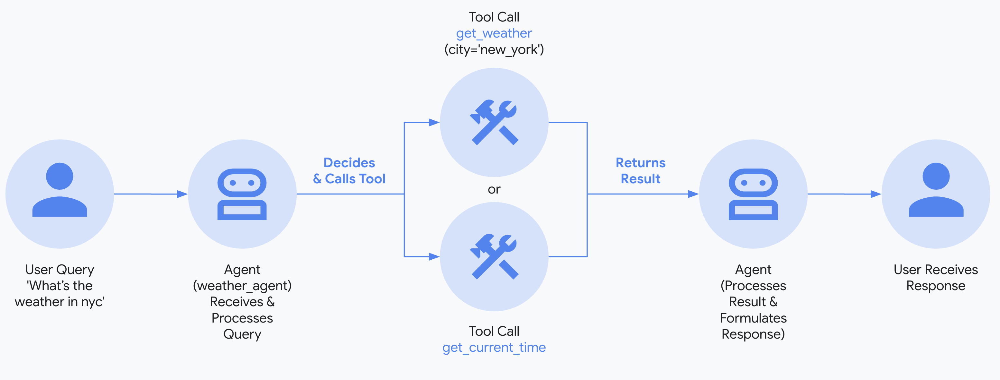
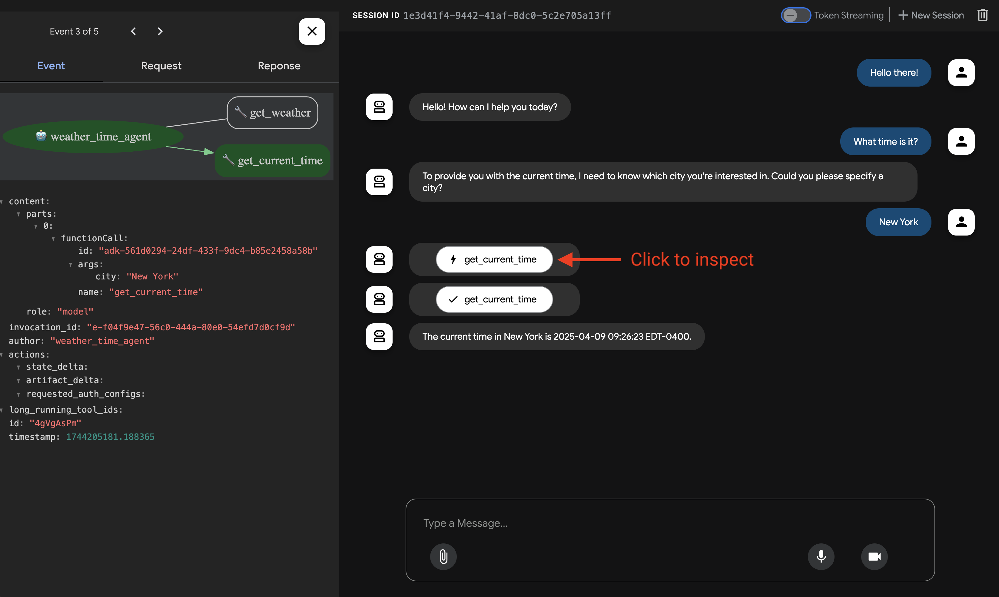
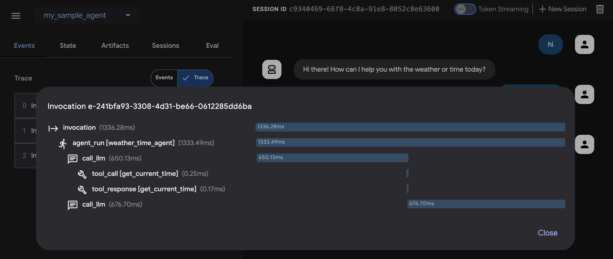
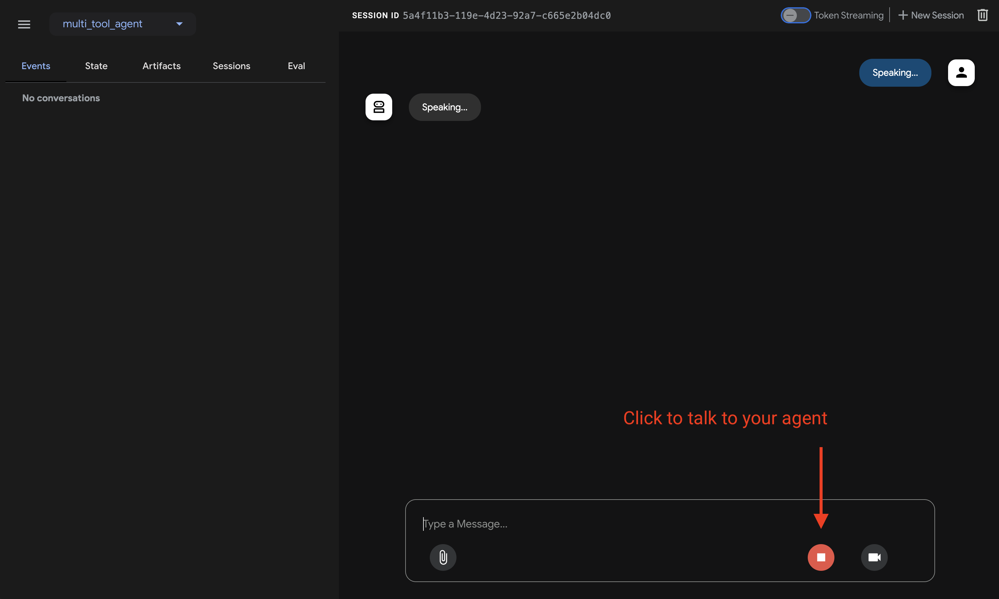
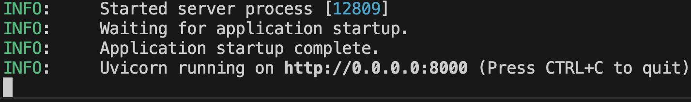

 [ Python](https://github.com/google/adk-python "adk-python on GitHub")[ JS ](https://github.com/google/adk-js "adk-js on GitHub")[ Go ](https://github.com/google/adk-go "adk-go on GitHub")[ Java ](https://github.com/google/adk-java "adk-java on GitHub")[ Kotlin](https://github.com/google/adk-kotlin "adk-kotlin on GitHub")

-   [Home](../..)
-    Build Agents
    
    Build Agents
    
    -   [Get Started](../../get-started/)
        
        Get Started
        
        -   [Python](../../get-started/python/)
        -   [TypeScript](../../get-started/typescript/)
        -   [Go](../../get-started/go/)
        -   [Java](../../get-started/java/)
        -   [Kotlin](../../get-started/kotlin/)
        -   [Agents CLI](../../get-started/agents-cli/)
        -   [Installation](../../get-started/installation/)
        -   [Google Cloud](../../get-started/google-cloud/)
        -   [Migrate to ADK](../../get-started/migrate/)
        
    -   [Build your Agent](../)
        
        Build your Agent
        
        -    Multi-tool agent [Multi-tool agent](./)
            
            Table of contents
            
            -   [1\. Set up Environment & Install ADK](#set-up-environment-install-adk)
            -   [Create a new Go module](#create-a-new-go-module)
            -   [Install ADK](#install-adk)
            -   [2\. Create Agent Project](#create-agent-project)
                
                -   [Project structure](#project-structure)
                -   [\_\_init\_\_.py](#__init__py)
                -   [agent.py](#agentpy)
                -   [.env](#env)
                -   [agent.ts](#agentts)
                -   [.env](#env_1)
                -   [agent.go](#agentgo)
                -   [.env](#env_2)
                -   [Create MultiToolAgent.java](#create-multitoolagentjava)
                -   [Create MultiToolAgent.kt](#create-multitoolagentkt)
                
            -   [3\. Set up the model](#set-up-the-model)
                
                -   [Model connection and authentication](#model-connection-and-authentication)
                
            -   [4\. Run Your Agent](#run-your-agent)
                
                -   [Run your Agent](#run-your-agent_1)
                -   [📝 Example prompts to try](#example-prompts-to-try)
                
            -   [🎉 Congratulations!](#congratulations)
            -   [🛣️ Next steps](#next-steps)
            
        -   [Agent team](../agent-team/)
        -   [Code with AI](../coding-with-ai/)
        -   [Agent Config](../../agents/config/)
        
    -   [Agents](../../agents/)
        
        Agents
        
        -   [Simple agents](../../agents/llm-agents/)
        -   [Managed agents](../../agents/managed-agents/)
        
    -   [Graph Workflows](../../graphs/)
        
        Graph Workflows
        
        -   [Graph routes](../../graphs/routes/)
        -   [Data handling](../../graphs/data-handling/)
        -   [Human input](../../graphs/human-input/)
        -   [Dynamic workflows](../../graphs/dynamic/)
        
    -   [Multi-Agent Workflows](../../workflows/)
        
        Multi-Agent Workflows
        
        -   [Collaborative workflows](../../workflows/collaboration/)
        -   [Template workflows](../../agents/workflow-agents/)
            
            Template workflows
            
            -   [Sequential workflow](../../agents/workflow-agents/sequential-agents/)
            -   [Loop workflow](../../agents/workflow-agents/loop-agents/)
            -   [Parallel workflow](../../agents/workflow-agents/parallel-agents/)
            -   [Custom template workflows](../../agents/custom-agents/)
            
        -   [Agent routing](../../agents/routing/)
        -   [Workflow patterns](../../workflows/patterns/)
        
    -   [Models for Agents](../../agents/models/)
        
        Models for Agents
        
        -   [Gemini](../../agents/models/google-gemini/)
            
            Gemini
            
            -   [Deferred scheduling](../../agents/models/google-gemini/deferred-schedule/)
            
        -   [Gemma](../../agents/models/google-gemma/)
        -   [Claude](../../agents/models/anthropic/)
        -   [Agent Platform hosted](../../agents/models/agent-platform/)
        -   [Apigee AI Gateway](../../agents/models/apigee/)
        -   [Model routing](../../agents/models/routing/)
        -   [OpenAI](../../agents/models/openai/)
        -   [Ollama](../../agents/models/ollama/)
        -   [vLLM](../../agents/models/vllm/)
        -   [LiteLLM](../../agents/models/litellm/)
        -   [LiteRT-LM](../../agents/models/litert-lm/)
        
    
-    Run Agents
    
    Run Agents
    
    -   [Agent Runtime](../../runtime/)
        
        Agent Runtime
        
        -   [Web Interface](../../runtime/web-interface/)
            
            Web Interface
            
            -   [Visual Builder](../../visual-builder/)
            
        -   [Command Line](../../runtime/command-line/)
        -   [API Server](../../runtime/api-server/)
        -   [Ambient Agents](../../runtime/ambient-agents/)
        -   [Resume Agents](../../runtime/resume/)
        -   [Cancel Agent Runs](../../runtime/cancel/)
        -   [Runtime Config](../../runtime/runconfig/)
        -   [Event Loop](../../runtime/event-loop/)
        
    -   [Deployment](../../deploy/)
        
        Deployment
        
        -   [Agent Runtime](../../deploy/agent-runtime/)
            
            Agent Runtime
            
            -   [Standard deployment](../../deploy/agent-runtime/deploy/)
            -   [agents-cli](../../deploy/agent-runtime/agents-cli/)
            -   [Test deployed agents](../../deploy/agent-runtime/test/)
            
        -   [Cloud Run](../../deploy/cloud-run/)
        -   [GKE](../../deploy/gke/)
        
    -   [Observability](../../observability/)
        
        Observability
        
        -   [Logging](../../observability/logging/)
        -   [Metrics](../../observability/metrics/)
        -   [Traces](../../observability/traces/)
        
    -   [Evaluation](../../evaluate/)
        
        Evaluation
        
        -   [Criteria](../../evaluate/criteria/)
        -   [User Simulation](../../evaluate/user-sim/)
        -   [Environment Simulation](../../evaluate/environment_simulation/)
        -   [Custom Metrics](../../evaluate/custom_metrics/)
        -   [Optimization](../../optimize/)
        
    -   [Safety and Security](../../safety/)
        
        Safety and Security
        
    
-    Components
    
    Components
    
    -   [Technical Overview](../../get-started/about/)
    -   [Custom Tools](../../tools-custom/)
        
        Custom Tools
        
        -    Function tools
            
            Function tools
            
            -   [Overview](../../tools-custom/function-tools/)
            -   [Tool performance](../../tools-custom/performance/)
            -   [Action confirmations](../../tools-custom/confirmation/)
            
        -   [MCP tools](../../tools-custom/mcp-tools/)
            
            MCP tools
            
            -   [Advanced configuration](../../tools-custom/mcp-tools/advanced/)
            -   [Deployment](../../tools-custom/mcp-tools/deployment/)
            -   [Agent as MCP server](../../tools-custom/mcp-tools/agent-as-server/)
            -   [Sub-agent delegation](../../tools-custom/mcp-tools/agent-managed/)
            
        -   [OpenAPI tools](../../tools-custom/openapi-tools/)
        -   [Authentication](../../tools-custom/authentication/)
        -   [Tool limitations](../../tools/limitations/)
        
    -   [Artifacts](../../artifacts/)
        
        Artifacts
        
    -   [Skills for Agents](../../skills/)
        
        Skills for Agents
        
    -   [App management](../../apps/)
        
        App management
        
        -   [Callbacks](../../callbacks/)
            
            Callbacks
            
            -   [Types of callbacks](../../callbacks/types-of-callbacks/)
            -   [Callback patterns](../../callbacks/design-patterns-and-best-practices/)
            
        -   [Plugins](../../plugins/)
        
    -   [Agent context](../../context/)
        
        Agent context
        
        -   [Conversational context](../../sessions/)
        -   [Sessions](../../sessions/session/)
            
            Sessions
            
            -   [Rewind sessions](../../sessions/session/rewind/)
            -   [Migrate sessions](../../sessions/session/migrate/)
            
        -   [State](../../sessions/state/)
        -   [Events](../../events/)
        -   [Memory](../../sessions/memory/)
        -   [Context compression](../../context/compaction/)
        -   [Model context caching](../../context/caching/)
        
    -   [A2A Protocol](../../a2a/)
        
        A2A Protocol
        
        -   [Introduction to A2A](../../a2a/intro/)
        -    A2A Quickstart (Exposing)
            
            A2A Quickstart (Exposing)
            
            -   [Python](../../a2a/quickstart-exposing/)
            -   [Go](../../a2a/quickstart-exposing-go/)
            -   [Java](../../a2a/quickstart-exposing-java/)
            
        -    A2A Quickstart (Consuming)
            
            A2A Quickstart (Consuming)
            
            -   [Python](../../a2a/quickstart-consuming/)
            -   [Go](../../a2a/quickstart-consuming-go/)
            -   [Java](../../a2a/quickstart-consuming-java/)
            -   [Kotlin](../../a2a/quickstart-consuming-kotlin/)
            
        -   [A2A Extension](../../a2a/a2a-extension/)
        
    -   [Live and Voice Agents](../../live/)
        
        Live and Voice Agents
        
        -   [Get started](../../live/get-started/)
            
            Get started
            
            -   [Python](../../live/get-started/streaming-python/)
            -   [Java](../../live/get-started/streaming-java/)
            
        -    Building
            
            Building
            
            -   [Workflows](../../live/workflows/)
            -   [Tools](../../live/tools/)
            -   [Sessions](../../live/sessions/)
            -   [Events](../../live/events/)
            -   [Audio and video](../../live/audio-video/)
            -   [Configuration](../../live/configuration/)
            
        -    Production
            
            Production
            
            -   [Guardrails](../../live/guardrails/)
            -   [Evaluation](../../live/evaluation/)
            -   [Build a custom server](../../live/custom-server/)
            
        -   [Supported models](../../live/models/)
        
    -   [Grounding](../../grounding/)
        
        Grounding
        
        -   [Google Search Grounding](../../grounding/google_search_grounding/)
        -   [Grounding with Search](../../grounding/grounding_with_search/)
        
    
-   [Integrations](../../integrations/)
    
    Integrations
    
-    Reference
    
    Reference
    
    -   [API Reference](../../api-reference/)
        
        API Reference
        
        -   [Python ADK](../../api-reference/python/)
        -   [TypeScript ADK](../../api-reference/typescript/)
        -    Go ADK
            
            Go ADK
            
            -   [Go v2.x](https://pkg.go.dev/google.golang.org/adk/v2)
            -   [Go v1.x](https://pkg.go.dev/google.golang.org/adk)
            
        -   [Java ADK](../../api-reference/java/)
        -   [Kotlin ADK](../../api-reference/kotlin/)
        -   [CLI Reference](../../api-reference/cli/)
        -   [Agent Config Reference](../../api-reference/agentconfig/)
        -   [REST API](../../api-reference/rest/)
        
    -   [Release Notes](../../release-notes/)
    
-   [Community](../../community/)
    
    Community
    
    -   [Contributing Guide](../../community/contributing-guide/)
    
-   [ADK 2.0](../../2.0/)
    
    ADK 2.0
    

Table of contents

-   [1\. Set up Environment & Install ADK](#set-up-environment-install-adk)
-   [Create a new Go module](#create-a-new-go-module)
-   [Install ADK](#install-adk)
-   [2\. Create Agent Project](#create-agent-project)
    
    -   [Project structure](#project-structure)
    -   [\_\_init\_\_.py](#__init__py)
    -   [agent.py](#agentpy)
    -   [.env](#env)
    -   [agent.ts](#agentts)
    -   [.env](#env_1)
    -   [agent.go](#agentgo)
    -   [.env](#env_2)
    -   [Create MultiToolAgent.java](#create-multitoolagentjava)
    -   [Create MultiToolAgent.kt](#create-multitoolagentkt)
    
-   [3\. Set up the model](#set-up-the-model)
    
    -   [Model connection and authentication](#model-connection-and-authentication)
    
-   [4\. Run Your Agent](#run-your-agent)
    
    -   [Run your Agent](#run-your-agent_1)
    -   [📝 Example prompts to try](#example-prompts-to-try)
    
-   [🎉 Congratulations!](#congratulations)
-   [🛣️ Next steps](#next-steps)

1.  [Home](../..)
2.  [Build Agents](../../get-started/)
3.  [Build your Agent](../)

# Build a multi-tool agent[¶](#build-a-multi-tool-agent "Permanent link")

Supported in ADKPython v0.1.0TypeScript v0.2.0Go v0.1.0Java v0.1.0Kotlin v0.1.0

This quickstart guides you through installing Agent Development Kit (ADK), setting up a basic agent with multiple tools, and running it locally either in the terminal or in the interactive, browser-based dev UI.

This quickstart assumes a local IDE (VS Code, PyCharm, IntelliJ IDEA, etc.) with Python 3.10+ or Java 17+ and terminal access. This method runs the application entirely on your machine and is recommended for internal development.

## 1\. Set up Environment & Install ADK[¶](#set-up-environment-install-adk "Permanent link")

PythonTypeScriptGoJavaKotlin

Create & Activate Virtual Environment (Recommended):

`# Create python3 -m venv .venv # Activate (each new terminal) # macOS/Linux: source .venv/bin/activate # Windows CMD: .venv\Scripts\activate.bat # Windows PowerShell: .venv\Scripts\Activate.ps1`

Install ADK:

`pip install google-adk`

Create a new project directory, initialize it, and install dependencies:

`mkdir my-adk-agent cd my-adk-agent npm init -y npm install @google/adk @google/adk-devtools npm install -D typescript`

Create a `tsconfig.json` file with the following content. This configuration ensures your project correctly handles modern Node.js modules.

tsconfig.json

`{     "compilerOptions": {        "target": "es2020",        "module": "nodenext",        "moduleResolution": "nodenext",        "esModuleInterop": true,        "strict": true,        "skipLibCheck": true,        // set to false to allow CommonJS module syntax:        "verbatimModuleSyntax": false    } }`

## Create a new Go module[¶](#create-a-new-go-module "Permanent link")

If you are starting a new project, you can create a new Go module:

`mkdir my-adk-agent cd my-adk-agent go mod init example.com/my-agent`

## Install ADK[¶](#install-adk "Permanent link")

To add the ADK to your project, run the following command:

`go get google.golang.org/adk/v2`

This will add the ADK as a dependency to your `go.mod` file.

To install ADK Java and set up the environment, see the [Java Quickstart](/get-started/java/).

To install ADK Kotlin and set up the environment, see the [Kotlin Quickstart](/get-started/kotlin/).

## 2\. Create Agent Project[¶](#create-agent-project "Permanent link")

### Project structure[¶](#project-structure "Permanent link")

PythonTypeScriptGoJavaKotlin

You will need to create the following project structure:

`parent_folder/         multi_tool_agent/                __init__.py                agent.py                .env`

Create the folder `multi_tool_agent`:

`mkdir multi_tool_agent/`

Note for Windows users

When using ADK on Windows for the next few steps, we recommend creating Python files using File Explorer or an IDE because the following commands (`mkdir`, `echo`) typically generate files with null bytes and/or incorrect encoding.

### `__init__.py`[¶](#__init__py "Permanent link")

Now create an `__init__.py` file in the folder:

`echo "from . import agent" > multi_tool_agent/__init__.py`

Your `__init__.py` should now look like this:

multi\_tool\_agent/\_\_init\_\_.py

`from . import agent`

### `agent.py`[¶](#agentpy "Permanent link")

Create an `agent.py` file in the same folder:

OS X & LinuxWindows

`touch multi_tool_agent/agent.py`

`type nul > multi_tool_agent/agent.py`

Copy and paste the following code into `agent.py`:

multi\_tool\_agent/agent.py

`# Copyright 2026 Google LLC # # Licensed under the Apache License, Version 2.0 (the "License"); # you may not use this file except in compliance with the License. # You may obtain a copy of the License at # #     http://www.apache.org/licenses/LICENSE-2.0 # # Unless required by applicable law or agreed to in writing, software # distributed under the License is distributed on an "AS IS" BASIS, # WITHOUT WARRANTIES OR CONDITIONS OF ANY KIND, either express or implied. # See the License for the specific language governing permissions and # limitations under the License. import datetime from zoneinfo import ZoneInfo from google.adk.agents import Agent def get_weather(city: str) -> dict:         """Retrieves the current weather report for a specified city.         Args:                city (str): The name of the city for which to retrieve the weather report.         Returns:                dict: status and result or error msg.        """        if city.lower() == "new york":                return {                        "status": "success",                        "report": (                                "The weather in New York is sunny with a temperature of 25 degrees"                                " Celsius (77 degrees Fahrenheit)."                        ),                }        else:                return {                        "status": "error",                        "error_message": f"Weather information for '{city}' is not available.",                }  def get_current_time(city: str) -> dict:         """Returns the current time in a specified city.         Args:                city (str): The name of the city for which to retrieve the current time.         Returns:                dict: status and result or error msg.        """         if city.lower() == "new york":                tz_identifier = "America/New_York"        else:                return {                        "status": "error",                        "error_message": (                                f"Sorry, I don't have timezone information for {city}."                        ),                }         tz = ZoneInfo(tz_identifier)        now = datetime.datetime.now(tz)        report = (                f'The current time in {city} is {now.strftime("%Y-%m-%d %H:%M:%S %Z%z")}'        )        return {"status": "success", "report": report}  root_agent = Agent(         name="weather_time_agent",        model="gemini-flash-latest",        description=(                "Agent to answer questions about the time and weather in a city."        ),        instruction=(                "You are a helpful agent who can answer user questions about the time and weather in a city."        ),        tools=[get_weather, get_current_time], )`

### `.env`[¶](#env "Permanent link")

Create a `.env` file in the same folder:

OS X & LinuxWindows

`touch multi_tool_agent/.env`

`type nul > multi_tool_agent\.env`

More instructions about this file are described in the next section on [Set up the model](#set-up-the-model).

You will need to create the following project structure in your `my-adk-agent` directory:

`my-adk-agent/         agent.ts        .env        package.json        tsconfig.json`

### `agent.ts`[¶](#agentts "Permanent link")

Create an `agent.ts` file in your project folder:

OS X & LinuxWindows

`touch agent.ts`

`type nul > agent.ts`

Copy and paste the following code into `agent.ts`:

agent.ts

``import 'dotenv/config'; import { FunctionTool, LlmAgent } from '@google/adk'; import { z } from 'zod'; const getWeather = new FunctionTool({     name: 'get_weather',    description: 'Retrieves the current weather report for a specified city.',    parameters: z.object({        city: z.string().describe('The name of the city for which to retrieve the weather report.'),    }),    execute: ({ city }) => {        if (city.toLowerCase() === 'new york') {            return {                status: 'success',                report:                    'The weather in New York is sunny with a temperature of 25 degrees Celsius (77 degrees Fahrenheit).',            };        } else {            return {                status: 'error',                error_message: `Weather information for '${city}' is not available.`,            };        }    }, }); const getCurrentTime = new FunctionTool({     name: 'get_current_time',    description: 'Returns the current time in a specified city.',    parameters: z.object({        city: z.string().describe("The name of the city for which to retrieve the current time."),    }),    execute: ({ city }) => {        let tz_identifier: string;        if (city.toLowerCase() === 'new york') {            tz_identifier = 'America/New_York';        } else {            return {                status: 'error',                error_message: `Sorry, I don't have timezone information for ${city}.`,            };        }         const now = new Date();        const report = `The current time in ${city} is ${now.toLocaleString('en-US', { timeZone: tz_identifier })}`;         return { status: 'success', report: report };    }, }); export const rootAgent = new LlmAgent({     name: 'weather_time_agent',    model: 'gemini-flash-latest',    description: 'Agent to answer questions about the time and weather in a city.',    instruction: 'You are a helpful agent who can answer user questions about the time and weather in a city.',    tools: [getWeather, getCurrentTime], });``

### `.env`[¶](#env_1 "Permanent link")

Create a `.env` file in the same folder:

OS X & LinuxWindows

`touch .env`

`type nul > .env`

More instructions about this file are described in the next section on [Set up the model](#set-up-the-model).

You will need to create the following project structure:

`my-adk-agent/         agent.go        .env        go.mod`

### `agent.go`[¶](#agentgo "Permanent link")

Create an `agent.go` file in your project folder:

OS X & LinuxWindows

`touch agent.go`

`type nul > agent.go`

Copy and paste the following code into `agent.go`:

agent.go

``package main import (         "context"        "log"        "os"        "strings"        "time"         "google.golang.org/genai"         "google.golang.org/adk/v2/agent"        "google.golang.org/adk/v2/agent/llmagent"        "google.golang.org/adk/v2/cmd/launcher"        "google.golang.org/adk/v2/cmd/launcher/full"        "google.golang.org/adk/v2/model/gemini"        "google.golang.org/adk/v2/tool"        "google.golang.org/adk/v2/tool/functiontool" ) type CityArgs struct {         City string `json:"city"` } func main() {         ctx := context.Background()         // 1. Setup the model.        // Note: Authentication is handled via GOOGLE_API_KEY environment variable.        model, err := gemini.NewModel(ctx, "gemini-flash-latest", &genai.ClientConfig{                APIKey: os.Getenv("GOOGLE_API_KEY"),        })        if err != nil {                log.Fatalf("Failed to create model: %v", err)        }         weatherTool, err := functiontool.New[CityArgs, map[string]any](                functiontool.Config{                        Name:        "get_weather",                        Description: "Retrieves the current weather report for a specified city.",                },                func(ctx agent.Context, args CityArgs) (map[string]any, error) {                        if strings.EqualFold(args.City, "new york") {                                return map[string]any{                                        "status": "success",                                        "report": "The weather in New York is sunny with a temperature of 25 degrees Celsius (77 degrees Fahrenheit).",                                }, nil                        }                        return map[string]any{                                "status":        "error",                                "error_message": "Weather information for '" + args.City + "' is not available.",                        }, nil                },        )        if err != nil {                log.Fatalf("Failed to create get_weather tool: %v", err)        }         currentTimeTool, err := functiontool.New[CityArgs, map[string]any](                functiontool.Config{                        Name:        "get_current_time",                        Description: "Returns the current time in a specified city.",                },                func(ctx agent.Context, args CityArgs) (map[string]any, error) {                        var tzIdentifier string                        if strings.EqualFold(args.City, "new york") {                                tzIdentifier = "America/New_York"                        } else {                                return map[string]any{                                        "status":        "error",                                        "error_message": "Sorry, I don't have timezone information for " + args.City + ".",                                }, nil                        }                         tz, err := time.LoadLocation(tzIdentifier)                        if err != nil {                                return nil, err                        }                         now := time.Now().In(tz)                        report := "The current time in " + args.City + " is " + now.Format("2006-01-02 15:04:05 MST-0700")                        return map[string]any{                                "status": "success",                                "report": report,                        }, nil                },        )        if err != nil {                log.Fatalf("Failed to create get_current_time tool: %v", err)        }         // 2. Define the agent.        a, err := llmagent.New(llmagent.Config{                Name:        "weather_time_agent",                Model:       model,                Description: "Agent to answer questions about the time and weather in a city.",                Instruction: "You are a helpful agent who can answer user questions about the time and weather in a city.",                Tools: []tool.Tool{                        weatherTool,                        currentTimeTool,                },        })        if err != nil {                log.Fatalf("Failed to create agent: %v", err)        }         // 3. Configure the launcher and run.        config := &launcher.Config{                AgentLoader: agent.NewSingleLoader(a),        }         l := full.NewLauncher()        if err = l.Execute(ctx, config, os.Args[1:]); err != nil {                log.Fatalf("Run failed: %v\n\n%s", err, l.CommandLineSyntax())        } }``

### `.env`[¶](#env_2 "Permanent link")

Create a `.env` file in the same folder:

OS X & LinuxWindows

`touch .env`

`type nul > .env`

Java projects generally feature the following project structure:

`project_folder/ ├── pom.xml (or build.gradle) ├── src/ ├── └── main/ │       └── java/ │           └── agents/ │               └── multitool/ └── test/`

### Create `MultiToolAgent.java`[¶](#create-multitoolagentjava "Permanent link")

Create a `MultiToolAgent.java` source file in the `agents.multitool` package in the `src/main/java/agents/multitool/` directory.

Copy and paste the following code into `MultiToolAgent.java`:

agents/multitool/MultiToolAgent.java

`package agents.multitool; import com.google.adk.agents.BaseAgent; import com.google.adk.agents.LlmAgent; import com.google.adk.events.Event; import com.google.adk.runner.InMemoryRunner; import com.google.adk.sessions.Session; import com.google.adk.tools.Annotations.Schema; import com.google.adk.tools.FunctionTool; import com.google.genai.types.Content; import com.google.genai.types.Part; import io.reactivex.rxjava3.core.Flowable; import java.nio.charset.StandardCharsets; import java.text.Normalizer; import java.time.ZoneId; import java.time.ZonedDateTime; import java.time.format.DateTimeFormatter; import java.util.Map; import java.util.Scanner; public class MultiToolAgent {         private static String USER_ID = "student";        private static String NAME = "multi_tool_agent";         // The run your agent with Dev UI, the ROOT_AGENT should be a global public static final variable.        public static final BaseAgent ROOT_AGENT = initAgent();         public static BaseAgent initAgent() {                return LlmAgent.builder()                        .name(NAME)                        .model("gemini-flash-latest")                        .description("Agent to answer questions about the time and weather in a city.")                        .instruction(                                "You are a helpful agent who can answer user questions about the time and weather"                                        + " in a city.")                        .tools(                                FunctionTool.create(MultiToolAgent.class, "getCurrentTime"),                                FunctionTool.create(MultiToolAgent.class, "getWeather"))                        .build();        }         public static Map<String, String> getCurrentTime(                @Schema(name = "city",                                description = "The name of the city for which to retrieve the current time")                String city) {                String normalizedCity =                        Normalizer.normalize(city, Normalizer.Form.NFD)                                .trim()                                .toLowerCase()                                .replaceAll("(\\p{IsM}+|\\p{IsP}+)", "")                                .replaceAll("\\s+", "_");                 return ZoneId.getAvailableZoneIds().stream()                        .filter(zid -> zid.toLowerCase().endsWith("/" + normalizedCity))                        .findFirst()                        .map(                                zid ->                                        Map.of(                                                "status",                                                "success",                                                "report",                                                "The current time in "                                                        + city                                                        + " is "                                                        + ZonedDateTime.now(ZoneId.of(zid))                                                        .format(DateTimeFormatter.ofPattern("HH:mm"))                                                        + "."))                        .orElse(                                Map.of(                                        "status",                                        "error",                                        "report",                                        "Sorry, I don't have timezone information for " + city + "."));        }         public static Map<String, String> getWeather(                @Schema(name = "city",                                description = "The name of the city for which to retrieve the weather report")                String city) {                if (city.toLowerCase().equals("new york")) {                        return Map.of(                                "status",                                "success",                                "report",                                "The weather in New York is sunny with a temperature of 25 degrees Celsius (77 degrees"                                        + " Fahrenheit).");                 } else {                        return Map.of(                                "status", "error", "report", "Weather information for " + city + " is not available.");                }        }         public static void main(String[] args) throws Exception {                InMemoryRunner runner = new InMemoryRunner(ROOT_AGENT);                 Session session =                        runner                                .sessionService()                                .createSession(NAME, USER_ID)                                .blockingGet();                 try (Scanner scanner = new Scanner(System.in, StandardCharsets.UTF_8)) {                        while (true) {                                System.out.print("\nYou > ");                                String userInput = scanner.nextLine();                                 if ("quit".equalsIgnoreCase(userInput)) {                                        break;                                }                                 Content userMsg = Content.fromParts(Part.fromText(userInput));                                Flowable<Event> events = runner.runAsync(USER_ID, session.id(), userMsg);                                 System.out.print("\nAgent > ");                                events.blockingForEach(event -> System.out.println(event.stringifyContent()));                        }                }        } }`

Kotlin projects generally feature the following project structure:

`project_folder/ ├── build.gradle.kts ├── src/ ├── └── main/ │       └── kotlin/ │           └── agents/ │               └── multitool/`

### Create `MultiToolAgent.kt`[¶](#create-multitoolagentkt "Permanent link")

Create a `MultiToolAgent.kt` source file in the `src/main/kotlin/agents/multitool/` directory.

Copy and paste the following code into `MultiToolAgent.kt`:

src/main/kotlin/agents/multitool/MultiToolAgent.kt

``package agents.multitool import com.google.adk.kt.agents.Instruction import com.google.adk.kt.agents.LlmAgent import com.google.adk.kt.annotations.Param import com.google.adk.kt.annotations.Tool import com.google.adk.kt.models.Gemini import com.google.adk.kt.runners.InMemoryRunner import com.google.adk.kt.sessions.InMemorySessionService import com.google.adk.kt.sessions.SessionKey import com.google.adk.kt.types.Content import com.google.adk.kt.types.Part import com.google.adk.kt.types.Role import kotlinx.coroutines.flow.toList import kotlinx.coroutines.runBlocking import java.text.Normalizer import java.time.ZoneId import java.time.ZonedDateTime import java.time.format.DateTimeFormatter import java.util.Scanner class MultiToolService {         @Tool        fun getCurrentTime(                @Param("The name of the city for which to retrieve the current time") city: String,        ): Map<String, String> {                val normalizedCity =                        Normalizer.normalize(city, Normalizer.Form.NFD)                                .trim()                                .lowercase()                                .replace(Regex("(\\p{IsM}+|\\p{IsP}+)"), "")                                .replace(Regex("\\s+"), "_")                 val zoneId =                        ZoneId.getAvailableZoneIds()                                .firstOrNull { it.lowercase().endsWith("/$normalizedCity") }                 return if (zoneId != null) {                        val time =                                ZonedDateTime.now(ZoneId.of(zoneId))                                        .format(DateTimeFormatter.ofPattern("HH:mm"))                        mapOf(                                "status" to "success",                                "report" to "The current time in $city is $time.",                        )                } else {                        mapOf(                                "status" to "error",                                "report" to "Sorry, I don't have timezone information for $city.",                        )                }        }         @Tool        fun getWeather(                @Param("The name of the city for which to retrieve the weather report") city: String,        ): Map<String, String> {                return if (city.lowercase() == "new york") {                        mapOf(                                "status" to "success",                                "report" to "The weather in New York is sunny with a temperature of " +                                        "25 degrees Celsius (77 degrees Fahrenheit).",                        )                } else {                        mapOf(                                "status" to "error",                                "report" to "Weather information for $city is not available.",                        )                }        } } fun main() =         runBlocking {                val model = Gemini(name = "gemini-flash-latest")                 val agent =                        LlmAgent(                                name = "multi_tool_agent",                                model = model,                                description = "Agent to answer questions about the time and weather in a city.",                                instruction =                                        Instruction(                                                "You are a helpful agent who can answer user questions about the " +                                                        "time and weather in a city.",                                        ),                                tools = MultiToolService().generatedTools(),                        )                 val sessionService = InMemorySessionService()                val runner =                        InMemoryRunner(                                agent = agent,                                appName = "multi_tool_app",                                sessionService = sessionService,                        )                 val userId = "student"                val sessionId = "session_1"                 sessionService.createSession(SessionKey("multi_tool_app", userId, sessionId))                 val scanner = Scanner(System.`in`)                while (true) {                        print("\nYou > ")                        val userInput = scanner.nextLine()                        if (userInput.lowercase() == "quit") break                         val userContent = Content(role = Role.USER, parts = listOf(Part(text = userInput)))                        val events =                                runner.runAsync(                                        userId = userId,                                        sessionId = sessionId,                                        newMessage = userContent,                                ).toList()                         print("\nAgent > ")                        for (event in events) {                                event.content?.parts?.forEach { part ->                                        part.text?.let { print(it) }                                }                        }                        println()                }        }``

## 3\. Set up the model[¶](#set-up-the-model "Permanent link")

Your agent's ability to understand user requests and generate responses is powered by a generative AI model or Large Language Model (LLM). This guide uses Gemini models as examples, but ADK is compatible with many AI models from Google and other providers. For more information on available models and how to configure them, see [AI Models for ADK agents](/agents/models/).

### Model connection and authentication[¶](#model-connection-and-authentication "Permanent link")

When using an AI model through a service, such as the Gemini API or Gemini Enterprise Agent Platform on Google Cloud, you must provide an API key or authenticate with the service. The most direct way to provide this information is to use environment variables or an `.env` file. The following examples show the most common way to configure an agent for use with the Gemini API or Gemini Enterprise Agent Platform.

Gemini APIGoogle Cloud Agent Platform

`# .env configuration file GOOGLE_API_KEY="PASTE_YOUR_GEMINI_API_KEY_HERE"`

`# .env configuration file GOOGLE_CLOUD_PROJECT=your-project-id GOOGLE_CLOUD_LOCATION=location-code        # example: us-central1 GOOGLE_GENAI_USE_ENTERPRISE=True`

For more details on connecting ADK agents to Google Cloud hosted models and services, including Gemini Enterprise Agent Platform, see the [Connect to Google Cloud and Agent Platform](/get-started/google-cloud/) guide.

## 4\. Run Your Agent[¶](#run-your-agent "Permanent link")

PythonTypeScriptGoJavaKotlin

Using the terminal, navigate to the parent directory of your agent project (e.g. using `cd ..`):

`parent_folder/      <-- navigate to this directory         multi_tool_agent/                __init__.py                agent.py                .env`

There are multiple ways to interact with your agent:

Dev UI (adk web)Terminal (adk run)API Server (adk api\_server)

Authentication Setup for Agent Platform Users

If you selected **"Gemini - Google Cloud Agent Platform"** in the previous step, you must authenticate with Google Cloud before launching the dev UI.

Run this command and follow the prompts:

`gcloud auth application-default login`

**Note:** Skip this step if you're using "Gemini - Google AI Studio".

Run the following command to launch the **dev UI**.

`adk web`

Caution: ADK Web for development only

ADK Web is ***not meant for use in production deployments***. You should use ADK Web for development and debugging purposes only.

Note for Windows users

When hitting the `_make_subprocess_transport NotImplementedError`, consider using `adk web --no-reload` instead.

**Step 1:** Open the URL provided (usually `http://localhost:8000` or `http://127.0.0.1:8000`) directly in your browser.

**Step 2.** In the top-left corner of the UI, you can select your agent in the dropdown. Select "multi\_tool\_agent".

Troubleshooting

If you do not see "multi\_tool\_agent" in the dropdown menu, make sure you are running `adk web` in the **parent folder** of your agent folder (i.e. the parent folder of multi\_tool\_agent).

**Step 3.** Now you can chat with your agent using the textbox:

**Step 4.** By using the `Events` tab at the left, you can inspect individual function calls, responses and model responses by clicking on the actions:

On the `Events` tab, you can also click the `Trace` button to see the trace logs for each event that shows the latency of each function calls:

**Step 5.** You can also enable your microphone and talk to your agent:

Model support for voice/video streaming

In order to use voice/video streaming in ADK, you will need to use Gemini models that support the Live API. You can find the **model ID(s)** that supports the Gemini Live API in the documentation:

-   [Google AI Studio: Gemini Live API](https://ai.google.dev/gemini-api/docs/models#live-api)
-   [Agent Platform: Gemini Live API](https://cloud.google.com/vertex-ai/generative-ai/docs/live-api)

You can then replace the `model` string in `root_agent` in the `agent.py` file you created earlier ([jump to section](#agentpy)). Your code should look something like:

`root_agent = Agent(         name="weather_time_agent",        model="replace-me-with-model-id", #e.g. gemini-live-2.5-flash-native-audio        ...`

Tip

When using `adk run` you can inject prompts into the agent to start by piping text to the command like so:

`echo "Please start by listing files" | adk run multi_tool_agent`

Run the following command, to chat with your Weather agent.

`adk run multi_tool_agent`

To exit, use Cmd/Ctrl+C.

`adk api_server` enables you to create a local FastAPI server in a single command, enabling you to test local cURL requests before you deploy your agent.

To learn how to use `adk api_server` for testing, refer to the [documentation on using the API server](/runtime/api-server/).

Using the terminal, navigate to your agent project directory:

`my-adk-agent/      <-- navigate to this directory         agent.ts        .env        package.json        tsconfig.json`

There are multiple ways to interact with your agent:

Dev UI (adk web)Terminal (adk run)API Server (adk api\_server)

Run the following command to launch the **dev UI**.

`npx adk web`

**Step 1:** Open the URL provided (usually `http://localhost:8000` or `http://127.0.0.1:8000`) directly in your browser.

**Step 2.** In the top-left corner of the UI, select your agent from the dropdown. The agents are listed by their filenames, so you should select "agent".

Troubleshooting

If you do not see "agent" in the dropdown menu, make sure you are running `npx adk web` in the directory containing your `agent.ts` file.

**Step 3.** Now you can chat with your agent using the textbox:

**Step 4.** By using the `Events` tab at the left, you can inspect individual function calls, responses and model responses by clicking on the actions:

On the `Events` tab, you can also click the `Trace` button to see the trace logs for each event that shows the latency of each function calls:

Run the following command to chat with your agent.

`npx adk run agent.ts`

To exit, use Cmd/Ctrl+C.

`npx adk api_server` enables you to create a local Express.js server in a single command, enabling you to test local cURL requests before you deploy your agent.

To learn how to use `api_server` for testing, refer to the [documentation on testing](/runtime/api-server/).

Using the terminal, navigate to your agent project directory:

`my-adk-agent/      <-- navigate to this directory         agent.go        .env        go.mod`

There are multiple ways to interact with your agent:

Dev UI (web)Terminal (console)

Run the following command to launch the **dev UI**. You must specify which sub-launchers to activate (e.g., `webui`, `api`).

`go run agent.go web webui api`

**Step 1:** Open the URL provided (usually `http://localhost:8080`) directly in your browser.

**Step 2.** In the top-left corner of the UI, select your agent from the dropdown. It should be "weather\_time\_agent".

**Step 3.** Now you can chat with your agent using the textbox.

Run the following command to chat with your agent in the terminal.

`go run agent.go console`

**Note:** If `console` is the first sublauncher in your code (as it is with `full.NewLauncher()`), you can also just run `go run agent.go`.

To exit, use Cmd/Ctrl+C.

Using the terminal, navigate to the parent directory of your agent project (e.g. using `cd ..`):

`project_folder/                <-- navigate to this directory ├── pom.xml (or build.gradle) ├── src/ ├── └── main/ │       └── java/ │           └── agents/ │               └── multitool/ │                   └── MultiToolAgent.java └── test/`

Dev UIMavenGradle

Run the following command from the terminal to launch the Dev UI.

**DO NOT change the main class name of the Dev UI server.**

terminal

`mvn exec:java \         -Dexec.mainClass="com.google.adk.web.AdkWebServer" \        -Dexec.args="--adk.agents.source-dir=src/main/java" \        -Dexec.classpathScope="compile"`

**Step 1:** Open the URL provided (usually `http://localhost:8080` or `http://127.0.0.1:8080`) directly in your browser.

**Step 2.** In the top-left corner of the UI, you can select your agent in the dropdown. Select "multi\_tool\_agent".

Troubleshooting

If you do not see "multi\_tool\_agent" in the dropdown menu, make sure you are running the `mvn` command at the location where your Java source code is located (usually `src/main/java`).

**Step 3.** Now you can chat with your agent using the textbox:

**Step 4.** You can also inspect individual function calls, responses and model responses by clicking on the actions:

Caution: ADK Web for development only

ADK Web is ***not meant for use in production deployments***. You should use ADK Web for development and debugging purposes only.

With Maven, run the `main()` method of your Java class with the following command:

terminal

`mvn compile exec:java -Dexec.mainClass="agents.multitool.MultiToolAgent"`

With Gradle, the `build.gradle` or `build.gradle.kts` build file should have the following Java plugin in its `plugins` section:

`plugins {         id('java')        // other plugins }`

Then, elsewhere in the build file, at the top-level, create a new task to run the `main()` method of your agent:

`tasks.register('runAgent', JavaExec) {         classpath = sourceSets.main.runtimeClasspath        mainClass = 'agents.multitool.MultiToolAgent' }`

Finally, on the command-line, run the following command:

`gradle runAgent`

Using the terminal, navigate to your agent project directory:

`project_folder/                <-- navigate to this directory ├── build.gradle.kts ├── src/ ├── └── main/ │       └── kotlin/ │           └── agents/ │               └── multitool/ │                   └── MultiToolAgent.kt`

### Run your Agent[¶](#run-your-agent_1 "Permanent link")

You can run the `main()` method of your Kotlin class using Gradle:

`./gradlew run`

Or if you are using IntelliJ IDEA, you can just click the green run arrow next to the `main()` function.

### 📝 Example prompts to try[¶](#example-prompts-to-try "Permanent link")

-   What is the weather in New York?
-   What is the time in New York?
-   What is the weather in Paris?
-   What is the time in Paris?

## 🎉 Congratulations

You've successfully created and interacted with your first agent using ADK!

* * *

## 🛣️ Next steps[¶](#next-steps "Permanent link")

-   **Go to the tutorial**: Learn how to add memory, session, state to your agent: [tutorial](/tutorials/).
-   **Delve into advanced configuration:** Explore the [setup](/get-started/installation/) section for deeper dives into project structure, configuration, and other interfaces.
-   **Understand Core Concepts:** Learn about [agents concepts](/agents/).

Back to top