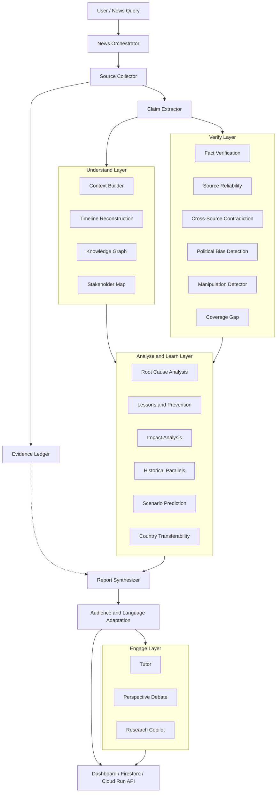
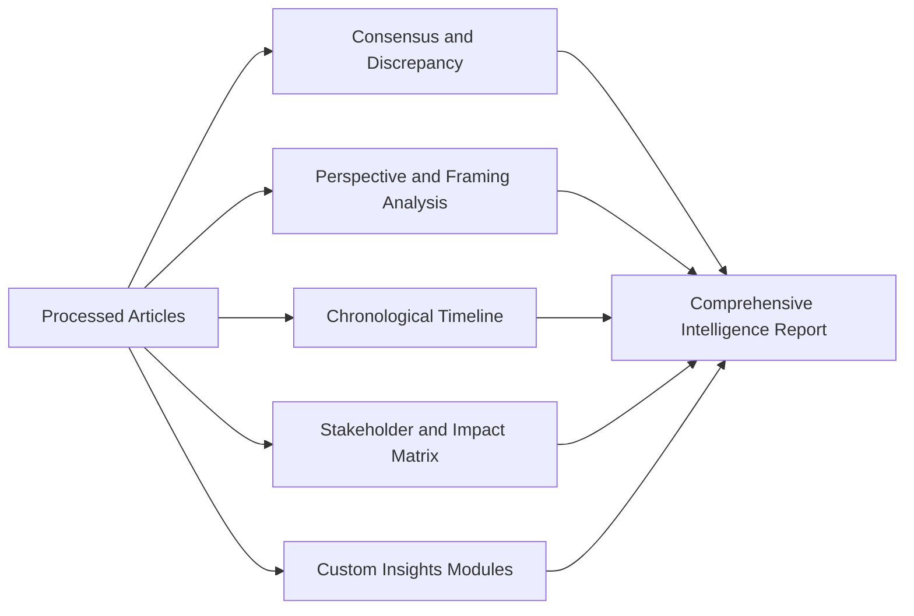

# Agentic News Analyser - Project Concept & Technical Specification

> **Hackathon Submission**: [Google Cloud AI Builder Cup 2026](./ai-builder-cup.md)  
> **Theme**: Media, Content & Digital Experiences  
> **Stack**: Google Agent Development Kit (ADK), Gemini Models, Google Cloud Run / Firebase  

---

## 1. Executive Summary

In today's fast-paced digital information landscape, breaking news stories are reported simultaneously across hundreds of outlets with varying editorial perspectives, incomplete facts, and implicit biases. Readers and researchers face severe **information overload, echo chambers, and fragmented reporting**, making it difficult to discern the objective truth and broader implications of a news event.

The **Agentic News Analyser** is an autonomous, multi-agent intelligence application. When given a news topic or breaking event query, it autonomously:

1. Searches and gathers coverage from diverse global and local news publications.
2. Extracts and deduplicates core claims, quotes, and timeline elements.
3. Conducts multi-dimensional comparative analysis across sources.
4. Generates deep, actionable insights and transparent synthesis with traceable citations.

Built using the **Google Agent Development Kit (ADK)** and powered by **Google Gemini**, the application transforms how digital news is discovered, critically examined, and consumed.

---

## 2. Alignment with AI Builder Cup 2026

The project is purpose-built to address the hackathon guidelines specified in [ai-builder-cup.md](./ai-builder-cup.md):

| Hackathon Requirement | How Agentic News Analyser Aligns |
| :--- | :--- |
| **Theme**: *Media, Content & Digital Experiences* | Directly addresses digital news publishing, content discovery, narrative understanding, and reader comprehension. |
| **Technical Merit (40%)** | Leverages Google ADK for multi-agent orchestration, stateful workflows, tool execution, and Gemini models for complex reasoning and structured multi-source synthesis. |
| **Problem Alignment & Impact (25%)** | Solves critical societal problems: media bias polarization, misinformation, fatigue from redundant articles, and lack of cross-source verification. |
| **Innovation & Creativity (25%)** | Moves beyond single-prompt summarization into an autonomous investigative multi-agent research pipeline that highlights consensus, contradictions, and narrative framing. |
| **UX & Solution Design (10%)** | Interactive web dashboard featuring visual narrative breakdowns, timeline views, bias spectra, source reliability tags, and executive summaries. |
| **Google Cloud Stack** | Orchestrated via Google ADK, powered by Gemini, backend hosted on Cloud Run, and frontend/realtime data managed with Firebase. |

---

## 3. Core System Architecture

The application is a layered multi-agent pipeline built on **Google ADK (Python)**. Work flows as: collect, then understand and verify in parallel, then analyse, then synthesise, then adapt and engage. A cross-cutting **Evidence Ledger** records the source behind every claim so any insight can be traced back to its articles.

**Orchestration pattern (ADK)**: the Orchestrator runs the layers as a sequential workflow. The Understand and Verify layers run as parallel fan-outs, because their agents are independent and read the same extracted claims. Their outputs are written to shared session state and read by the Analyse layer.

---

## 4. Agent Roster

After review, 37 proposed ideas were consolidated into **25 agents** (5 core and platform, 4 Understand, 6 Verify, 6 Analyse, 2 Synthesis and Adaptation, and 2 Engage). The Research Copilot is listed under core agents but is shown in the Engage layer in the diagram because it is user-facing. Priority: **P0** = core demo, **P1** = high value, **P2** = stretch.

### 4.1 Core and Platform Agents

| Agent | Responsibility | Priority |
| :--- | :--- | :--- |
| **News Orchestrator** | Understands the user's topic and intent, sets time window, geography and language, schedules the layers, and manages session state. | P0 |
| **Source Collector** | Expands the query into diverse search terms, pulls articles from search APIs and RSS feeds, deliberately includes regional and cross-spectrum outlets (absorbs the *Global Perspective* idea), and extracts article text and metadata. | P0 |
| **Claim Extractor** | Splits articles into atomic claims, quotes and figures, and deduplicates syndicated stories. Feeds every downstream layer. | P0 |
| **Evidence Ledger (Traceability)** | Cross-cutting service that links every claim and insight to its source article, passage and URL. Powers click-through citations and an explainability panel. | P0 |
| **Research Copilot** | Chat over the collected articles with citations. Includes an **Investigation Mode** that autonomously follows leads (new queries, more sources) for a deep dive on a sub-question. | P1 |

### 4.2 Understand Layer - Context for Newcomers

| Agent | Responsibility | Priority |
| :--- | :--- | :--- |
| **Context Builder** | Identifies people, places, organisations and key events with plain-language explainers, defines jargon, and gives the historical background. | P0 |
| **Timeline Reconstruction** | Builds a de-duplicated chronological timeline with citations. Also tracks **narrative evolution**, meaning how framing and claims changed over time across outlets. | P0 |
| **Knowledge Graph** | Builds the entity relationship graph (people, institutions, events) and the **dependency graph** showing which events caused or enabled others. | P1 |
| **Stakeholder Map** | Maps each actor's position, interests and incentives, and who gains or loses. | P1 |

### 4.3 Verify Layer - Trust and Accuracy

| Agent | Responsibility | Priority |
| :--- | :--- | :--- |
| **Fact Verification** | Checks each atomic claim against other sources and fact-check databases; labels Verified, Disputed or Unverified with evidence. | P0 |
| **Source Reliability** | Scores outlets on track record, sourcing quality and corrections history. Its scores weight the Fact Verification verdicts. | P1 |
| **Cross-Source Contradiction** | Finds where outlets disagree on numbers, dates, quotes or causes and shows them side by side. | P0 |
| **Political Bias Detection** | Rates articles and outlets as left, centre or right with a rationale based on framing, word choice, omissions and story selection. | P0 |
| **Manipulation Detector** | Flags propaganda techniques, loaded language, clickbait and headline-body mismatch. Also flags **cognitive-bias triggers** (fear appeals, bandwagon, anchoring) aimed at the reader. | P1 |
| **Coverage Gap** | Detects missing information, unanswered questions and perspectives or regions that are not covered. | P1 |

### 4.4 Analyse and Learn Layer - Deeper Insights

| Agent | Responsibility | Priority |
| :--- | :--- | :--- |
| **Root Cause Analysis** | Explains why the event happened: contributing factors, failure points, and underlying causes. Feeds Lessons. | P1 |
| **Lessons and Prevention** | Distils lessons learned and concrete preventive actions (for example: maintain reserves, improve monitoring, strengthen institutions) for individuals, organisations and policymakers. | P0 |
| **Impact Analysis** | Covers economic impact (prices, jobs, sectors, public finances) and citizen impact ("what it means for me"), and produces a **consequences tree** of first, second and third-order effects. No trading or stock-price predictions. | P1 |
| **Historical Parallels** | Finds similar past events and how they played out, as evidence for prediction and lessons. | P1 |
| **Scenario Prediction** | Forecasts likely next events with best, likely and worst scenarios, confidence levels and signals to watch. Supports **what-if** questions that change one assumption. Labelled as speculation. | P0 |
| **Country Transferability** | Assesses whether the event could happen in the user's country and which lessons or policies transfer, based on laws, institutions and context. | P1 |

### 4.5 Synthesis and Adaptation

| Agent | Responsibility | Priority |
| :--- | :--- | :--- |
| **Report Synthesizer** | Assembles all outputs into the executive brief, key-numbers dashboard, structured JSON for the UI, and shareable export. | P0 |
| **Audience and Language Adaptation** | Rewrites output for different audiences (explain like I'm five, teenager, college essay, executive brief) and translates into multiple languages, plus length and audio options. | P0 |

### 4.6 Engage Layer

| Agent | Responsibility | Priority |
| :--- | :--- | :--- |
| **Tutor** | Generates MCQ quizzes and explanations, flashcards and spaced review (**knowledge retention**), and adapts difficulty to the user (**personalised learning**). | P0 |
| **Perspective Debate** | Has agents argue the strongest supporter and critic positions on the issue, grounded in the sources, for balanced understanding. | P2 |

### 4.7 Ideas Merged or Removed

| Original idea | Decision | Reason |
| :--- | :--- | :--- |
| Stock Market Impact Agent | **Removed** | Market predictions carry financial-advice risk and low accuracy. Sector-level effects are covered by Impact Analysis. |
| Attention Score | **Removed** | Vague metric that rewards engagement, which conflicts with the goal of trustworthy understanding. |
| News Debate Agent, AI Debate Chamber, Perspective Simulation | **Merged** into Perspective Debate | Three names for the same capability. |
| Educational Tutor, Personalized Learning, Knowledge Retention Mode | **Merged** into Tutor | Same user, same quiz and review loop. |
| Explain Like Different Audiences, Multi-Language | **Merged** into Audience and Language Adaptation | Both are output transformations over the same text. |
| Knowledge Graph, News Dependency Graph | **Merged** into Knowledge Graph | The dependency graph is one edge type on the same graph. |
| Economic Impact, Citizen Impact Analyzer, Explain Consequences Tree | **Merged** into Impact Analysis | Different views of one impact analysis. |
| Future Scenario Prediction, "What If" Simulation Engine | **Merged** into Scenario Prediction | What-if is a re-run of the scenario with a changed assumption. |
| Lessons Learned, Prevention Recommendations | **Merged** into Lessons and Prevention | Prevention is the actionable half of lessons. |
| Propaganda and Manipulation Detector, Cognitive Bias Detector | **Merged** into Manipulation Detector | Overlapping techniques, one pass over the text. |
| Missing Information Detector, Global Perspective Agent | **Merged** into Coverage Gap (detection) and Source Collector (retrieval) | Detecting a gap and fetching diverse sources are two ends of the same need. |
| News Research Copilot, News Investigation Mode | **Merged** into Research Copilot | Investigation is a mode of the copilot. |
| Detect Narrative Evolution | **Merged** into Timeline Reconstruction | Narrative change is a property of the timeline. |
| Evidence Traceability | **Kept** as a platform service | It is a cross-cutting concern and a differentiator for judging. |
| Maintain reserves, Improve monitoring, Strengthen institutions | **Treated as example outputs** | These were sample lessons, not agents. |

---

## 5. Feature Catalogue

Features are grouped into themes. Each feature maps to the agent that owns it (see Section 4). Priority: **P0** = core demo (must ship), **P1** = high-value, **P2** = stretch.

### 5.1 Understand - Context for Newcomers

| # | Feature | Description | Owner Agent | Priority |
| :--- | :--- | :--- | :--- | :--- |
| F1 | **Who / Where / What Primer** | Extracts key people, organisations, places and pivotal events, each with a 1-2 line plain-language explainer so a reader with zero background can follow. | Context Builder | P0 |
| F2 | **Chronological Timeline** | Orders events by date with source citations; merges duplicate reports of the same event into a single entry. | Timeline Reconstruction | P0 |
| F3 | **Glossary & Jargon Buster** | Auto-defines technical, legal, financial or political terms inline. | Context Builder | P1 |
| F4 | **Entity Relationship Map** | Visual graph of who is connected to whom (allies, opponents, funders, institutions). | Knowledge Graph | P1 |
| F5 | **Background Explainer** | "How did we get here?" - pulls the historical backdrop behind the story. | Context Builder | P1 |
| F29 | **Narrative Evolution** | Shows how the framing and claims about the story changed over time and across outlets. | Timeline Reconstruction | P1 |
| F30 | **Event Dependency Graph** | Shows which events caused or enabled others. | Knowledge Graph | P2 |
| F31 | **Stakeholder Map** | Each actor's position, interests, and who gains or loses. | Stakeholder Map | P1 |

### 5.2 Verify - Trust & Accuracy

| # | Feature | Description | Owner Agent | Priority |
| :--- | :--- | :--- | :--- | :--- |
| F6 | **Fact Verification** | Breaks articles into atomic claims and checks each against other sources and fact-check databases; labels *Verified / Disputed / Unverified* with evidence links. | Fact Verification | P0 |
| F7 | **Cross-Source Contradiction Detector** | Highlights where outlets disagree on numbers, dates, quotes or causes, side by side. | Cross-Source Contradiction | P0 |
| F8 | **Political Lean & Bias Meter** | Rates each source and article as left / centre / right using framing, word choice, omissions and story selection; shows a spectrum of coverage with rationale. | Political Bias Detection | P0 |
| F9 | **Source Credibility Score** | Scores outlets on track record, sourcing quality (named vs anonymous), and corrections history. | Source Reliability | P1 |
| F10 | **Sensationalism & Loaded-Language Flags** | Highlights emotive wording, clickbait headlines, and headline-vs-body mismatches. | Manipulation Detector | P1 |
| F11 | **Coverage Gap Finder** | Shows what is *not* being reported, or which perspectives are missing. | Coverage Gap | P1 |
| F12 | **Media Authenticity Check** | Flags potentially recycled or manipulated images/videos via reverse-image search. | Fact Verification | P2 |
| F32 | **Evidence Traceability** | Every claim and insight links to its source article and passage; an explainability panel shows how each conclusion was reached. | Evidence Ledger | P0 |
| F33 | **Propaganda & Cognitive-Bias Flags** | Names propaganda techniques and reader-targeted bias triggers (fear appeal, bandwagon, anchoring) found in the text. | Manipulation Detector | P1 |

### 5.3 Learn & Apply - Deeper Insights

| # | Feature | Description | Owner Agent | Priority |
| :--- | :--- | :--- | :--- | :--- |
| F13 | **Lessons Learned** | Distils key takeaways: what went wrong or right, and why. | Lessons and Prevention | P0 |
| F14 | **How to Avoid / Prevent** | Actionable preventive steps for individuals, organisations and policymakers. | Lessons and Prevention | P1 |
| F15 | **Next-Event Prediction** | Forecasts plausible next developments with scenarios (best / likely / worst), confidence levels and the signals to watch. Clearly labelled as speculation. | Scenario Prediction | P0 |
| F16 | **Cross-Country Applicability** | "Could this happen here?" - maps an event from one country to the user's country: relevant laws, institutions, similar past cases, and adaptable policy lessons. | Country Transferability | P1 |
| F17 | **Stakeholder & Citizen Impact** | Who wins, who loses, and how it affects the user (economy, jobs, prices, safety) with a "what it means for me" view. | Impact Analysis | P1 |
| F18 | **Historical Parallels** | Finds similar past events and how they played out. | Historical Parallels | P1 |
| F19 | **Key Numbers Dashboard** | Pulls out statistics and renders simple charts for quick comprehension. | Report Synthesizer | P2 |
| F34 | **Root Cause Analysis** | Explains why the event happened: contributing factors and failure points. | Root Cause Analysis | P1 |
| F35 | **Consequences Tree** | Maps first, second and third-order effects of the event. | Impact Analysis | P1 |
| F36 | **What-If Simulation** | Changes one assumption (for example "if rates rise") and re-runs the scenario. | Scenario Prediction | P2 |
| F37 | **Economic Impact** | Sector, price, jobs and public-finance effects. Does not predict individual stock prices. | Impact Analysis | P1 |

### 5.4 Engage & Test Understanding

| # | Feature | Description | Owner Agent | Priority |
| :--- | :--- | :--- | :--- | :--- |
| F20 | **Comprehension Quiz (MCQ)** | Generates multiple-choice questions grounded in the analysis with answer explanations and a score; adjustable difficulty. | Tutor | P0 |
| F21 | **Ask-the-Analysis Chat** | Follow-up Q&A over the collected articles, always citing sources. | Research Copilot | P1 |
| F22 | **Flashcards / Spaced Review** | Turns key entities and facts into flashcards for knowledge retention. | Tutor | P2 |
| F23 | **"Think for Yourself" Prompts** | Reflection questions that encourage critical reading rather than passive consumption. | Tutor | P2 |
| F38 | **Perspective Debate** | Agents argue the strongest supporter and critic positions, grounded in sources. | Perspective Debate | P2 |
| F39 | **Investigation Mode** | Autonomous deep dive on a sub-question: new queries, more sources, a focused report. | Research Copilot | P1 |

### 5.5 Adapt - Tone, Language & Format

| # | Feature | Description | Owner Agent | Priority |
| :--- | :--- | :--- | :--- | :--- |
| F24 | **Tone Rewriter** | Rewrites or summarises the analysis/article as: *Explain like I'm five*, *Teenager*, *College essay*, *Executive brief*, *Neutral news report*. | Audience and Language Adaptation | P0 |
| F25 | **Multilingual Translation** | Translates summaries and reports into multiple languages (e.g., English, Hindi, Telugu, Tamil, Spanish, Japanese), preserving names and terms. | Audience and Language Adaptation | P0 |
| F26 | **Reading Level & Length Control** | Selects length (30-second / 3-minute / deep-dive) and reading level. | Audience and Language Adaptation | P1 |
| F27 | **Audio Briefing** | Text-to-speech podcast-style summary, available in the chosen language. | Audience and Language Adaptation | P2 |
| F28 | **Shareable Brief Export** | Exports as PDF or a shareable link with citations. | Report Synthesizer | P2 |

### 5.6 Additional Ideas (Brainstorm Backlog)

- **Misinformation Watch**: Detects if a viral claim is spreading and links to debunks.
- **Topic Tracker / Alerts**: Follow a topic and get notified when significant new facts or contradictions appear.
- **Bias-Balanced Reading List**: Recommends articles from opposing viewpoints to broaden perspective.
- **Opinion vs. Fact Separator**: Tags sentences as reported fact, attributed claim, or opinion.
- **Impact Timeline for Local Area**: Region-specific effects, such as city/state-level implications.
- **Accessibility Mode**: High-contrast, screen-reader-friendly output and simplified language.

### 5.7 Proposed MVP Scope (Hackathon Demo)

Deliver an end-to-end flow for one topic within the 3-minute demo:

1. Topic input -> source collection, primer and timeline (F1, F2).
2. Verification layer: fact check, contradictions, political lean (F6, F7, F8), with evidence traceability on every claim (F32).
3. Insights: lessons learned, next-event prediction (F13, F15).
4. Engagement & adaptation: quiz, tone rewriter, translation (F20, F24, F25).

All other features follow as P1/P2 after the MVP is stable. MVP agents: News Orchestrator, Source Collector, Claim Extractor, Evidence Ledger, Context Builder, Timeline Reconstruction, Fact Verification, Cross-Source Contradiction, Political Bias Detection, Lessons and Prevention, Scenario Prediction, Report Synthesizer, Audience and Language Adaptation, Tutor.

### 5.8 Guiding Principles

- **Cite everything**: every claim links to its source article.
- **Transparency of uncertainty**: predictions, bias ratings and verdicts show confidence and reasoning.
- **Neutrality**: the app informs; it does not push a political position.
- **Source diversity**: deliberately pull from across the political spectrum and regions.
- **No financial advice**: impact analysis describes effects, not trades.

---

## 6. Deep Insights Framework (Foundational Blueprint)

> *Note: This section establishes the extensible foundation. Specific analytical modules and proprietary scoring algorithms will be expanded in upcoming discussions.*

The analysis engine is architected as a pluggable pipeline capable of generating multi-layered intelligence:

### 6.1 Potential Deep Insight Dimensions

1. **Consensus vs. Divergence**:
   - What facts are universally confirmed by all reporting outlets?
   - Where do sources diverge or present conflicting numbers, timelines, or causes?

2. **Editorial Framing & Tone**:
   - How do different publications frame the same event (e.g., economic impact vs. human interest vs. political accountability)?
   - Identification of emotionally charged language and editorial spin.

3. **Timeline & Narrative Evolution**:
   - Chronological sequencing of how the story unfolded from first alert to latest developments.

4. **Stakeholder & Actor Mapping**:
   - Key entities involved, their public positions, and conflicting interests.

5. **Impact Forecasting & Unanswered Questions**:
   - What questions remain unaddressed by current media coverage?
   - Near-term implications for industries, markets, or communities.

---

## 7. Technology Stack & Implementation Plan

### 7.1 Gen AI & Agentic Layer

- **Google Agent Development Kit (ADK)**: Python runtime for agent definition, state machines, tools, and execution loop.
- **Google Gemini (Gemini 1.5 Pro / Flash)**:
  - Gemini Flash: High-speed ingestion, filtering, and initial extraction.
  - Gemini Pro: In-depth cross-source reasoning, nuanced semantic comparison, and final synthesis.

### 7.2 Data & Retrieval Layer

- **Search & News Gathering**: News search APIs (e.g., Google Custom Search / News APIs), RSS feed parsers, headless content parsers (e.g., `trafilatura` / `newspaper3k` / `BeautifulSoup`).
- **Data Persistence**: Cloud Firestore for persistent caching, historical analyses, and real-time frontend subscriptions.

### 7.3 Deployment & Infrastructure (GCP)

- **Backend Service**: Containerized Python ADK service deployed on **Google Cloud Run**.
- **Frontend / Delivery**: Web app hosted on **Firebase App Hosting** / **Firebase Hosting** with reactive updates.
- **Observability**: Cloud Logging and Monitoring for agent telemetry and token tracking.

---

## 8. Next Discussion Points & Roadmap

The following design decisions are slated for upcoming collaboration:

- [ ] **Custom Insight Definitions**: Finalize the specific deep insights, metrics, and intelligence outputs to prioritize.
- [ ] **Data Sources & API Integrations**: Select specific news APIs, search backends, and scraping fallbacks.
- [ ] **User Experience & Interaction**: Design the input flow (topic prompt vs. URL input) and visualization layout (web dashboard vs. chat companion).
- [ ] **ADK Agent Architecture Configuration**: Define concrete agent tools, schemas, and memory strategies in accordance with [docs/google-adk/](./google-adk/).
