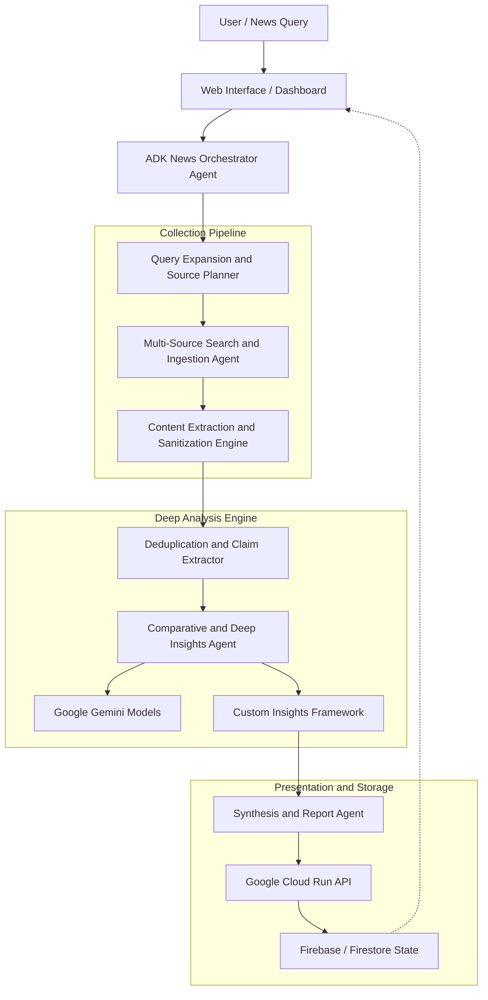
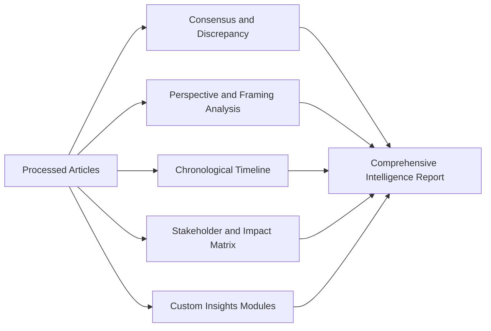

# Agentic News Analyser - Project Concept & Technical Specification

> **Hackathon Submission**: [Google Cloud AI Builder Cup 2026](./ai-builder-cup.md)  
> **Theme**: Media, Content & Digital Experiences  
> **Stack**: Google Agent Development Kit (ADK), Gemini Models, Google Cloud Run / Firebase  

---

## 1. Executive Summary

In today's fast-paced digital information landscape, breaking news stories are reported simultaneously across hundreds of outlets with varying editorial perspectives, incomplete facts, and implicit biases. Readers and researchers face severe **information overload, echo chambers, and fragmented reporting**, making it difficult to discern the objective truth and broader implications of a news event.

The **Agentic News Analyser** is an autonomous, multi-agent intelligence application. When given a news topic or breaking event query, it autonomously:

1. Searches and gathers coverage from diverse global and local news publications.
2. Extracts and deduplicates core claims, quotes, and timeline elements.
3. Conducts multi-dimensional comparative analysis across sources.
4. Generates deep, actionable insights and transparent synthesis with traceable citations.

Built using the **Google Agent Development Kit (ADK)** and powered by **Google Gemini**, the application transforms how digital news is discovered, critically examined, and consumed.

---

## 2. Alignment with AI Builder Cup 2026

The project is purpose-built to address the hackathon guidelines specified in [ai-builder-cup.md](./ai-builder-cup.md):

| Hackathon Requirement | How Agentic News Analyser Aligns |
| :--- | :--- |
| **Theme**: *Media, Content & Digital Experiences* | Directly addresses digital news publishing, content discovery, narrative understanding, and reader comprehension. |
| **Technical Merit (40%)** | Leverages Google ADK for multi-agent orchestration, stateful workflows, tool execution, and Gemini models for complex reasoning and structured multi-source synthesis. |
| **Problem Alignment & Impact (25%)** | Solves critical societal problems: media bias polarization, misinformation, fatigue from redundant articles, and lack of cross-source verification. |
| **Innovation & Creativity (25%)** | Moves beyond single-prompt summarization into an autonomous investigative multi-agent research pipeline that highlights consensus, contradictions, and narrative framing. |
| **UX & Solution Design (10%)** | Interactive web dashboard featuring visual narrative breakdowns, timeline views, bias spectra, source reliability tags, and executive summaries. |
| **Google Cloud Stack** | Orchestrated via Google ADK, powered by Gemini, backend hosted on Cloud Run, and frontend/realtime data managed with Firebase. |

---

## 3. Core System Architecture

The application adopts an agentic multi-agent architecture built on **Google ADK (Python)**:

---

## 4. Agent Roles & Responsibilities

### 4.1 Orchestrator Agent (NewsOrchestrator)

- Coordinates the end-to-end research lifecycle using Google ADK session and workflow primitives.
- Manages user intent, clarifies ambiguity in the query if required, and establishes the search perimeter (time window, geographies, language).

### 4.2 Ingestion & Discovery Agent (SourceCollectorAgent)

- Generates diverse search terms to prevent single-narrative retrieval bias.
- Queries search APIs, news aggregators, RSS feeds, and open web sources.
- Fetches article HTML/content, parses body text, extracts publication metadata (author, date, publisher, original URL).

### 4.3 Fact & Claim Extraction Agent (ClaimExtractorAgent)

- Identifies the central event, core factual assertions, statistical figures, and official statements.
- Clusters articles covering identical sub-events and removes duplicate syndicated stories.

### 4.4 Deep Insights & Analysis Engine (InsightAnalysisAgent)

- Performs cross-source synthesis across multiple dimensions.
- Interfaces with the modular **Deep Insights Framework** (detailed below and open for upcoming expansion).

### 4.5 Report Synthesis Agent (ReportSynthesizerAgent)

- Formats findings into intuitive, high-impact deliverables:
  - Executive TL;DR & key takeaways.
  - Interactive multi-perspective breakdown with direct source citations.
  - Structured JSON schema payloads for client rendering and downstream feeds.

---

## 5. Feature Catalogue

Features are grouped into themes. Priority: **P0** = core demo (must ship), **P1** = high-value, **P2** = stretch. Each feature maps to the agent that owns it (see Section 4).

### 5.1 Understand - Context for Newcomers

| # | Feature | Description | Owner Agent | Priority |
| :--- | :--- | :--- | :--- | :--- |
| F1 | **Who / Where / What Primer** | Extracts key people, organisations, places and pivotal events, each with a 1-2 line plain-language explainer so a reader with zero background can follow. | `ClaimExtractorAgent` | P0 |
| F2 | **Chronological Timeline** | Orders events by date with source citations; merges duplicate reports of the same event into a single entry. | `ClaimExtractorAgent` | P0 |
| F3 | **Glossary & Jargon Buster** | Auto-defines technical, legal, financial or political terms inline. | `ReportSynthesizerAgent` | P1 |
| F4 | **Entity Relationship Map** | Visual graph of who is connected to whom (allies, opponents, funders, institutions). | `InsightAnalysisAgent` | P2 |
| F5 | **Background Explainer** | "How did we get here?" - pulls the historical backdrop behind the story. | `InsightAnalysisAgent` | P1 |

### 5.2 Verify - Trust & Accuracy

| # | Feature | Description | Owner Agent | Priority |
| :--- | :--- | :--- | :--- | :--- |
| F6 | **Fact Verification** | Breaks articles into atomic claims and checks each against other sources and fact-check databases; labels *Verified / Disputed / Unverified* with evidence links. | `FactCheckAgent` | P0 |
| F7 | **Cross-Source Contradiction Detector** | Highlights where outlets disagree on numbers, dates, quotes or causes, side by side. | `InsightAnalysisAgent` | P0 |
| F8 | **Political Lean & Bias Meter** | Rates each source and article as left / centre / right using framing, word choice, omissions and story selection; shows a spectrum of coverage with rationale. | `BiasAnalysisAgent` | P0 |
| F9 | **Source Credibility Score** | Scores outlets on track record, sourcing quality (named vs anonymous), and corrections history. | `FactCheckAgent` | P1 |
| F10 | **Sensationalism & Loaded-Language Flags** | Highlights emotive wording, clickbait headlines, and headline-vs-body mismatches. | `BiasAnalysisAgent` | P1 |
| F11 | **Coverage Gap Finder** | Shows what is *not* being reported, or which perspectives are missing. | `InsightAnalysisAgent` | P1 |
| F12 | **Media Authenticity Check** | Flags potentially recycled or manipulated images/videos via reverse-image search. | `FactCheckAgent` | P2 |

### 5.3 Learn & Apply - Deeper Insights

| # | Feature | Description | Owner Agent | Priority |
| :--- | :--- | :--- | :--- | :--- |
| F13 | **Lessons Learned** | Distils key takeaways: what went wrong or right, and why. | `LessonsAgent` | P0 |
| F14 | **How to Avoid / Prevent** | Actionable preventive steps for individuals, organisations and policymakers. | `LessonsAgent` | P1 |
| F15 | **Next-Event Prediction** | Forecasts plausible next developments with scenarios (best / likely / worst), confidence levels and the signals to watch. Clearly labelled as speculation. | `ForecastAgent` | P0 |
| F16 | **Cross-Country Applicability** | "Could this happen here?" - maps an event from one country to the user's country: relevant laws, institutions, similar past cases, and adaptable policy lessons. | `ForecastAgent` | P1 |
| F17 | **Stakeholder Impact Analysis** | Who wins, who loses, and how it affects the user (economy, jobs, prices, safety) with a "what it means for me" view. | `InsightAnalysisAgent` | P1 |
| F18 | **Historical Parallels** | Finds similar past events and how they played out. | `ForecastAgent` | P2 |
| F19 | **Key Numbers Dashboard** | Pulls out statistics and renders simple charts for quick comprehension. | `ReportSynthesizerAgent` | P2 |

### 5.4 Engage & Test Understanding

| # | Feature | Description | Owner Agent | Priority |
| :--- | :--- | :--- | :--- | :--- |
| F20 | **Comprehension Quiz (MCQ)** | Generates multiple-choice questions grounded in the analysis with answer explanations and a score; adjustable difficulty. | `QuizAgent` | P0 |
| F21 | **Ask-the-Analysis Chat** | Follow-up Q&A over the collected articles, always citing sources. | `NewsOrchestrator` | P1 |
| F22 | **Flashcards / Spaced Review** | Turns key entities and facts into flashcards. | `QuizAgent` | P2 |
| F23 | **"Think for Yourself" Prompts** | Reflection questions that encourage critical reading rather than passive consumption. | `QuizAgent` | P2 |

### 5.5 Adapt - Tone, Language & Format

| # | Feature | Description | Owner Agent | Priority |
| :--- | :--- | :--- | :--- | :--- |
| F24 | **Tone Rewriter** | Rewrites or summarises the analysis/article as: *Explain like I'm five*, *Teenager*, *College essay*, *Executive brief*, *Neutral news report*. | `StyleAgent` | P0 |
| F25 | **Multilingual Translation** | Translates summaries and reports into multiple languages (e.g., English, Hindi, Telugu, Tamil, Spanish, Japanese), preserving names and terms. | `StyleAgent` | P0 |
| F26 | **Reading Level & Length Control** | Selects length (30-second / 3-minute / deep-dive) and reading level. | `StyleAgent` | P1 |
| F27 | **Audio Briefing** | Text-to-speech podcast-style summary, available in the chosen language. | `StyleAgent` | P2 |
| F28 | **Shareable Brief Export** | Exports as PDF or a shareable link with citations. | `ReportSynthesizerAgent` | P2 |

### 5.6 Additional Ideas (Brainstorm Backlog)

- **Misinformation Watch**: Detects if a viral claim is spreading and links to debunks.
- **Perspective Simulator**: "How would a supporter vs. a critic argue this?" balanced steelman arguments.
- **Topic Tracker / Alerts**: Follow a topic and get notified when significant new facts or contradictions appear.
- **Personalisation**: Remembers user's country, language, interests and reading level (ADK session/memory).
- **Bias-Balanced Reading List**: Recommends articles from opposing viewpoints to broaden perspective.
- **Opinion vs. Fact Separator**: Tags sentences as reported fact, attributed claim, or opinion.
- **Impact Timeline for Local Area**: Region-specific effects, such as city/state-level implications.
- **Accessibility Mode**: High-contrast, screen-reader-friendly output and simplified language.
- **Explainability Panel**: Shows which sources and reasoning steps produced every insight (builds trust).

### 5.7 Proposed MVP Scope (Hackathon Demo)

Deliver an end-to-end flow for one topic within the 3-minute demo:

1. Topic input -> source collection (F1, F2 primer & timeline).
2. Verification layer: fact check, contradictions, political lean (F6, F7, F8).
3. Insights: lessons learned, next-event prediction (F13, F15).
4. Engagement & adaptation: quiz, tone rewriter, translation (F20, F24, F25).

All other features follow as P1/P2 after the MVP is stable.

### 5.8 Guiding Principles

- **Cite everything**: every claim links to its source article.
- **Transparency of uncertainty**: predictions, bias ratings and verdicts show confidence and reasoning.
- **Neutrality**: the app informs; it does not push a political position.
- **Source diversity**: deliberately pull from across the political spectrum and regions.

---

## 6. Deep Insights Framework (Foundational Blueprint)

> *Note: This section establishes the extensible foundation. Specific analytical modules and proprietary scoring algorithms will be expanded in upcoming discussions.*

The analysis engine is architected as a pluggable pipeline capable of generating multi-layered intelligence:

### 6.1 Potential Deep Insight Dimensions

1. **Consensus vs. Divergence**:
   - What facts are universally confirmed by all reporting outlets?
   - Where do sources diverge or present conflicting numbers, timelines, or causes?

2. **Editorial Framing & Tone**:
   - How do different publications frame the same event (e.g., economic impact vs. human interest vs. political accountability)?
   - Identification of emotionally charged language and editorial spin.

3. **Timeline & Narrative Evolution**:
   - Chronological sequencing of how the story unfolded from first alert to latest developments.

4. **Stakeholder & Actor Mapping**:
   - Key entities involved, their public positions, and conflicting interests.

5. **Impact Forecasting & Unanswered Questions**:
   - What questions remain unaddressed by current media coverage?
   - Near-term implications for industries, markets, or communities.

---

## 7. Technology Stack & Implementation Plan

### 7.1 Gen AI & Agentic Layer

- **Google Agent Development Kit (ADK)**: Python runtime for agent definition, state machines, tools, and execution loop.
- **Google Gemini (Gemini 1.5 Pro / Flash)**:
  - Gemini Flash: High-speed ingestion, filtering, and initial extraction.
  - Gemini Pro: In-depth cross-source reasoning, nuanced semantic comparison, and final synthesis.

### 7.2 Data & Retrieval Layer

- **Search & News Gathering**: News search APIs (e.g., Google Custom Search / News APIs), RSS feed parsers, headless content parsers (e.g., `trafilatura` / `newspaper3k` / `BeautifulSoup`).
- **Data Persistence**: Cloud Firestore for persistent caching, historical analyses, and real-time frontend subscriptions.

### 7.3 Deployment & Infrastructure (GCP)

- **Backend Service**: Containerized Python ADK service deployed on **Google Cloud Run**.
- **Frontend / Delivery**: Web app hosted on **Firebase App Hosting** / **Firebase Hosting** with reactive updates.
- **Observability**: Cloud Logging and Monitoring for agent telemetry and token tracking.

---

## 8. Next Discussion Points & Roadmap

The following design decisions are slated for upcoming collaboration:

- [ ] **Custom Insight Definitions**: Finalize the specific deep insights, metrics, and intelligence outputs to prioritize.
- [ ] **Data Sources & API Integrations**: Select specific news APIs, search backends, and scraping fallbacks.
- [ ] **User Experience & Interaction**: Design the input flow (topic prompt vs. URL input) and visualization layout (web dashboard vs. chat companion).
- [ ] **ADK Agent Architecture Configuration**: Define concrete agent tools, schemas, and memory strategies in accordance with [docs/google-adk/](./google-adk/).
