# Document 01: User & Evaluator Guide
## Step-by-Step Evaluator Walkthrough, UI Navigation, Problem-Solving Sections & Visual Media Tour

> **Submission Track**: Google Cloud AI Builder Cup 2026 — *Media, Content & Digital Experiences*  
> **Target System**: [Agentic News Analyser](../../README.md)  
> **Primary Evaluation URL**: `http://localhost:5173/`  
> **Sample Pre-Audited Investigation URL**: [`http://localhost:5173/analysis/09c0dbae-2b01-4852-83de-ddc89fdb6614`](http://localhost:5173/analysis/09c0dbae-2b01-4852-83de-ddc89fdb6614)  

---

## 1. Fast-Track Evaluator Checklist (3 Minutes)

Evaluators and judges can explore the complete live platform in under 3 minutes:

1. **Launch Verification**: Ensure both servers are active:
   * **Backend API**: `http://localhost:8080/` (or run `python backend/api_server.py`)
   * **Frontend UI**: `http://localhost:5173/` (or run `cd frontend && npm run dev`)
2. **Instant Golden Test Case**: Open [`http://localhost:5173/analysis/09c0dbae-2b01-4852-83de-ddc89fdb6614`](http://localhost:5173/analysis/09c0dbae-2b01-4852-83de-ddc89fdb6614) to load the pre-audited intelligence dossier for **"Elon Musk Starlink India Issue"**.
3. **Tab Tour**: Click across the 10 investigation tabs on the left sidebar:
   * **Executive Brief** $\rightarrow$ **Verified Sources** $\rightarrow$ **Fact Checks & Contradictions** $\rightarrow$ **Timeline** $\rightarrow$ **Causal & Scenarios** $\rightarrow$ **Active Recall Tutor** $\rightarrow$ **Perspective Debate** $\rightarrow$ **Research Copilot** $\rightarrow$ **Article Studio** $\rightarrow$ **Image Studio**.
4. **Interactive Test**: Go to the **Active Recall Tutor** tab and answer Question 1 to see the instant feedback badge and pedagogical explanation, or explore the **Article Studio** tab to hear Web Speech audio narration or translate the brief into 50+ languages.

---

## 2. Animated Platform Walkthrough

Below is an interactive animated tour showing the end-to-end investigative workflow—from global breaking feeds to deep contradiction auditing, causal consequence trees, active recall learning, and on-demand article and image generation. All GIFs play continuously in an **infinite loop** with a relaxed **2.6 to 3.0-second transition pace** between frames so you can comfortably read and absorb each section:

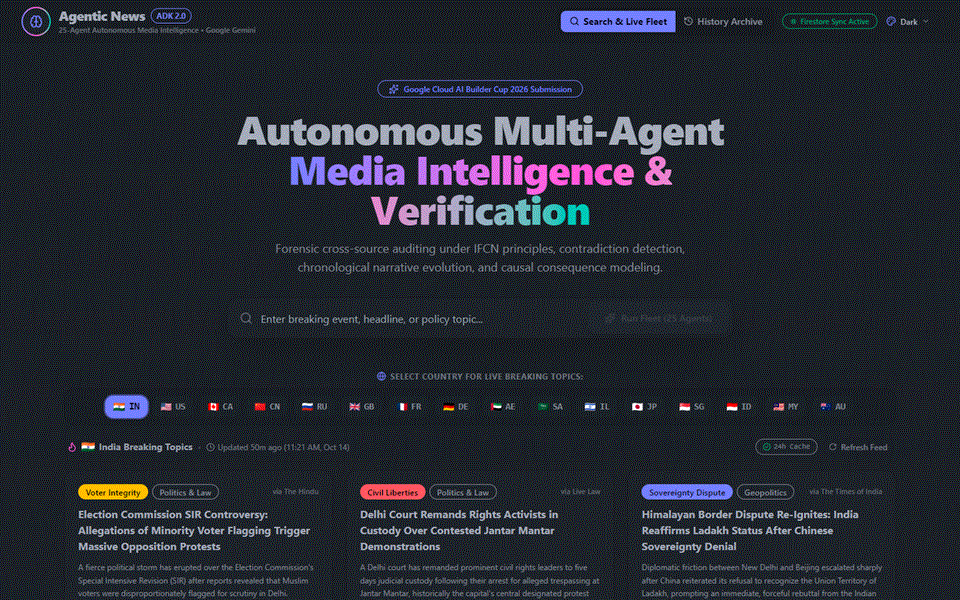

---

## 3. UI Navigation & Global Shell Architecture

The user interface was built to deliver the responsiveness of a high-end financial terminal with the visual polish of a modern media publication.

### Global Header & Navigation Controls
* **Brain Logo & Fleet Status**: Shows active connectivity to the 25-agent Google ADK fleet.
* **Top Navigation**: Direct access to `Search & Live Fleet` (`/`) and `History Archive` (`/history`).
* **Firestore Sync Indicator**: Real-time badge indicating whether reports are persisting to Google Cloud Firestore or the local emulator.
* **DaisyUI Multi-Theme Switcher**: Instant switching between `Dark`, `Light`, `Cyberpunk`, and `Synthwave` themes.
* **Bidirectional Tab Navigation**: Pinned "Previous" and "Next" quick-switch buttons at the base of each analysis tab for effortless reading progression.
* **Responsive Drawer**: Mobile-friendly sidebar drawer on smaller viewports.

---

## 4. UI Page Deep Dives: What Problem Each Section Solves & How It Solves It

### Page 1: Home Dashboard & Dynamic 5-Country Breaking Feeds (`/`)

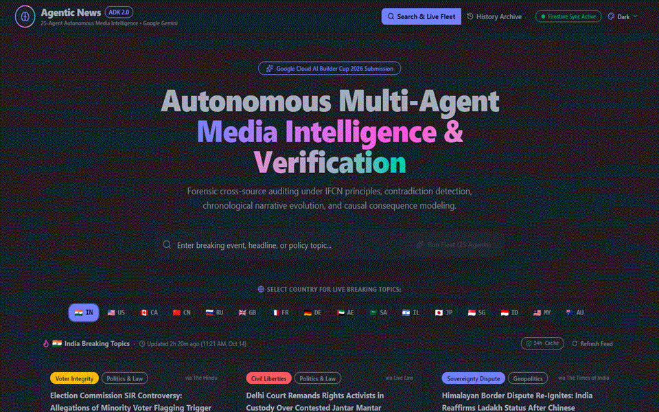

* **Problem It Solves**: In breaking news, readers suffer from geographic information silos, echo chambers, and delayed awareness of international developments across foreign media outlets.
* **How It Solves**: Ingests multi-region RSS feeds across 16 sovereign nations, applying Gemini 2.5 Flash to automatically curate, categorize, and synthesize real-time breaking events into verified intelligence prompts before firing the 25-agent autonomous fleet.
* **Sub-Sections & Core Functionality**:
  1. **Investigative Dispatch & Query Terminal**: High-visibility search console accepting natural language queries, controversial claims, or direct news URLs with instant submission to the 25-agent fleet.
  2. **16-Nation Sovereign Feed Switcher**: Regional selector bar featuring country flags and ISO codes for rapid toggling across major global media ecosystems (IN, US, GB, JP, DE, FR, CA, CN, RU, etc.).
  3. **Live Regional Feed Status & Cache Monitor**: Dynamic status bar displaying active country, last update timestamp, 24-hour Firestore cache verification badge, and on-demand RSS feed refresh trigger.
  4. **Curated Breaking Topics Grid (9 Intelligence Cards)**: Responsive 3-column card matrix displaying curated breaking topics with category badges (Politics & Law, Economy & Markets, etc.), source outlet attribution, and one-click "Analyze with 25 Agents $\rightarrow$ Deploy Fleet" execution.
  5. **Real-Time 6-Stage Pipeline Stepper**: Interactive visual execution pipeline displaying live progress across all 6 stages (Ingestion $\rightarrow$ Understand $\rightarrow$ Verify $\rightarrow$ Analyse $\rightarrow$ Synthesis $\rightarrow$ Engage) via Server-Sent Events (SSE).

---

### Page 2: History & Archive Repository (`/history`)

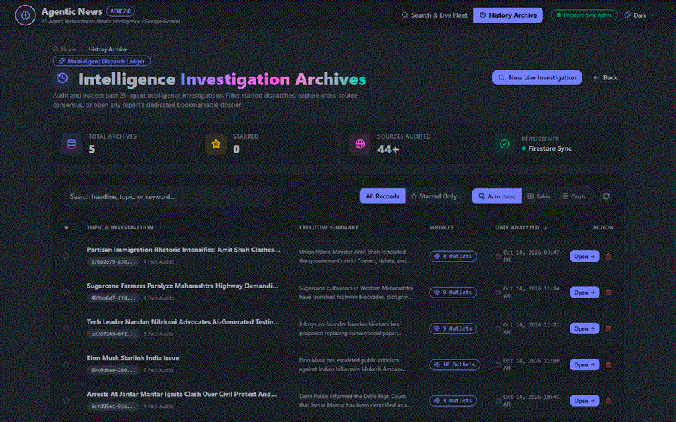

* **Problem It Solves**: News investigations are traditionally ephemeral; readers cannot track how stories evolve over time, audit past fact-checks, or revisit saved analyses.
* **How It Solves**: Persists every completed 25-agent forensic analysis to Cloud Firestore with indexed metadata, enabling instant sub-100ms rehydration, keyword searching, and favorite curation without re-running expensive LLM pipelines.
* **Sub-Sections & Core Functionality**:
  1. **Archive Ledger Metrics Tiles**: High-level summary cards reporting total saved investigations, starred items, cumulative audited sources, and active Cloud Firestore synchronization status.
  2. **Query & Filter Toolbar**: Real-time search filter for instantly searching across headlines, topics, and summaries, alongside a "Starred Only" toggle and Table/Card layout switcher.
  3. **Investigation Archives Ledger (Table & Card Views)**: Comprehensive historical list displaying topic titles, permanent UUID links, executive summary snippets, source count badges, date analyzed, favorite star toggles, and direct dossier navigation buttons.

---

## 5. The 10 Analysis Report Tabs in Detail

*(Demonstrated using live sample: `http://localhost:5173/analysis/09c0dbae-2b01-4852-83de-ddc89fdb6614`)*

### Tab 1: Executive Intelligence Brief (`#brief`)

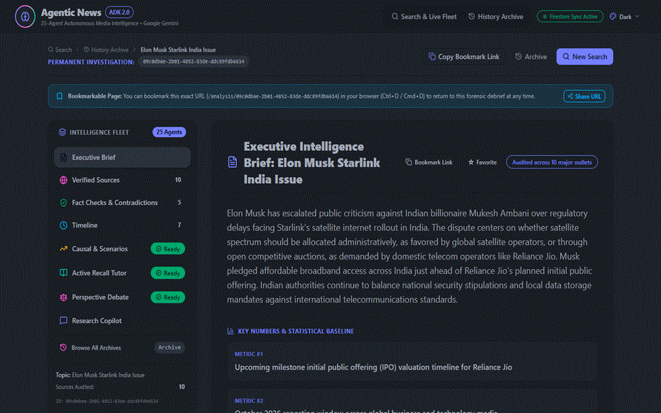

* **Problem It Solves**: Readers face cognitive overload from lengthy conflicting articles and lack the baseline institutional context to understand the stakeholders and technical jargon involved.
* **How It Solves**: Synthesizes verified multi-source reporting into an authoritative consensus brief, extracts key numerical baselines, and generates a structured Who/Where/What entity primer with verified Wikipedia linkages.
* **Sub-Sections & Core Functionality**:
  1. **Executive Summary & Dossier Header**: Authoritative synthesis of the core news event, audit count across major global outlets, permanent bookmark link, and favorite toggle.
  2. **Key Numbers & Statistical Baseline**: Numerical metrics and baseline indicators extracted from the report (market valuations, subscriber counts, regulatory deadlines).
  3. **Origins & Historical Backdrop**: Background story detailing antecedent regulatory history, founding context, and corporate origins.
  4. **Key Organizations & Institutions Primer**: Structured cards for corporate entities and regulatory bodies with roles, 2-line explainers, historical context, and direct Wikipedia dossier links.
  5. **Key Figures & Decision Makers (Persons) Primer**: Profiles of executives, policymakers, and key leaders with entity avatars, titles, background context, and Wikipedia links.
  6. **Key Doctrines, Legal Frameworks & Locations**: Expandable accordions for legal statutes, spectrum allocation policies, and sovereign jurisdictions.
  7. **Jargon Buster & Plain-Language Glossary**: Expandable accordions translating specialized legal, corporate, and regulatory terminology into clear plain English.
  8. **Cross-Spectrum Consensus Points**: Verified facts and agreements acknowledged across all media outlets regardless of editorial lean.

---

### Tab 2: Verified Sources & Media Bias (`#sources`)

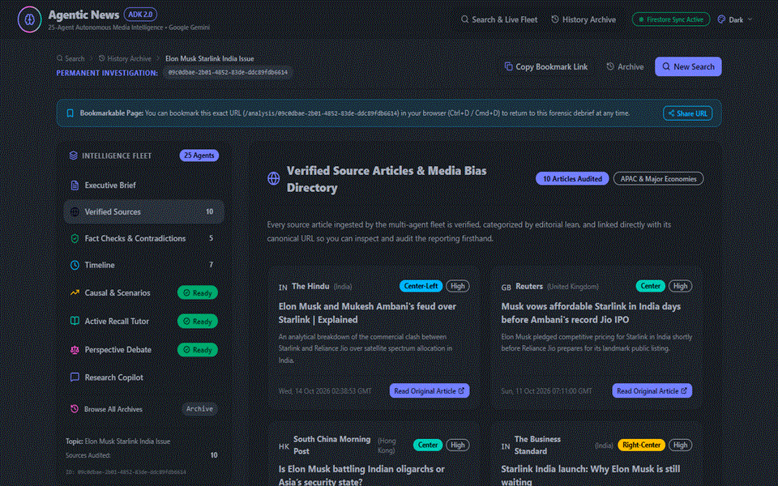

* **Problem It Solves**: Readers consume news from single ideological bubbles without visibility into publisher political leanings, source reliability tiers, or critical coverage gaps.
* **How It Solves**: Audits every ingested source against international media transparency standards, categorizing outlets across a 7-point political spectrum and cataloging unaddressed reporting gaps.
* **Sub-Sections & Core Functionality**:
  1. **Verified Sources Directory & Audit Header**: Ingestion status badge indicating the total number of audited articles across APAC and global major economies.
  2. **Verified Source Articles Matrix**: Detailed cards for each ingested report featuring publisher country flag, outlet name, editorial lean badge (Center-Left, Center, Right-Center), reliability tier (High, Medium), article headline, content excerpt, published date, and canonical URL outbound link.

---

### Tab 3: Fact Checks & Contradictions (`#verification`)

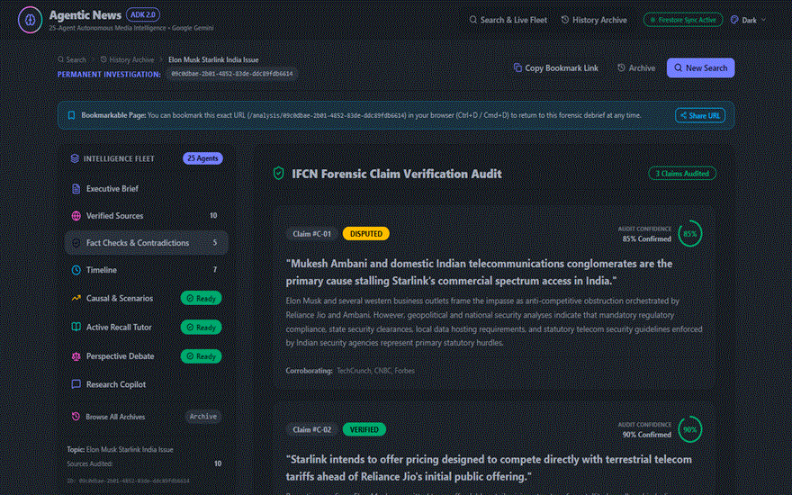

* **Problem It Solves**: Conflicting factual assertions across competing news outlets are rarely juxtaposed directly, allowing partisan spin and unverified claims to spread unchecked.
* **How It Solves**: Deploys automated IFCN-aligned claim auditing agents to assign confidence scores and builds a side-by-side contradiction matrix contrasting opposing reporting lines directly against verified evidence.
* **Sub-Sections & Core Functionality**:
  1. **IFCN Forensic Claim Verification Audit**: Discrete fact-check cards featuring claim IDs, verified/disputed status badges, radial progress meters for confidence percentages, claim text, forensic reasoning, and corroborating source lists.
  2. **Cross-Source Contradictions Matrix**: Side-by-side comparison contrasting Outlet A's claim against Outlet B's counter-claim, classified by divergence type (Fact Negation, Numerical Discrepancy, Timeline Divergence) with manipulative framing tactics flagged.
  3. **Media Framing & Political Lean Spectrum**: Outlet-by-outlet narrative analysis exposing framing techniques, assessed political lean, and emotionally loaded terms detected in the text.

---

### Tab 4: Chronological Event Timeline (`#timeline`)

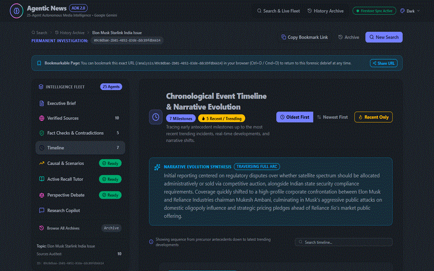

* **Problem It Solves**: Fast-moving breaking events cause temporal confusion, obscuring the sequence of cause and effect and when media narratives shifted.
* **How It Solves**: Extracts and orders all chronological milestones from precursor antecedents to trending developments, synthesizing narrative trajectory shifts across the reporting arc.
* **Sub-Sections & Core Functionality**:
  1. **Timeline Milestones Header & Direction Controls**: Milestone counter, trending incidents indicator, and interactive sorting toggles ("Oldest First" vs. "Newest First").
  2. **Narrative Evolution Synthesis**: Holistic summary describing how news coverage transitioned across phases (e.g., from initial regulatory filings to corporate escalations).
  3. **Timeline Search & Trending Filter**: Real-time keyword filter and quick toggle to isolate recent/trending developments.
  4. **Chronological Milestone Event Stream**: Rich event cards displaying timestamp badges, reporting outlet, verified headline, detailed occurrence description, and narrative shift annotations.

---

### Tab 5: Causal & Scenarios (`#insights`)

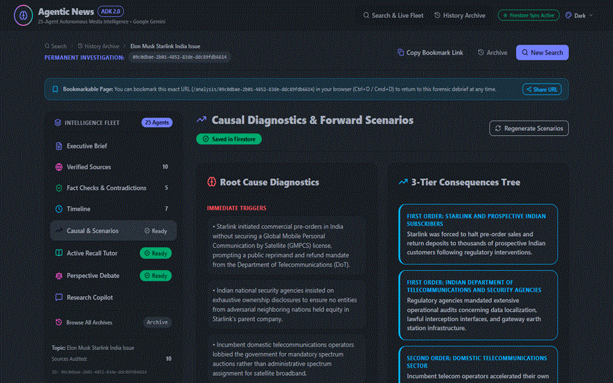

* **Problem It Solves**: Conventional news describes symptoms rather than root causes, leaving readers unprepared for cascading consequences or future outcomes.
* **How It Solves**: Conducts a structured 5-Whys causal root analysis, maps 3 tiers of systemic knock-on effects, and models probabilistic best/worst/likely future scenarios with leading indicator signals.
* **Sub-Sections & Core Functionality**:
  1. **Root Cause Diagnostics**: Deconstructs the underlying drivers into Immediate Triggers, Structural Failure Points, and Underlying Systemic Factors.
  2. **3-Tier Consequences Tree**: Hierarchical impact breakdown mapping First-Order (direct operational), Second-Order (industry/market), and Third-Order (macroeconomic/geopolitical) repercussions.
  3. **Forward-Looking Scenarios & Probability Ratings**: 3-column scenario forecasting (Best Case, Worst Case, Most Likely) with star probability ratings, time horizons, "What-If" assumptions, and leading indicator signals to monitor.
  4. **Lessons Learned & Prevention Strategies**: Actionable takeaways categorized by target audience: Individuals/Consumers, Industry Leaders, and Regulators/Policymakers.

---

### Tab 6: Active Recall Comprehension Quiz (`#quiz`)

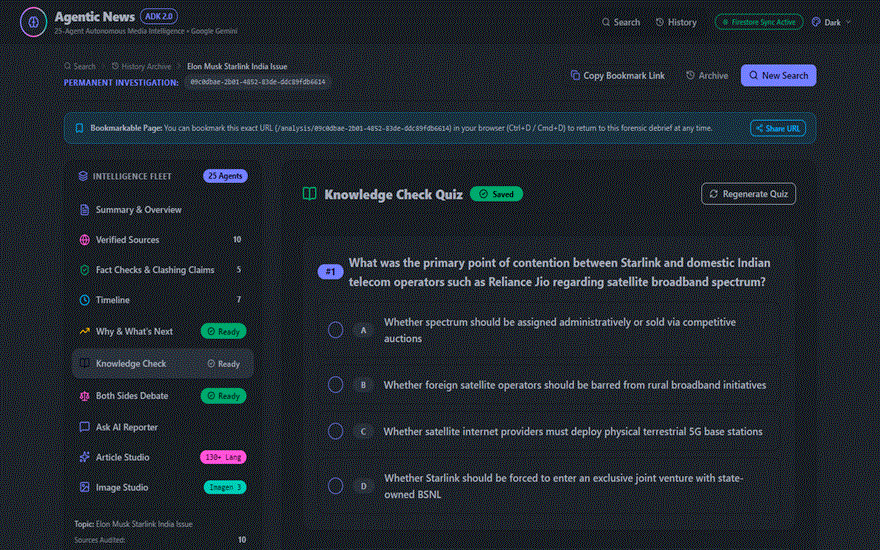

* **Problem It Solves**: Passive news reading results in the "illusion of competence," where readers forget over 70% of facts within 24 hours without retaining critical distinctions.
* **How It Solves**: Generates interactive active-recall questions grounded directly in the verified facts and contradictions, providing instant pedagogical explanations and scoring.
* **Sub-Sections & Core Functionality**:
  1. **Active Recall Tutor Header & Status**: Displays quiz status, Firestore persistence state, and on-demand quiz generation triggers.
  2. **Pedagogical Multiple-Choice Question Cards**: Interactive question modules with single-select radio options (A, B, C, D) testing comprehension of contested claims, timelines, and causal drivers.
  3. **Automated Grading Engine & Radial Scorecard**: Submits user answers for instant grading, revealing visual feedback badges, explanatory rationales for correct/incorrect choices, and an overall comprehension score meter.

---

### Tab 7: Dialectical Perspective Debate (`#debate`)

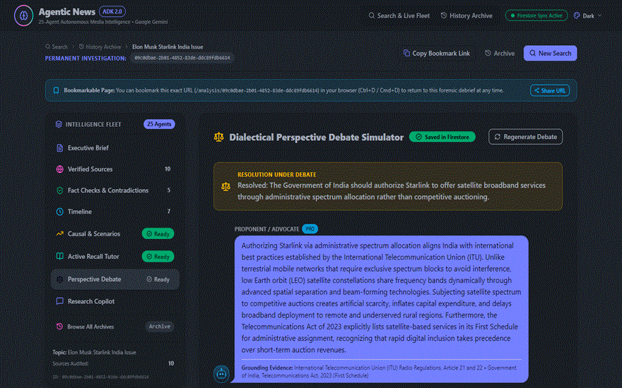

* **Problem It Solves**: Hyper-partisan news reporting forces readers into polarized viewpoints, obscuring legitimate arguments held by opposing stakeholders.
* **How It Solves**: Simulates a structured Socratic debate between steelmanned pro and con stakeholder representatives, culminating in an objective policy compromise synthesis.
* **Sub-Sections & Core Functionality**:
  1. **Debate Resolution Banner**: Formulates the central contentious proposition under debate (e.g., administrative spectrum allocation vs. open competitive auction).
  2. **Steelmanned Pro/Con Dialectic Exchange**: Alternating speaker cards representing opposing perspectives with avatar badges, core thesis statements, and grounding evidence citations.
  3. **Neutral Compromise Synthesis & Policy Bridge**: Balanced, objective conclusion synthesizing common ground and how policymakers can resolve competing stakeholder priorities.

---

### Tab 8: Research Copilot (`#copilot`)

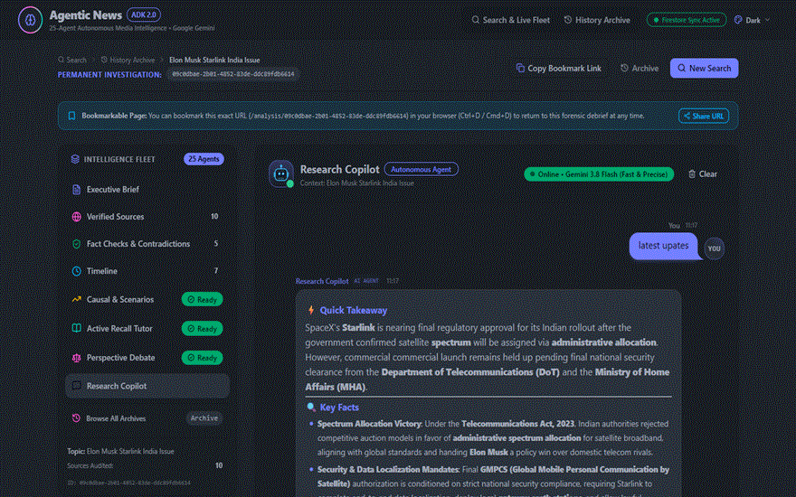

* **Problem It Solves**: Static news articles cannot answer specific user questions or clarify ambiguities in reporting.
* **How It Solves**: Provides a conversational AI research partner powered by Gemini 2.5 Flash, strictly grounded in the session's verified evidence ledger with zero hallucinations.
* **Sub-Sections & Core Functionality**:
  1. **Copilot Agent Header & Status Badge**: Displays online agent status, Gemini model engine attribution, and conversation management controls (Clear Chat History).
  2. **Evidence-Grounded Chat Stream**: Conversational message thread rendering user questions and agent responses in formatted markdown with direct citations to analyzed articles.
  3. **Interactive Investigation Input Bar**: Real-time query input enabling users to probe specific claims, request entity clarifications, or ask "what if" questions regarding the investigation.

---

### Tab 9: On-Demand Article Studio (`#article`)

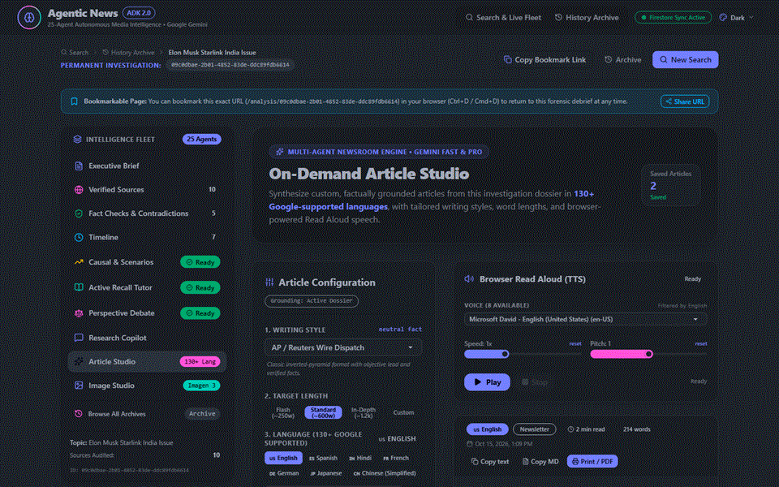

* **Problem It Solves**: Transforming raw factual intelligence into tailored editorial publications for distinct audiences (executives, general public, academic researchers, social followers) requires hours of tedious drafting, tone adjustment, and multilingual localization.
* **How It Solves**: Deploys an automated editorial synthesis bureau that translates verified investigation dossiers into publication-ready articles across 7 journalistic styles, complete with Web Speech audio narration, social media distribution kits, and 50+ language translations.
* **Sub-Sections & Core Functionality**:
  1. **Editorial Style Selector (7 Journalistic Formats)**:
     * *AP / Reuters Wire Dispatch* (Neutral inverted-pyramid lead)
     * *Investigative Watchdog* (Forensic deep-dive into evidence and motives)
     * *Executive Strategic Brief* (C-suite risk analysis and market impacts)
     * *Dialectical Op-Ed Column* (Balanced perspective steelmanning)
     * *ELI5 Deep Explainer* (Zero-jargon conceptual analogies)
     * *Academic Research Paper* (Scholarly citation and institutional framework)
     * *Punchy Modern Newsletter* (Curated Morning Brew/Substack takeaways)
  2. **Target Length & Perspective Controls**: Customize output depth (`Flash Dispatch`, `Standard Report`, `Deep-Dive Longform`) and analytical focus.
  3. **Multilingual Localization Hub (50+ Languages)**: Instantly re-synthesizes and translates the article into global languages (Spanish, French, German, Japanese, Hindi, Mandarin, Arabic, etc.) with localized nuance.
  4. **Integrated Text-to-Speech (TTS) Narration**: Built-in audio player with play, pause, stop, and rate controls for listening on the go.
  5. **Social Publishing & SEO Distribution Kit**: Automated extraction of catchy headline variants, SEO meta descriptions, Twitter/X threads with hook cards, and key takeaways.
  6. **Saved Article Repository & Export**: Bookmark, copy formatted markdown, print/PDF export, or delete generated editions.

---

### Tab 10: On-Demand Image Studio (`#image`)

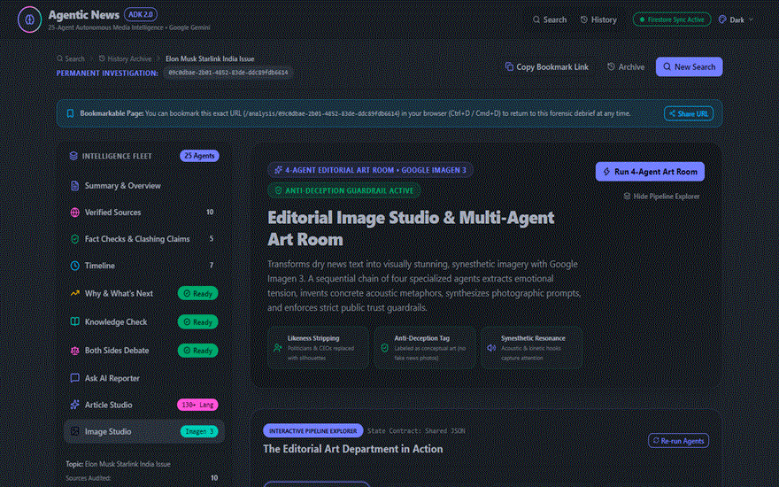

* **Problem It Solves**: Quality news reporting requires compelling, contextually grounded visuals, but journalists and readers are typically trapped between generic stock photos or copyright-infringing web grabs.
* **How It Solves**: Leverages Google Imagen 3 and Gemini multimodal capabilities to generate photorealistic documentary photography, magazine-cover concept art, and technical diagrams grounded directly in the investigated facts, persisted to Google Cloud Storage.
* **Sub-Sections & Core Functionality**:
  1. **AI Editorial Prompt Suggestions**: 5 pre-formulated, forensic visual prompts generated specifically from the investigation's verified actors, locations, and events.
  2. **Visual Style Presets (5 Aesthetics)**:
     * *Photojournalism* (Authentic 35mm news photograph, candid natural lighting)
     * *Magazine Cover* (Conceptual editorial art inspired by The Economist & TIME)
     * *3D Isometric* (Clean technical diagram visualizing industrial infrastructure)
     * *Cinematic Still* (16:9 widescreen anamorphic depth with dramatic chiaroscuro)
     * *Minimalist Vector* (Bold Swiss graphic design and geometric symbolism)
  3. **Multi-Platform Aspect Ratio Selector**: 16:9 Landscape (Hero headers), 1:1 Square (Social feeds), 4:3 Editorial (Print standard), and 9:16 Vertical (Mobile stories).
  4. **Negative Prompting & Composition Controls**: Advanced negative prompt inputs to eliminate artifacts, watermarks, or unwanted visual elements.
  5. **Cloud Storage Persistence & Asset Gallery**: Seamless upload to Google Cloud Storage with fast local caching, lightbox modal inspection, metadata display, and one-click image downloads.
