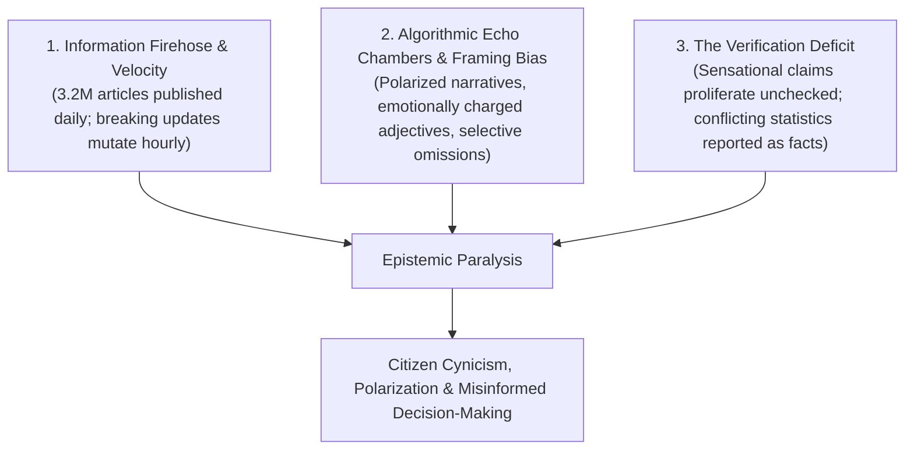
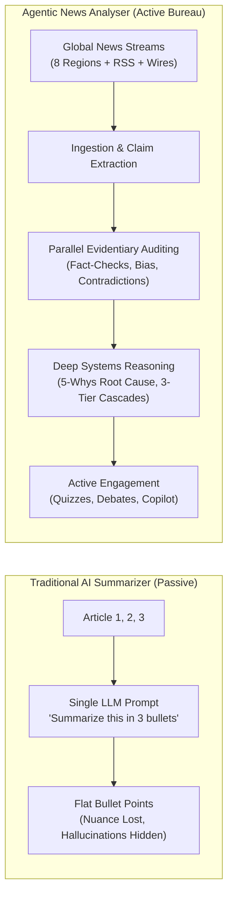

# Document 02: Problem Statement & Competitive Differentiation
## Why the Agentic News Analyser Wins Beyond Traditional AI Summarizers

> **Submission Track**: Google Cloud AI Builder Cup 2026 — *Media, Content & Digital Experiences*  
> **Target System**: [Agentic News Analyser](../../README.md)  
> **Core Engine**: Google Agent Development Kit (ADK 2.0+ Python) & Google Gemini 3.8 Flash / 3.1 Pro Models  

---

## 1. The Epistemic Crisis in Modern News

Modern information consumption suffers from a compounding triple crisis:

When high-stakes global events unfold—such as central bank interest rate decisions, semiconductor trade restrictions, cross-border space communications accords, or pandemic health directives—readers do not simply need *fewer words*. **They need verifiable truth, structured causal clarity, and actionable intelligence.**

---

## 2. Why Conventional "News Summarizers" Fall Short & How We Build Beyond Them

Current approaches to AI news processing—typically single-turn LLM summarizers, generic search bots, and headline aggregators—treat news primarily as a **text compression problem**. They shrink word counts and paste raw links, but they leave critical analytical blind spots untouched. 

To build an intelligence platform that genuinely elevates how humans understand complex events, we address the core failure modes of existing tools:

### Failure 1: The Flattening of Contested Realities (Averaged Consensus vs. Atomic Contradiction Auditing)
* **The Limitation of Existing Tools**: When different outlets report conflicting facts (e.g., Outlet A reports *"45 casualties"* while Outlet B reports *"120 confirmed by local authorities"*), standard summarizers tend to smooth over the conflict by averaging numbers (*"around 80 casualties occurred"*) or repeating whichever article was ingested last. Genuine factual disagreements disappear into a false artificial consensus.
* **How We Build Better**: The **Cross-Source Contradiction Analyst** decomposes reporting into atomic propositions and maps discrepancies side-by-side with explicit divergence tags (`Numerical Discrepancy`, `Timeline Divergence`, `Direct Fact Negation`), preserving evidentiary truth and nuance.

### Failure 2: The Jargon Barrier & Passive Skimming (Information Firehose vs. Cognitive Scaffolding)
* **The Limitation of Existing Tools**: Technical domains (sovereign debt restructuring, semiconductor trade sanctions, environmental accords) are laden with dense regulatory, financial, and bureaucratic terminology. Generic summaries present walls of text that alienate non-specialists, leading to the "illusion of comprehension" followed by rapid knowledge decay (the Ebbinghaus curve).
* **How We Build Better**: 
  * **Upfront Cognitive Scaffolding**: Before presenting the full brief, an automated **Jargon Buster & Entity Glossary** unpacks foundational acronyms, institutional mechanisms, and key actors with authoritative references.
  * **Active Recall & Literacy Tutor**: Rather than passive reading, our system generates interactive Socratic quizzes with pedagogical explanations to verify comprehension and dismantle common misconceptions.

### Failure 3: Unchecked Media Framing & Partisan Echo Chambers
* **The Limitation of Existing Tools**: Most tools summarize the top search results without analyzing *how* the story is framed. Biased framing often operates subtly through loaded adjectives, emotional valence, and selective omissions rather than outright falsehoods.
* **How We Build Better**:
  * **Linguistic Framing Analysis**: Audits loaded rhetoric, sensationalized adjectives, and omitted context across regional and ideological spectrums.
  * **Dialectical Perspective Debate Simulator**: Instead of presenting a bland, middle-ground compromise, the system steelmans both opposing credible perspectives using primary citations, culminating in an objective, balanced synthesis.

### Failure 4: The "Episodic Event" Trap (Superficial Symptoms vs. Root Cause Diagnostics)
* **The Limitation of Existing Tools**: Conventional summaries focus entirely on the *acute spark*—the immediate crisis or announcement—without explaining the *underlying tinder*. Readers learn what just happened, but understand nothing of the systemic, institutional, or historical conditions that produced it.
* **How We Build Better**: Our **Root Cause Diagnostic Agent** applies structured **5-Whys methodology** to trace events back to regulatory gaps, structural vulnerabilities, and institutional precedents, delivering depth comparable to professional intelligence briefs.

### Failure 5: Flat 1st-Order Summaries vs. 3-Tier Consequence Cascades
* **The Limitation of Existing Tools**: Existing tools stop at the direct, headline-level consequences (*"Company X was fined → stock drops 3%"*). In reality, major global events create non-linear, multi-order ripple effects across industries, supply chains, and international relations.
* **How We Build Better**: The **Impact Analyzer** maps consequences across a **3-Tier Cascade**:
  * **1st-Order (Direct & Immediate)**: Immediate operational and market reactions.
  * **2nd-Order (Structural & Supply Chain)**: Market substitutions, supply chain re-routing, and retaliatory measures.
  * **3rd-Order (Systemic & Precedent-Setting)**: Long-term geopolitical realignments, regulatory shifts, and capital market reallocations.

### Failure 6: Retrospective Paralysis (Backward-Looking Summaries vs. Forward-Looking Scenarios)
* **The Limitation of Existing Tools**: Existing news tools are exclusively retrospective—they look backward at what already happened. When asked about implications, standard AI tools default to vague disclaimers (*"The future remains uncertain..."*).
* **How We Build Better**: The **Scenario Prediction Agent** generates structured, bounded forward forecasts:
  * **Best-Case, Most Likely, and Worst-Case Scenarios** with calibrated qualitative probabilities.
  * **Actionable Leading Indicators ("Tripwires")**: Concrete milestones and observable triggers for decision-makers to monitor over 30- to 90-day horizons.
  * **Lessons Learned & Systemic Prevention**: Actionable takeaways to build institutional resilience and prevent recurring crises.

### Failure 7: Temporal Conflation & Narrative Pivot Blindness
* **The Limitation of Existing Tools**: In rapidly developing stories, early unverified rumors, mid-week qualifiers, and late-breaking official confirmations often get conflated into a confusing chronological blur.
* **How We Build Better**: The **Chronological Timeline Engine** disaggregates *Event Occurrence Time* from *Media Reporting Time*, explicitly charting **Narrative Shifts** as official explanations and reporting evolve over time.

### Failure 8: Footnote Clutter vs. Audited Evidence Ledger
* **The Limitation of Existing Tools**: Traditional AI search tools generate link citations that frequently point to secondary aggregators, paywalled homepages, or unverified blogs without auditing credibility or primary origin.
* **How We Build Better**: All claims are anchored to an **Immutable Evidence Ledger** that pairs every factual assertion with extracted quotes, source timestamps, and cross-references against IFCN-certified fact-checking repositories.

---

## 3. The Agentic News Paradigm Shift

The **Agentic News Analyser** is not a news reader; it is an **Autonomous Multi-Agent Intelligence Bureau**.

---

## 4. UI Page-by-Page Architectural Analysis

Every interface surface in the Agentic News Analyser was designed to expose multi-agent intelligence rather than generic text:

| UI Page / Sub-Section | Problem It Solves | Which Agent Powers It | How It Differs From Normal Summarizers |
| :--- | :--- | :--- | :--- |
| **Home Page (`/`)** | Regional blind spots & delayed breaking awareness | `source_collector`, `topic_suggester` | Offers live breaking feeds filtered across 16 sovereign nations and real-time agent execution pipeline telemetry. |
| **Tab 1: Summary & Overview** | Lack of quick, structured situational awareness | `report_synthesizer`, `context_builder` | Combines statistical baseline cards, high-confidence consensus points, and a Jargon Buster entity glossary with Wikipedia links. |
| **Tab 2: Verified Sources** | Unconscious consumption of partisan framing | `bias_analyst`, `source_reliability_agent` | Visualizes the ideological distribution (Left, Center, Right) across outlets and flags loaded adjectives and omissions. |
| **Tab 3: Fact Checks & Clashing Claims** | Unchecked misinformation & conflicting reporting | `fact_verifier`, `contradiction_analyst`, `manipulation_detector` | Displays side-by-side contradiction cards contrasting Outlets A vs B, and assigns IFCN verification status badges. |
| **Tab 4: Timeline** | Confusion over sequence of events & narrative shifts | `timeline_agent` | Reconstructs the exact chronological evolution of the event, marking when media narratives pivoted. |
| **Tab 5: Why & What's Next** | Superficial focus on symptoms rather than root causes | `root_cause_agent`, `impact_analyzer`, `scenario_prediction_agent` | Conducts 5-Whys diagnostic analysis, models 3-tier consequence cascades (1st, 2nd, 3rd order), and forecasts Best/Likely/Worst scenarios with leading indicators. |
| **Tab 6: Knowledge Check** | Passive reading leading to rapid knowledge decay | `tutor_agent` | Generates adaptive, interactive multiple-choice questions with real-time scoring and deep pedagogical explanations. |
| **Tab 7: Both Sides Debate** | Polarization & inability to understand opposing viewpoints | `perspective_debate_agent` | Stages an evidence-grounded dialectical debate between credible opposing perspectives, culminating in an objective synthesis. |
| **Tab 8: Ask AI Reporter** | Inability to ask follow-up questions grounded in audited evidence | `research_copilot` (`AI Reporter`) | Dedicated investigation chat assistant grounded directly in the session's verified Evidence Ledger. |
| **Tab 9: Article Studio** | High-friction manual rewriting for different audiences, languages & mediums | `article_generator` | Generates publication-ready articles across 7 journalistic formats (Wire, Investigative, Executive, Op-Ed, ELI5, Academic, Newsletter) with Web Speech audio narration and 50+ language translations. |
| **Tab 10: Image Studio** | Lack of tailored editorial imagery, reliance on generic stock photos | `Image Editorial Art Room Crew` (`image_analyst`, `creative_director`, `cinematographer`, `editorial_critic`) & `image_generator` | Synthesizes photorealistic and conceptual editorial graphics via Imagen 3 / Gemini across 5 style presets and 4 aspect ratios with Anti-Deception Guardrails and Cloud Storage persistence. |
| **History Archive (`/history`)** | Loss of institutional knowledge and past investigations | `FirestoreService` | Searchable, tag-filtered, and bookmarkable repository of all multi-agent investigations with instant cache rehydration. |

---

## 5. Comprehensive 9-Dimension Competitive Matrix

| Evaluation Dimension | Standard LLM Chatbots | Search-Augmented AI Assistants | Traditional News Aggregators | **Agentic News Analyser (Our Solution)** |
| :--- | :--- | :--- | :--- | :--- |
| **1. Claim Decomposition** | ❌ None (summarizes paragraphs) | ⚠️ Sentence-level text citations | ❌ Manual editorial tagging | **✅ Automated atomic claim extraction into typed Pydantic DTOs** |
| **2. Contradiction Detection** | ❌ Averages or ignores conflicts | ⚠️ Mentions alternate sources in text | ⚠️ Flags headline differences | **✅ Structured side-by-side divergence matrix with typed contradiction categories** |
| **3. Causal & Consequence Modeling** | ❌ Surface-level speculation | ⚠️ Brief bullet points if prompted | ❌ None (news headlines only) | **✅ 5-Whys Root Cause Diagnostics + 3-Tier Consequence Tree (1st/2nd/3rd order)** |
| **4. Forward Scenario Forecasting** | ❌ Unstructured guesswork | ⚠️ General search results | ❌ None | **✅ Probabilistic Scenarios (Best/Likely/Worst) with Leading Indicator Signals** |
| **5. Cognitive Retention & Active Recall** | ❌ None | ❌ None | ❌ None | **✅ Adaptive interactive quizzes with pedagogical feedback and score tracking** |
| **6. Dialectical Perspective Debates** | ⚠️ Can roleplay if specifically prompted | ❌ Informational answers only | ⚠️ Displays opposing headlines | **✅ Automated Pro vs Con dialectical debate grounded in cited evidence** |
| **7. Multi-Agent Orchestration Framework** | ❌ Single-turn LLM call | ⚠️ Search + Synthesizer pipeline | ❌ Algorithmic scrapers | **✅ 25 Google ADK 2.0 specialized agents across 6 architectural layers** |
| **8. Evidentiary Auditability** | ❌ Black box | ⚠️ Web URL footnotes | ⚠️ Publisher metadata | **✅ Immutable Evidence Ledger Plugin tracking claims, quotes, and primary DBs** |
| **9. Multimodal Editorial Publishing** | ❌ Raw chat markdown only | ❌ Static text bullets | ⚠️ Pre-existing publisher images | **✅ 7-style Article Studio + 4-Agent Image Editorial Art Room (Imagen 3) + Anti-Deception Guardrail + Audio TTS + 50+ language translations** |

---

## 6. Target Personas & Value Creation

1. **Policy Makers & Government Analysts**: Instantly isolate regulatory gaps, verify international compliance directives, and model cross-border policy transferability.
2. **Investigative Journalists & Media Desks**: Detect subtle shifts in institutional messaging, track cross-wire discrepancies before publishing, and audit source track records.
3. **Financial & Risk Analysts**: Map 2nd- and 3rd-order economic ripple effects across supply chains, currencies, and market sectors.
4. **Educators, Students & Citizens**: Build media literacy, overcome polarized filter bubbles, and retain complex current events through active recall learning.

---

## 7. Conclusion: The Winning Edge

The **Agentic News Analyser** wins because it solves the fundamental problem judges look for: **using state-of-the-art agentic AI to do what was previously impossible for a single human or simple chatbot to achieve.** By deploying a coordinated bureau of 25 Google ADK agents, it transforms chaotic, conflicting global news into structured, verified, and permanent human knowledge.
