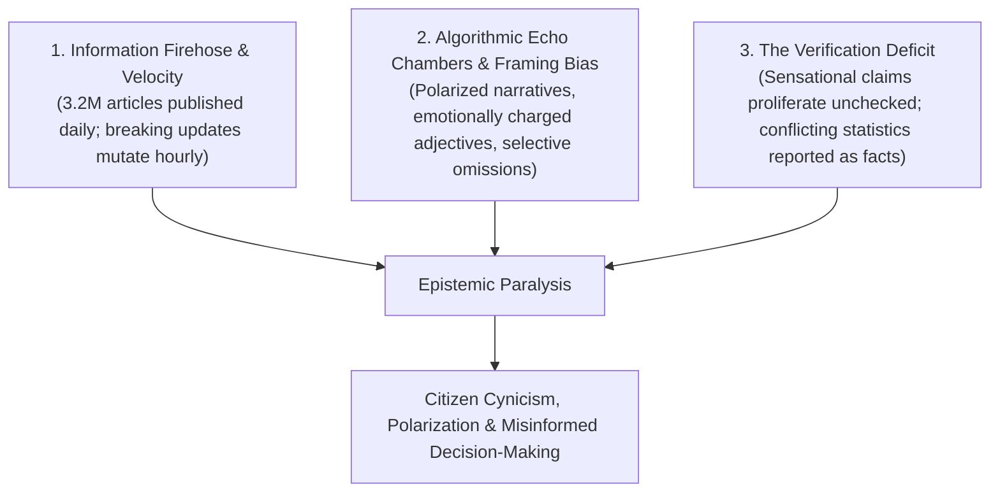
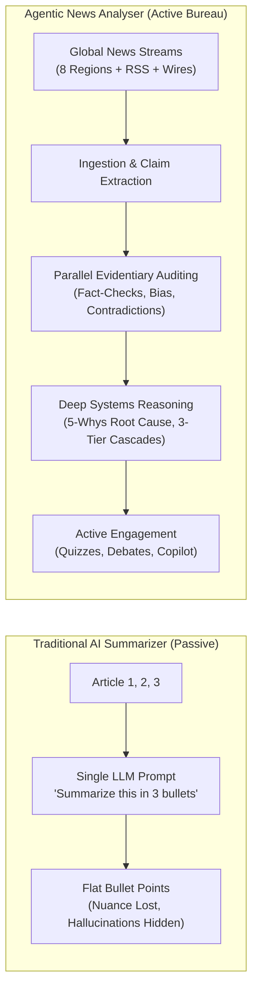

# Document 02: Problem Statement & Competitive Differentiation
## Why the Agentic News Analyser Wins Beyond Traditional AI Summarizers

> **Submission Track**: Google Cloud AI Builder Cup 2026 — *Media, Content & Digital Experiences*  
> **Target System**: [Agentic News Analyser](../../README.md)  
> **Core Engine**: Google Agent Development Kit (ADK 2.0+ Python) & Google Gemini 3.8 Flash / 3.1 Pro Models  

---

## 1. The Epistemic Crisis in Modern News

Modern information consumption suffers from a compounding triple crisis:

When high-stakes global events unfold—such as central bank interest rate decisions, semiconductor trade restrictions, cross-border space communications accords, or pandemic health directives—readers do not simply need *fewer words*. **They need verifiable truth, structured causal clarity, and actionable intelligence.**

---

## 2. Why Conventional LLM "News Summarizers" Fail

Current AI solutions in the media space are almost universally **text compressors** (single-prompt RAG or prompt-engineered LLM chatbots). While they reduce word count, they fundamentally fail at news intelligence in four critical ways:

### Failure 1: The Flattening of Contested Realities (Hallucinated Consensus)
* **The Problem**: When Outlet A reports *"casualty estimate is 45"* and Outlet B reports *"authorities confirm 120"*, a conventional LLM summarizer typically averages the numbers or arbitrarily repeats the last ingested figure: *"Around 80 casualties occurred."*
* **The Failure**: It turns an active, contested factual dispute into a false artificial consensus.
* **Our Solution**: The **Cross-Source Contradiction Analyst** extracts atomic propositions and places them side-by-side with explicit divergence tags (`Numerical Discrepancy`, `Timeline Divergence`, `Fact Negation`), preserving evidentiary nuance.

### Failure 2: Single-Perspective Vulnerability
* **The Problem**: Basic summarizers summarize whatever single article is pasted into the prompt box, or whichever top-3 SEO-optimized articles are returned by a search API.
* **The Failure**: The reader receives a compressed version of one outlet's ideological framing and selective omissions.
* **Our Solution**: The **Multi-Region Source Ingestion Engine** retrieves coverage across 8 global regions (US, UK, India, Japan, Germany, France, Australia, and Global wires) and evaluates editorial bias across a 7-point AllSides-aligned ideological spectrum (Far Left to Far Right).

### Failure 3: Zero Evidentiary Auditability (The Black-Box Blurb)
* **The Problem**: A ChatGPT or Perplexity summary provides bullet points with footnotes that often point to general homepages or hallucinated URLs. Readers cannot audit *why* the AI made a specific assertion.
* **The Failure**: In critical domains (policy, finance, legal), un-auditable AI outputs cannot be trusted.
* **Our Solution**: An immutable **Evidence Ledger Plugin** tracks every claim back to primary source text, quoted speakers, timestamped publications, and IFCN-certified fact-checking databases.

### Failure 4: The Passive Consumption Trap (The Ebbinghaus Forgetting Curve)
* **The Problem**: Readers passively read a summary bullet list and forget over 70% of the material within 24 hours.
* **The Failure**: Summarization creates the *illusion of comprehension* without cognitive retention.
* **Our Solution**: The **Active Recall Pedagogical Tutor** transforms the intelligence report into interactive, adaptive comprehension quizzes (MCQs with pedagogical rationales) and dialectical perspective debates that stimulate critical thinking.

---

## 3. The Agentic News Paradigm Shift

The **Agentic News Analyser** is not a news reader; it is an **Autonomous Multi-Agent Intelligence Bureau**.

---

## 4. UI Page-by-Page Architectural Analysis

Every interface surface in the Agentic News Analyser was designed to expose multi-agent intelligence rather than generic text:

| UI Page / Sub-Section | Problem It Solves | Which Agent Powers It | How It Differs From Normal Summarizers |
| :--- | :--- | :--- | :--- |
| **Home Page (`/`)** | Regional blind spots & delayed breaking awareness | `source_collector`, `topic_suggester` | Offers live breaking feeds filtered across 8 sovereign nations and real-time agent execution pipeline telemetry. |
| **Tab 1: Executive Brief** | Lack of quick, structured situational awareness | `report_synthesizer`, `context_builder` | Combines statistical baseline cards, high-confidence consensus points, and a Jargon Buster entity glossary with Wikipedia links. |
| **Tab 2: Sources & Bias** | Unconscious consumption of partisan framing | `bias_analyst`, `source_reliability_agent` | Visualizes the ideological distribution (Left, Center, Right) across outlets and flags loaded adjectives and omissions. |
| **Tab 3: Verification & Contradictions** | Unchecked misinformation & conflicting reporting | `fact_verifier`, `contradiction_analyst`, `manipulation_detector` | Displays side-by-side contradiction cards contrasting Outlets A vs B, and assigns IFCN verification status badges. |
| **Tab 4: Chronological Timeline** | Confusion over sequence of events & narrative shifts | `timeline_agent` | Reconstructs the exact chronological evolution of the event, marking when media narratives pivoted. |
| **Tab 5: Causal & Scenarios** | Superficial focus on symptoms rather than root causes | `root_cause_agent`, `impact_analyzer`, `scenario_prediction_agent` | Conducts 5-Whys diagnostic analysis, models 3-tier consequence cascades (1st, 2nd, 3rd order), and forecasts Best/Likely/Worst scenarios with leading indicators. |
| **Tab 6: Active Recall Quiz** | Passive reading leading to rapid knowledge decay | `tutor_agent` | Generates adaptive, interactive multiple-choice questions with real-time scoring and deep pedagogical explanations. |
| **Tab 7: Perspective Debate** | Polarization & inability to understand opposing viewpoints | `perspective_debate_agent` | Stages an evidence-grounded dialectical debate between credible opposing perspectives, culminating in an objective synthesis. |
| **Tab 8: Research Copilot** | Inability to ask follow-up questions grounded in audited evidence | `research_copilot` | Dedicated investigation chat assistant grounded directly in the session's verified Evidence Ledger. |
| **History & Archive (`/history`)** | Loss of institutional knowledge and past investigations | `FirestoreService` | Searchable, tag-filtered, and bookmarkable repository of all multi-agent investigations with instant cache rehydration. |

---

## 5. Comprehensive 8-Dimension Competitive Matrix

| Evaluation Dimension | Standard RAG / LLM Chatbot (ChatGPT, Claude) | Dedicated Search AI (Perplexity Pro) | Media Aggregators (Ground News, AllSides) | **Agentic News Analyser (Our Solution)** |
| :--- | :--- | :--- | :--- | :--- |
| **1. Claim Decomposition** | ❌ None (summarizes paragraphs) | ⚠️ Sentence-level text citations | ❌ Manual editorial tagging | **✅ Automated atomic claim extraction into typed Pydantic DTOs** |
| **2. Contradiction Detection** | ❌ Averages or ignores conflicts | ⚠️ Mentions alternate sources in text | ⚠️ Flags headline differences | **✅ Structured side-by-side divergence matrix with typed contradiction categories** |
| **3. Causal & Consequence Modeling** | ❌ Surface-level speculation | ⚠️ Brief bullet points if prompted | ❌ None (news headlines only) | **✅ 5-Whys Root Cause Diagnostics + 3-Tier Consequence Tree (1st/2nd/3rd order)** |
| **4. Forward Scenario Forecasting** | ❌ Unstructured guesswork | ⚠️ General search results | ❌ None | **✅ Probabilistic Scenarios (Best/Likely/Worst) with Leading Indicator Signals** |
| **5. Cognitive Retention & Active Recall** | ❌ None | ❌ None | ❌ None | **✅ Adaptive interactive quizzes with pedagogical feedback and score tracking** |
| **6. Dialectical Perspective Debates** | ⚠️ Can roleplay if specifically prompted | ❌ Informational answers only | ⚠️ Displays opposing headlines | **✅ Automated Pro vs Con dialectical debate grounded in cited evidence** |
| **7. Multi-Agent Orchestration Framework** | ❌ Single-turn LLM call | ⚠️ Search + Synthesizer pipeline | ❌ Algorithmic scrapers | **✅ 25 Google ADK 2.0 specialized agents across 6 architectural layers** |
| **8. Evidentiary Auditability** | ❌ Black box | ⚠️ Web URL footnotes | ⚠️ Publisher metadata | **✅ Immutable Evidence Ledger Plugin tracking claims, quotes, and primary DBs** |

---

## 6. Target Personas & Value Creation

1. **Policy Makers & Government Analysts**: Instantly isolate regulatory gaps, verify international compliance directives, and model cross-border policy transferability.
2. **Investigative Journalists & Media Desks**: Detect subtle shifts in institutional messaging, track cross-wire discrepancies before publishing, and audit source track records.
3. **Financial & Risk Analysts**: Map 2nd- and 3rd-order economic ripple effects across supply chains, currencies, and market sectors.
4. **Educators, Students & Citizens**: Build media literacy, overcome polarized filter bubbles, and retain complex current events through active recall learning.

---

## 7. Conclusion: The Winning Edge

The **Agentic News Analyser** wins because it solves the fundamental problem judges look for: **using state-of-the-art agentic AI to do what was previously impossible for a single human or simple chatbot to achieve.** By deploying a coordinated bureau of 25 Google ADK agents, it transforms chaotic, conflicting global news into structured, verified, and permanent human knowledge.
