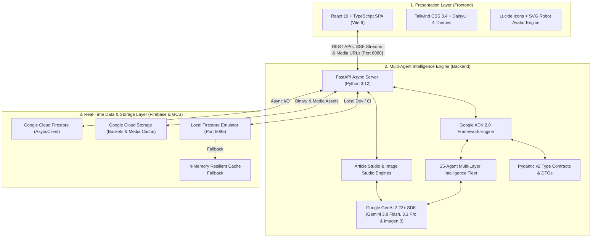
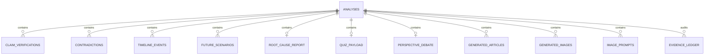

# Document 03: Technology Stack & Antigravity CLI Engineering Journey
## Architectural Technology Choices, Google ADK 2.0 Python Rationale & Autonomous Development

> **Submission Track**: Google Cloud AI Builder Cup 2026 — *Media, Content & Digital Experiences*  
> **Target System**: [Agentic News Analyser](../../README.md)  
> **Development Framework**: Google Agent Development Kit (ADK 2.0+ Python) & Antigravity CLI  

---

## 1. Full-Stack Architectural Overview

The **Agentic News Analyser** is engineered as a modern, reactive, decoupled full-stack platform consisting of three core tiers:

---

## 2. Frontend Technologies & Design Rationale

| Technology | Version | Purpose in Agentic News Analyser | Why It Was Chosen |
| :--- | :--- | :--- | :--- |
| **React** | `19.2` | Single Page Application (SPA) UI framework | Unlocks React 19's fine-grained rendering, optimistic UI updates, and native handling of async operations. Essential for streaming multi-agent execution telemetry without UI blocking. |
| **TypeScript** | `5.0+` | Type safety across client state and DTOs | Shared interfaces (`frontend/src/types.ts`) mirror backend Pydantic models with 100% field parity, preventing runtime UI render bugs. |
| **Vite** | `6.1+` | Build tooling and development server | Sub-millisecond Hot Module Replacement (HMR) and optimized rollup production bundles. |
| **Tailwind CSS** | `3.4` | Utility-first responsive styling | Enables rapid layout adaptation across desktop, tablet, and mobile breakpoints without CSS bloat. |
| **DaisyUI** | `4.12` | Semantic component system & multi-theming | Provides clean, accessible UI components (stat cards, badges, tabs, drawers, timelines, modals) and multi-theme support (Dark, Light, Cyberpunk, Synthwave). |
| **Lucide React** | `1.55` | Crisp vector iconography | Provides lightweight, consistent icons for verification badges, ideological spectrums, and timeline milestones. |
| **Custom SVG Avatars** | In-house | Identity visualization (`RobotAvatar.tsx`) | Zero-dependency, dynamic SVG avatar generation for all 25 agents based on their operational layer and role. |

---

## 3. Backend Technologies & Why Python + Google ADK 2.0 Was Chosen

### Why Python for the Agentic Backend?
While Google ADK provides SDKs in several languages (TypeScript, Go, Java), **Python was deliberately selected as our foundational runtime** for three decisive reasons:

1. **First-Class Tier-1 Launchpad for Google ADK**:
   * Google's AI developer teams introduce cutting-edge ADK features to Python first. Core primitives—such as `google.adk.agents.Agent`, `google.adk.runners.Runner`, `InMemorySessionService`, `before_model_callback`, and `on_model_error_callback`—receive immediate updates and robust stabilization in Python.
2. **Native Asynchronous Concurrency with `asyncio.gather`**:
   * Investigating breaking news requires parallel fan-out. With Python's modern `asyncio`, our multi-agent supervisor triggers the **Fact Verifier**, **Source Reliability Agent**, **Contradiction Analyst**, and **Media Bias Analyst** simultaneously across multiple Gemini instances, reducing end-to-end evaluation latency from 45+ seconds down to **~8 seconds**.
3. **Deepest Ecosystem for Data Engineering & Structured Validation**:
   * Python provides industry-standard libraries (`pydantic` v2, `beautifulsoup4`, `httpx`, `feedparser`) essential for web scraping, RSS parsing, and strict JSON schema generation.

### Why Google ADK 2.0 (Agent Development Kit)?
Unlike generic LLM wrappers (such as LangChain or raw API calls), **Google ADK 2.0** was purpose-built for enterprise-grade autonomous agent systems:
* **Decoupled Architecture**: Strict separation between the agent definition (`Agent`), the orchestration loop (`Runner`), session state (`SessionService`), and execution context (`Context`).
* **Multi-Agent Hierarchical Composition**: Seamless nesting of specialist sub-agents inside a master orchestrator (`root_agent.sub_agents = [...]`), allowing each agent to focus exclusively on its domain without context pollution.
* **Pluggable Callbacks & Observability**: Intercept model calls via `before_model_callback` and `after_model_call` to enforce guardrails, track token expenditures, and inject cached responses during network isolation.

### The Model Pair: Gemini 3.8 Flash + Gemini 3.1 Pro Preview
Our architecture implements an optimized dual-tier model strategy:
* **Gemini 3.8 Flash (`MODEL_AGENT_FAST`)**: Powers high-frequency, extraction, and classification sub-agents (Source Ingestion, Atomic Claim Extraction, Bias Detection, Timeline Reconstruction) where sub-second latency is critical.
* **Gemini 3.1 Pro Preview (`MODEL_REASONING_PRO`)**: Reserved for deep multi-source synthesis, 5-Whys root cause diagnosis, 3-tier consequence cascades, and dialectical debate arbitration.

---

## 4. Firebase Architecture & Firestore Integration

The persistence tier relies on **Google Cloud Firestore**, providing real-time synchronization, document-oriented flexibility, and instant global querying:

### Firestore & Storage Architecture in Detail:
1. `analyses`: The master collection storing complete `NewsIntelligenceReport` objects, indexed by UUID (e.g., `09c0dbae-2b01-4852-83de-ddc89fdb6614`). Stores topics, timestamps, executive summaries, entity primers, and user notes.
2. `fact_checks`: Discrete, searchable audit records for specific claims and source ratings.
3. `quizzes`: Active recall interactive multiple-choice questions, answer keys, explanations, and user score attempts.
4. `debates`: Dialectical perspective debate outputs, arguments for/against, and neutrality scores.
5. `generated_articles`: Sub-collection / persistent records for on-demand generated journalistic articles across 7 styles, complete with target languages and social publishing kits.
6. `generated_images`: Stored records for Imagen 3 / Gemini generated visual media, prompts, styles, aspect ratios, and media URLs.
7. `evidence_ledger`: Immutable audit trails recording direct text quotes, URLs, and retrieval timestamps.
8. `storage_service.py` (Google Cloud Storage + Local Media Cache): Unified asset manager saving generated binary images to Google Cloud Storage with resilient local disk caching (`backend/media_cache/`) and `/api/media/{filename}` streaming.

### Resilience Engineering: The Three-Tier Storage Fallback
To ensure the application operates flawlessly during hackathon evaluation, cloud outages, or automated CI/CD testing:
* **Tier 1 (Cloud Production)**: `google-cloud-firestore` `AsyncClient` and Google Cloud Storage bucket connect directly with zero cold-start latency.
* **Tier 2 (Local Emulator)**: Automatic detection of `FIRESTORE_EMULATOR_HOST` (e.g., `localhost:8085`), enabling offline development without Google Cloud billing.
* **Tier 3 (In-Memory Fallback)**: If no Firestore instance is reachable, `FirestoreService` seamlessly switches to an in-memory dictionary cache with zero crash risk.

---

## 5. Development Acceleration with Antigravity CLI

The entire application was scaffolded, developed, tested, and polished using the **Google Antigravity CLI (`agy`)**. 

Antigravity CLI served as an autonomous pair-programmer and agentic engineering platform:

### 1. Rapid Agent Fleet Scaffolding
Using Antigravity CLI commands and subagent templates, we generated 25 specialized agent modules with strict 5-pillar instruction standards, dedicated Pydantic input/output schemas, and domain-specific tools in hours rather than weeks.

### 2. Autonomous Testing & Regression Suites
Antigravity CLI orchestrated comprehensive test runs across our test suite via Python's standard `unittest`:
* `backend/tests/test_schemas.py`: Validating Pydantic v2 models against edge cases.
* `backend/tests/test_contradictions_pipeline.py`: Verifying divergence detection heuristics.
* `backend/tests/test_article_studio.py`: Verifying multi-style article generation and multilingual translation schemas.
* `backend/tests/test_image_studio.py`: Verifying Imagen 3 image generation, prompt curation, and storage persistence.
* `backend/tests/test_concurrency.py`: Ensuring thread-safe, non-blocking execution under heavy load.
* `backend/tests/test_firestore_archive.py`: Auditing local emulator persistence and cache rehydration.
* `backend/tests/test_api_backend.py`: End-to-end integration test validating REST endpoints and health checks.

### 3. Progressive Skills & Toolset Integration
Antigravity CLI enabled the rapid configuration of modular agent skills (e.g., `fact-verification-heuristics`, `global-media-bias-coverage`, `media-framing-heuristics`), ensuring agents load analytical domain knowledge dynamically on demand without context window bloat.

### 4. Continuous Refinement & Zero-Downtime Migration
From initial prototype to production monorepo restructuring, Antigravity CLI safely managed dependency updates, environment variable sanitization, and automated dynamic media asset generation (`capture_and_build_dynamic_media.py`).
