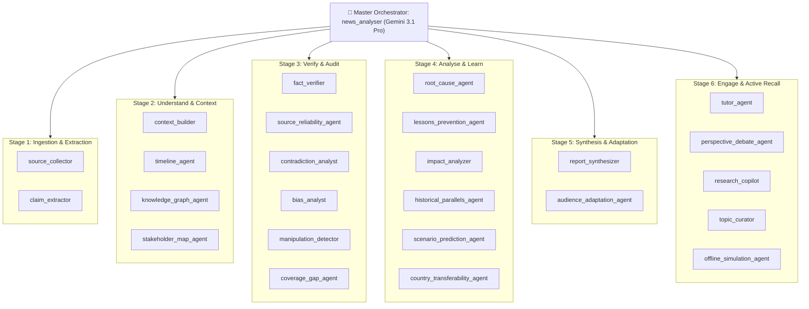

# Document 04: Multi-Agent Ecosystem & Orchestration
## The 25-Agent Fleet, Hierarchical Orchestration, UI Mapping & 5-Pillar Architecture Standards

> **Submission Track**: Google Cloud AI Builder Cup 2026 — *Media, Content & Digital Experiences*  
> **Target System**: [Agentic News Analyser](../../README.md)  
> **Architectural Standard**: [Best Agents Architecture Guide](../best-agents-architecture-guide.md)  
> **Engine**: Google Agent Development Kit (ADK 2.0+ Python) & Google Gemini Models  

---

## 1. Executive Fleet Hierarchy: 25 Agents Across 6 Stages

Rather than building a brittle, monolithic chatbot that tries to do everything in one prompt, the **Agentic News Analyser** deploys a specialized multi-agent bureau organized into **6 functional layers**:



---

## 2. Main vs. Sub-Agent Orchestration Pattern

### Why Hierarchical Delegation Matters
In complex investigative workflows, stuffing every article, claim, guideline, and calculation into a single LLM prompt causes **context degradation, instruction forgetfulness, and high hallucination rates**.

The **Master Orchestrator (`news_analyser`)** acts like the Editor-in-Chief of an elite newsroom:
1. **Delegates Discrete Tasks**: It sends specific data slices to individual sub-agents (e.g., passing only claims to `fact_verifier`, or passing article text to `manipulation_detector`).
2. **Context Window Isolation**: Each sub-agent operates with a tight, focused context window, ensuring razor-sharp attention and schema compliance.
3. **Synthesis & Quality Control**: The master agent reviews intermediate sub-agent outputs, reconciling cross-agent insights into the final unified `NewsIntelligenceReport`.

---

## 3. Comprehensive Agent-to-UI Mapping Matrix

Every single agent directly powers an observable, interactive surface in the web application:

| Agent Name | Architectural Stage | Primary Model | Python Module | Frontend Component & UI Tab | Problem It Solves in UI |
| :--- | :--- | :--- | :--- | :--- | :--- |
| **`news_analyser`** | Root Orchestrator | Gemini 3.1 Pro | `backend/news_analyser/agent.py` | `App.tsx` & Stepper Banner | Coordinates end-to-end multi-agent execution with live progress telemetry. |
| **`source_collector`** | 1. Ingestion | Gemini 3.8 Flash | `shared/agents/ingestion.py` | `HomePage.tsx` (Regional Feeds) | Discovers breaking reporting across 8 international regions and diverse outlets. |
| **`claim_extractor`** | 1. Ingestion | Gemini 3.8 Flash | `shared/agents/ingestion.py` | `tab-03-verification` | Breaks chaotic news narratives into isolated, testable atomic factual claims. |
| **`context_builder`** | 2. Understand | Gemini 3.8 Flash | `shared/agents/understand.py` | `tab-01-brief` (Entity Primer) | Explains Who/Where/What with direct Wikipedia links and Jargon Buster cards. |
| **`timeline_agent`** | 2. Understand | Gemini 3.8 Flash | `timeline_agent/agent.py` | `tab-04-timeline` (`TimelineSection.tsx`) | Reconstructs the exact chronological evolution of events and narrative pivots. |
| **`knowledge_graph_agent`** | 2. Understand | Gemini 3.8 Flash | `shared/agents/understand.py` | `tab-01-brief` (Relationships) | Maps institutional dependencies, alliances, and regulatory oversight bodies. |
| **`stakeholder_map_agent`**| 2. Understand | Gemini 3.8 Flash | `shared/agents/understand.py` | `tab-01-brief` (Stakeholders) | Identifies who gains, who loses, and the underlying incentives of key actors. |
| **`fact_verifier`** | 3. Verify | Gemini 3.8 Flash | `fact_verifier/agent.py` | `tab-03-verification` | Forensic verification of claims (VERIFIED, DISPUTED, MISLEADING) with confidence scores. |
| **`source_reliability_agent`**| 3. Verify | Gemini 3.8 Flash | `shared/agents/verify.py` | `tab-02-sources` (Reliability Tiers) | Audits publisher track records, journalistic corrections history, and source rigor. |
| **`contradiction_analyst`** | 3. Verify | Gemini 3.1 Pro | `shared/agents/verify.py` | `tab-03-verification` (`CrossSourceContradictionsSection.tsx`) | Detects cross-outlet factual, numerical, and timeline discrepancies side-by-side. |
| **`bias_analyst`** | 3. Verify | Gemini 3.8 Flash | `shared/agents/verify.py` | `tab-02-sources` (Bias Spectrum) | Classifies political lean across a 7-point spectrum and flags loaded language. |
| **`manipulation_detector`**| 3. Verify | Gemini 3.8 Flash | `shared/agents/verify.py` | `tab-03-verification` (Framing Flags) | Unmasks propaganda techniques, fear appeals, false dilemmas, and sensationalism. |
| **`coverage_gap_agent`** | 3. Verify | Gemini 3.8 Flash | `shared/agents/verify.py` | `tab-02-sources` (Unanswered Qs) | Detects what outlets are *not* reporting and identifies critical blind spots. |
| **`root_cause_agent`** | 4. Analyse | Gemini 3.1 Pro | `shared/agents/analyse.py` | `tab-05-insights` (5-Whys Diagnostic) | Diagnoses immediate triggers, contributing factors, and structural failure points. |
| **`impact_analyzer`** | 4. Analyse | Gemini 3.1 Pro | `shared/agents/analyse.py` | `tab-05-insights` (Consequence Tree) | Models 3-tier ripple effects: 1st-order (immediate), 2nd-order, and 3rd-order (macro). |
| **`lessons_prevention_agent`**| 4. Analyse | Gemini 3.8 Flash | `shared/agents/analyse.py` | `tab-05-insights` (Action Directives) | Distills concrete prevention steps for individuals, organizations, and regulators. |
| **`historical_parallels_agent`**| 4. Analyse | Gemini 3.1 Pro | `shared/agents/analyse.py` | `tab-05-insights` (Historical Case) | Retrieves similar past historical crises and compares how they were resolved. |
| **`scenario_prediction_agent`**| 4. Analyse | Gemini 3.1 Pro | `scenario_prediction/agent.py` | `tab-05-insights` (Scenarios) | Forecasts Best, Likely, and Worst-case outcomes with leading indicator signals. |
| **`country_transferability_agent`**| 4. Analyse | Gemini 3.8 Flash | `shared/agents/analyse.py` | `tab-05-insights` (Transferability) | Evaluates whether the crisis could happen in the user's home country. |
| **`report_synthesizer`** | 5. Synthesis | Gemini 3.1 Pro | `shared/agents/synthesis.py` | `tab-01-brief` (Executive Brief) | Synthesizes consensus facts, key metrics, and strategic takeaways into brief format. |
| **`audience_adaptation_agent`**| 5. Synthesis | Gemini 3.8 Flash | `shared/agents/synthesis.py` | `tab-01-brief` (Audience Tone) | Rewrites briefs for varied reading levels (ELI5, Executive, Academic) and languages. |
| **`tutor_agent`** | 6. Engage | Gemini 3.8 Flash | `tutor_agent/agent.py` | `tab-06-quiz` (Active Recall Test) | Generates interactive MCQs with pedagogical explanations to reinforce learning. |
| **`perspective_debate_agent`**| 6. Engage | Gemini 3.1 Pro | `perspective_debate/agent.py` | `tab-07-debate` (Dialectical Stage) | Conducts an evidence-backed debate between competing ideological viewpoints. |
| **`research_copilot`** | 6. Engage | Gemini 3.1 Pro | `research_copilot/agent.py` | `tab-08-copilot` (Grounded Chat) | Interactive investigative assistant answering follow-up queries via Evidence Ledger. |
| **`topic_curator`** | Discovery | Gemini 3.8 Flash | `shared/topic_suggester.py` | `HomePage.tsx` (Trending Chips) | Curates timely, high-impact investigative topics across 8 sovereign nations. |

---

## 4. Compliance with the 5-Pillar Architecture Standards

Our multi-agent engineering directly adheres to the principles established in [`docs/best-agents-architecture-guide.md`](../best-agents-architecture-guide.md):

```
       ┌──────────────────────────────────────────────────────────┐
       │     The 5 Pillars of Enterprise Agent Architecture        │
       └────────────────────────────┬─────────────────────────────┘
                                    │
    ┌────────────────┬──────────────┴───┬───────────────┬────────────────┐
    │                │                  │               │                │
┌───▼────────────┐┌──▼──────────────┐┌──▼───────────┐┌──▼────────────┐┌──▼─────────────┐
│ 1. Structured  ││ 2. Pydantic DTO ││ 3. Grounded  ││ 4. Progressive││ 5. Callbacks,   │
│ Instructions   ││ Strict Outputs  ││ Evidence     ││ Skills &      ││ Guardrails &   │
│ (5 Patterns)   ││ (Zero Halluc)   ││ Tools        ││ Heuristics    ││ Observability  │
└────────────────┘└─────────────────┘└──────────────┘└───────────────┘└────────────────┘
```

### Pillar 1: Professional 5-Pattern Structured Instructions
Every agent's prompt in the codebase follows the standard 5-part structure:
1. **IDENTITY**: Persona, tone, and domain authority.
2. **MISSION**: Explicit single objective without scope creep.
3. **METHODOLOGY**: Step-by-step cognitive procedure.
4. **BOUNDARIES**: Negative constraints (*"NEVER take a political stance. NEVER hallucinate citations."*).
5. **FEW-SHOT EXAMPLES**: Schema-compliant input/output demonstrations.

### Pillar 2: Strict Structured Output with Pydantic (`output_schema`)
Zero unstructured text output. All agents deliver typed Pydantic models with validated fields and enumerations (`PoliticalLean`, `VerificationStatus`, `ReliabilityTier`).

### Pillar 3: Grounded Evidence Tools
Sub-agents are equipped with purpose-built tools (`fetch_news_tool`, `scrape_article_tool`, `factcheck_db_tool`, `perspectives_tool`) rather than guessing facts from parametric memory.

### Pillar 4: Progressive Skills & Heuristics
Specialized analytical playbooks reside in modular skills (`backend/shared/skills/`):
* `fact-verification-heuristics`: Methodical claim decomposition and IFCN rating rules.
* `global-media-bias-coverage`: Media framing, headline dissonance, and ideological classification.
* `media-framing-heuristics`: Detection of manipulative rhetoric, fear appeals, and false dilemmas.

### Pillar 5: Callbacks, Plugins & Observability
* `EvidenceLedgerPlugin`: Maintains cryptographic auditability of tool invocations.
* `TokenTrackerPlugin`: Tracks operational token cost per agent.
* `before_model_callback` & `on_model_error_callback`: Enables seamless offline simulation and fail-safe recovery.
