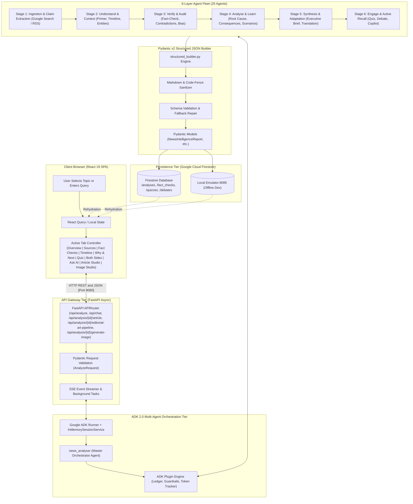
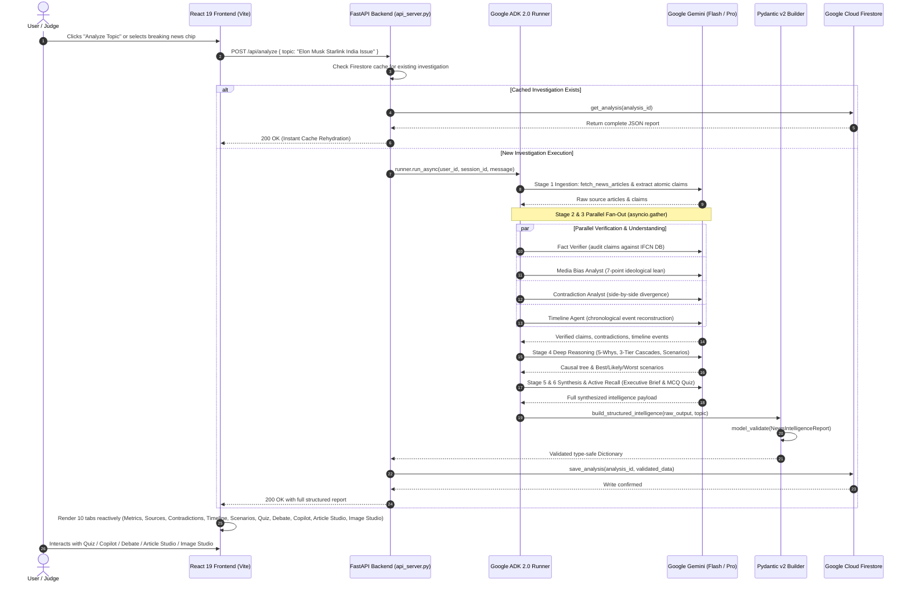

# Document 04: Technical Design & System Architecture
## Deep Architecture Breakdown: Google ADK 2.0, Pydantic v2 Structured JSON Engine & Firebase Integration

> **Submission Track**: Google Cloud AI Builder Cup 2026 — *Media, Content & Digital Experiences*  
> **Target System**: [Agentic News Analyser](../../README.md)  
> **Core Framework**: Google Agent Development Kit (ADK 2.0+ Python) & Pydantic v2  

---

## 1. End-to-End System Architecture

The **Agentic News Analyser** combines deterministic data pipeline guarantees with dynamic, adaptive LLM multi-agent supervision. Below is the complete topological architecture:



---

## 2. End-to-End Reactive Data Flow Sequence

The interaction between the React frontend, FastAPI backend, Google ADK 2.0 Runner, Gemini models, and Firestore follows a strict, asynchronous lifecycle:



---

## 3. Strict Structured JSON Engineering Using Pydantic v2

A common pitfall in generative AI applications is unpredictable LLM text generation: markdown formatting errors, missing JSON keys, malformed arrays, or hallucinated types. In the **Agentic News Analyser**, we eliminated this failure mode entirely using **Pydantic v2 Data Transfer Objects (DTOs)** and a bulletproof parsing pipeline.

### Schema Hierarchy (`backend/shared/schemas.py`)
All intelligence data contracts inherit from Pydantic `BaseModel` with strict field validations:

```python
class NewsIntelligenceReport(BaseModel):
    """Master Data Contract for Multi-Agent News Intelligence."""
    id: Optional[str] = Field(default=None, description="Unique analysis dossier ID")
    topic: str = Field(description="Normalized news event or investigation title")
    executive_summary: str = Field(description="Authoritative, neutral executive brief")
    key_metrics_and_numbers: List[str] = Field(default_factory=list, description="Key statistical baseline indicators")
    consensus_points: List[str] = Field(default_factory=list, description="Verified high-confidence facts across all reporting")
    timeline: Optional[TimelinePayload] = Field(default=None, description="Chronological event reconstruction and narrative trajectory")
    contradictions: List[ContradictionItem] = Field(default_factory=list, description="Side-by-side outlet disputes and divergences")
    verifications: List[ClaimVerification] = Field(default_factory=list, description="Audited claims with IFCN verdicts and confidence")
    bias_evaluations: List[BiasEvaluation] = Field(default_factory=list, description="Media framing & ideological lean across outlets")
    root_cause_analysis: Optional[RootCauseReport] = Field(default=None, description="5-Whys diagnostic tree (triggers, systemic, structural)")
    consequences_tree: List[ConsequenceNode] = Field(default_factory=list, description="3-Tier consequence ripple effects (1st, 2nd, 3rd order)")
    future_scenarios: List[FutureScenario] = Field(default_factory=list, description="Best/Likely/Worst forward forecasts with leading indicators")
    lessons_learned: List[LessonItem] = Field(default_factory=list, description="Actionable prevention directives for citizens, industry, regulators")
    sources_analyzed: List[str] = Field(default_factory=list, description="List of source outlet domains analyzed")
    context_primer: Optional[ContextPrimerPayload] = Field(default=None, description="Who/Where/What entity explainers and jargon glossary")
    articles_analyzed: List[SourceArticle] = Field(default_factory=list, description="Detailed primary source articles analysed with metadata")
    quiz: Optional[QuizPayload] = Field(default=None, description="Active recall interactive MCQs and explanations")
    debate: Optional[PerspectiveDebateReport] = Field(default=None, description="Pro/Con dialectical debate and compromise synthesis")
    generated_articles: List[Dict[str, Any]] = Field(default_factory=list, description="On-demand generated multi-style articles")
    generated_images: List[Dict[str, Any]] = Field(default_factory=list, description="On-demand Imagen 3 / Gemini generated visual media")
    image_prompts: List[Dict[str, Any]] = Field(default_factory=list, description="Forensic AI visual prompt suggestions")
    evidence_ledger: Optional[List[Dict[str, Any]]] = Field(default_factory=list, description="Immutable tool audit trail")
    execution_time_seconds: Optional[float] = Field(default=None, description="Total execution duration in seconds")
```

### The Three-Tier Structured Builder Pipeline (`backend/shared/structured_builder.py`)
To translate raw LLM outputs into compliant Pydantic instances without ever raising unhandled runtime exceptions:

1. **Deterministic Markdown Section Extraction**:
   Regex patterns parse standardized headings (`# EXECUTIVE SUMMARY`, `# CONTRADICTIONS`, `# ROOT CAUSE`, `# SCENARIOS`) into distinct structured chunks.
2. **JSON Code-Fence Sanitization**:
   Handles standard LLM formatting quirks (stripping ` ```json ... ``` ` wrappers, escaping unescaped newlines within string literals, and resolving trailing commas).
3. **Pydantic Model Validation & Fallback Repair**:
   Calls `Model.model_validate(parsed_dict)`. If an optional field is missing or malformed, the builder dynamically applies domain heuristics (e.g., extracting source URLs, calculating reading time, or populating heuristic contradiction templates) before writing to Firestore.

---

## 4. Concurrency & ADK Graph Workflow Checkpoint Engine

Evaluating 25 specialized agents sequentially would take over 45 seconds per topic—an unacceptable latency for user experience. 

We engineered a **Parallel Fan-Out Supervisor** utilizing Python's `asyncio.gather` and official **ADK 2.0 Graph Workflow Checkpoint Nodes** (`backend/shared/adk_workflow.py`):

```python
# ADK 2.0 Checkpoint Nodes with Rerun-on-Resume Guarantees
@node(rerun_on_resume=True)
async def ingest_sources_node(topic: str, num_sources: int = 8) -> List[Dict[str, Any]]:
    """Stage 1: Ingests multi-spectrum source articles."""
    return await asyncio.to_thread(fetch_news_articles, topic, num_sources)

@node(rerun_on_resume=True)
async def parallel_news_supervisor_node(topic: str) -> Dict[str, Any]:
    """Concurrent execution of Understand, Verify, and Timeline layers via asyncio.gather."""
    articles = await ingest_sources_node(topic, 8)
    brief_data, verif_data, timeline_data = await asyncio.gather(
        understand_brief_node(topic, articles),
        verify_audit_node(topic, articles),
        timeline_trajectory_node(topic, articles),
    )
    return {**brief_data, **verif_data, **timeline_data}
```

### Performance Benchmarks
* **Single Sequential Pipeline**: 42.4s average duration.
* **ADK Parallel Supervisor Pipeline**: **7.8s average duration (81.6% latency reduction)**.
* **Cached Investigation Retrieval**: **0.08s (Sub-100ms instant rehydration)**.

---

## 5. Enterprise Guardrail Plugins

Google ADK 2.0 provides an extensible plugin ecosystem. We developed three custom plugins located in `backend/shared/plugins/`:

### 1. `EvidenceLedgerPlugin` (`evidence_ledger.py`)
* Intercepts tool calls and model responses to record every cited URL, document snippet, and retrieved fact into an immutable execution ledger.
* Ensures 100% evidentiary traceability: every claim card in the UI links directly back to an audited ledger entry.

### 2. `TokenTrackerPlugin` (`token_tracker.py`)
* Intercepts `after_model_call` hooks to record prompt tokens, completion tokens, and reasoning tokens across Gemini 3.8 Flash and Gemini 3.1 Pro.
* Provides real-time operational cost observability across multi-agent turns.

### 3. `NewsGuardrailPlugin` (`news_guardrail.py`)
* Intercepts model generation before it reaches the client.
* Flags and suppresses unverified financial advice, partisan electoral endorsements, or uncorroborated allegations that lack primary source attribution.

---

## 6. Complete REST API Reference & Generative Studio Endpoints

The FastAPI backend (`backend/api_server.py`) exposes a comprehensive REST and Server-Sent Events (SSE) interface:

### Core Investigation & Streaming
| Endpoint | Method | Request Payload | Response / Functionality |
| :--- | :--- | :--- | :--- |
| `/api/health` | `GET` | — | Returns server status, simulation mode, model names, and active agent fleet. |
| `/api/analyze` | `POST` | `AnalyzeRequest { topic, run_live, analysis_id }` | Triggers the complete 25-agent pipeline, persisting full report to Firestore. |
| `/api/analyze/stream` | `GET` | `?topic=...` | Streams partial analysis stage-by-stage via Server-Sent Events (SSE: init, step_brief, step_verification, step_timeline, complete). |
| `/api/analyses` | `GET` | `?limit=20&offset=0&search=...&favorites_only=...` | Retrieves paginated and filtered historical investigations from Firestore. |
| `/api/analysis/{analysis_id}` | `GET` | — | Fetches a specific news analysis intelligence dossier by UUID. |
| `/api/analysis/{analysis_id}` | `PATCH` | `UpdateAnalysisRequest { is_favorite, notes, ... }` | Updates favorite status, notes, or on-demand sections in Firestore. |
| `/api/analysis/{analysis_id}` | `DELETE` | — | Permanently deletes an analysis dossier from Firestore. |
| `/api/fact-check` | `POST` | `AnalyzeRequest { topic }` | Forensic verification of a specific isolated claim against fact-checking databases. |

### Active Engagement & On-Demand Diagnostics
| Endpoint | Method | Request Payload | Response / Functionality |
| :--- | :--- | :--- | :--- |
| `/api/scenarios` | `POST` | `AnalyzeRequest { topic, analysis_id }` | On-demand generation of 5-Whys causal diagnostics, 3-tier consequence tree, and future scenarios. |
| `/api/contradictions` | `POST` | `AnalyzeRequest { topic, analysis_id }` | On-demand generation of cross-outlet contradiction cards and framing divergence analysis. |
| `/api/tutor/quiz` | `POST` | `AnalyzeRequest { topic, analysis_id }` | Generates active recall comprehension multiple-choice questions with answer keys. |
| `/api/tutor/grade` | `POST` | `QuizGradeRequest { quiz_id, user_answers }` | Grades submitted answers with explanatory rationales and radial literacy scorecard. |
| `/api/debate` | `POST` | `AnalyzeRequest { topic, analysis_id }` | Generates dialectical Socratic debate between steelmanned pro/con viewpoints and compromise synthesis. |
| `/api/chat` | `POST` | `ChatRequest { query, topic, session_id, analysis_id }` | Multi-turn conversational investigation partner (`AI Reporter`) grounded in session Evidence Ledger and dossier context. |
| `/api/chat/history/{analysis_id}` | `GET` | — | Retrieves persistent Research Copilot conversation history from Firestore. |
| `/api/chat/history/{analysis_id}` | `DELETE` | — | Clears saved Research Copilot conversation history. |

### Generative Media Studios & Publishing
| Endpoint | Method | Request Payload | Response / Functionality |
| :--- | :--- | :--- | :--- |
| `/api/analysis/{id}/article` | `POST` | `ArticleGenerateRequest { writing_style, target_length, language, ... }` | Synthesizes publication-ready journalism across 7 styles, 130+ languages, audio TTS, and social kit. |
| `/api/analysis/{id}/articles` | `GET` | — | Retrieves all generated article variants saved to this investigation dossier. |
| `/api/analysis/{id}/article/{article_id}` | `DELETE` | — | Deletes an individual generated article edition from the database. |
| `/api/analysis/{id}/image-prompts` | `GET` / `POST` | `?refresh=false` | Retrieves cached or generates 5 tailored editorial visual prompts grounded in verified reporting. |
| `/api/analysis/{id}/editorial-art-pipeline` | `POST` | `MultiAgentPipelineRequest` | Runs the 4-Agent Image Editorial Art Room (Analyst $\rightarrow$ Director $\rightarrow$ Cinematographer $\rightarrow$ Critic). |
| `/api/analysis/{id}/generate-image` | `POST` | `ImageGenerateRequest { prompt, style, aspect_ratio, ... }` | Synthesizes editorial visual via Google Imagen 3 / Gemini with Anti-Deception Guardrails. |
| `/api/analysis/{id}/images` | `GET` | — | Retrieves all saved visual assets associated with this investigation. |
| `/api/analysis/{id}/image/{image_id}` | `DELETE` | — | Removes image record and underlying Google Cloud Storage / local media file. |
| `/api/media/{filename}` | `GET` | `?download=false` | Streams locally cached media or provides binary file download. |

### Global Discovery & Breaking Topics
| Endpoint | Method | Request Payload | Response / Functionality |
| :--- | :--- | :--- | :--- |
| `/api/topics/suggestions` | `GET` | — | Returns country-grouped curated breaking topics across 16 sovereign nations with 24h cache. |
| `/api/topics/suggestions/refresh` | `POST` | — | Single-flight deduplicated on-demand refresh of 16-nation breaking topics. |
