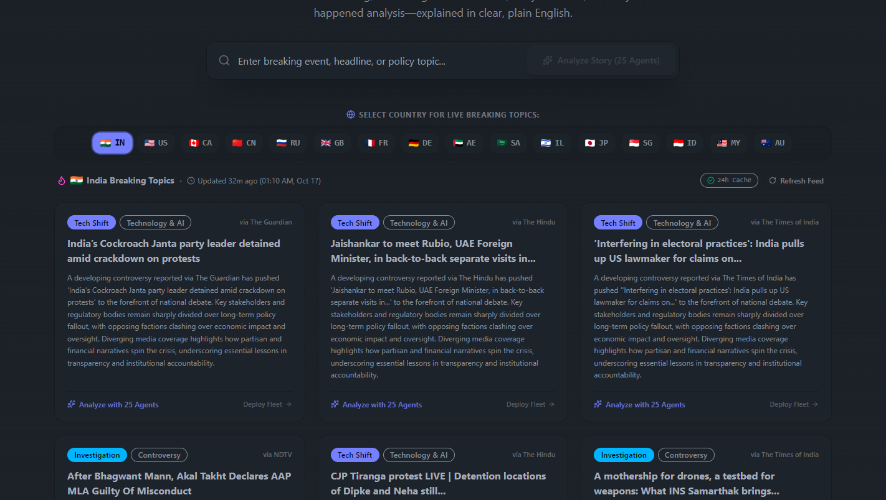
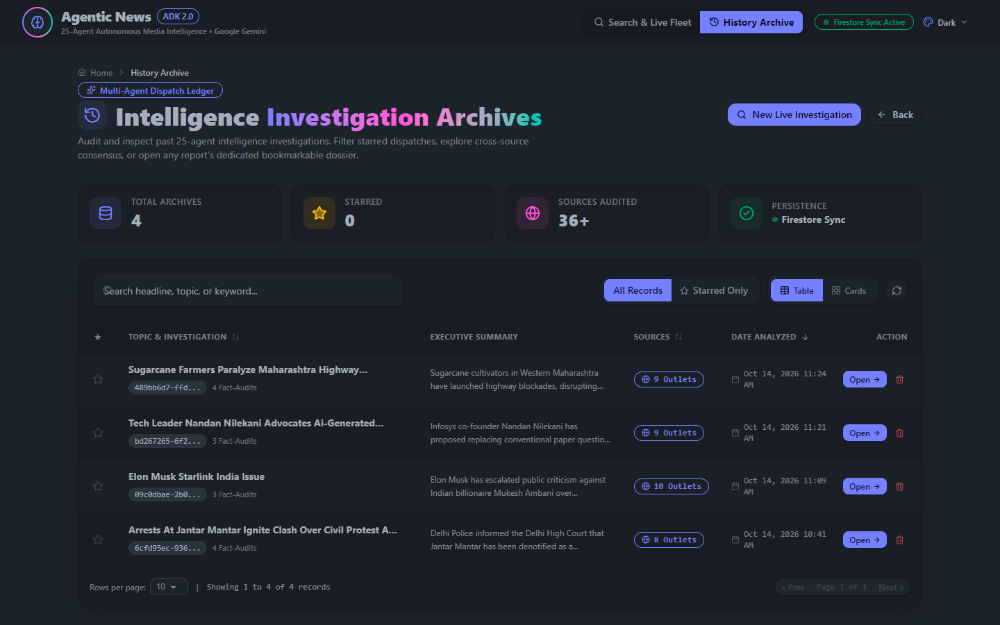
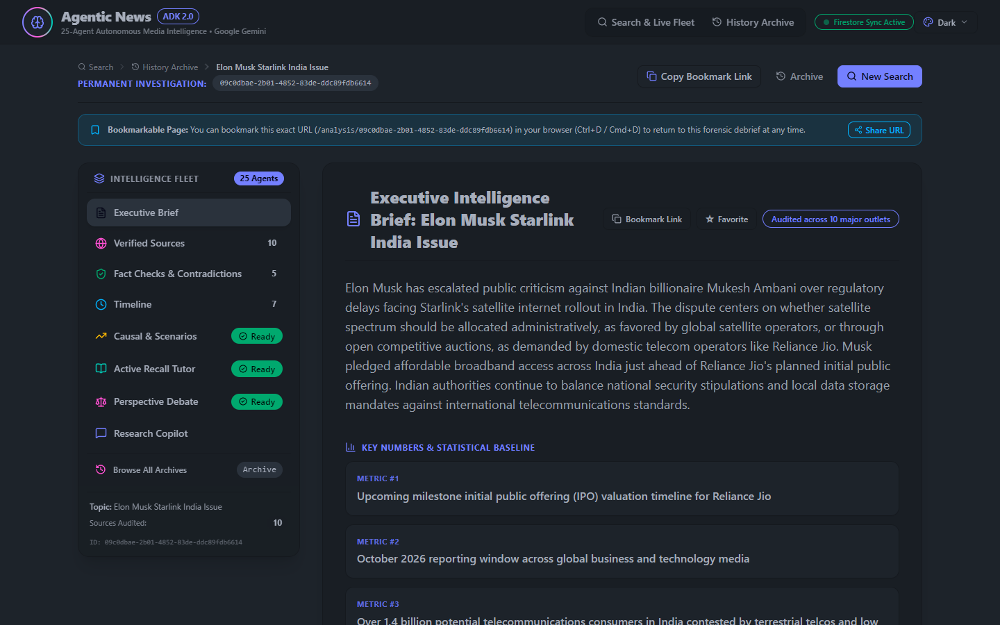
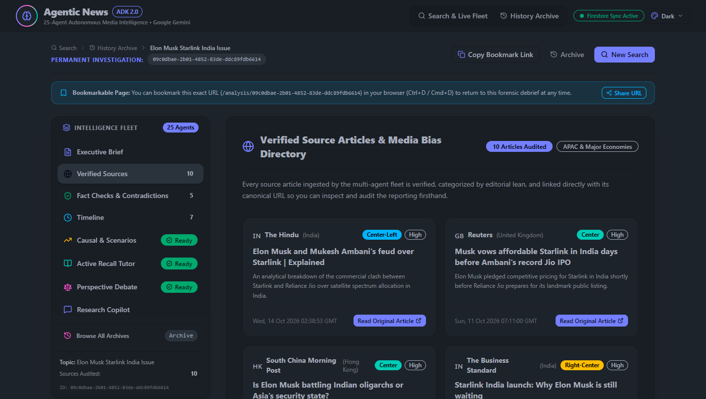
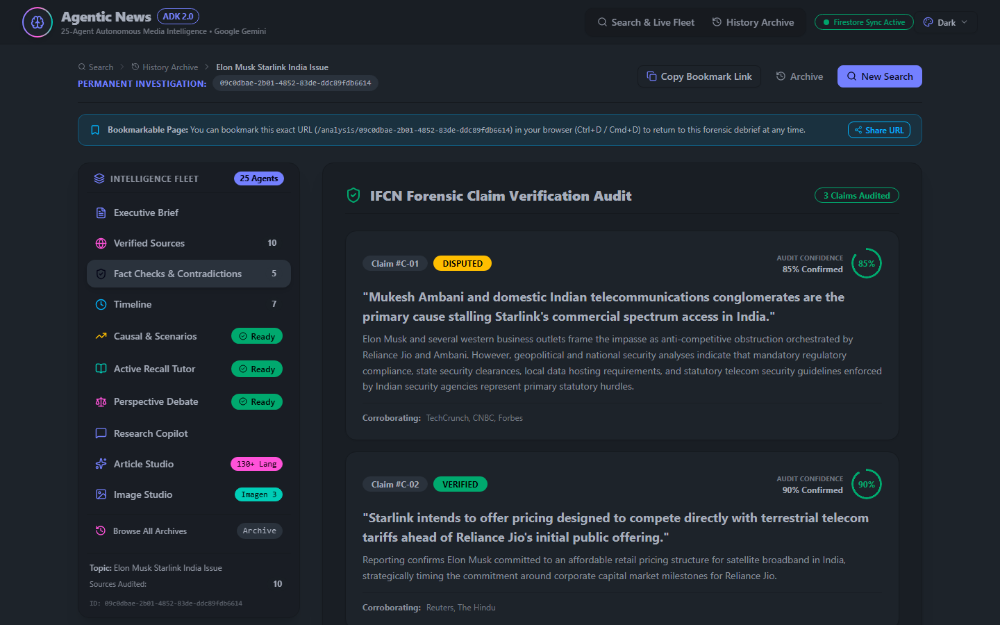
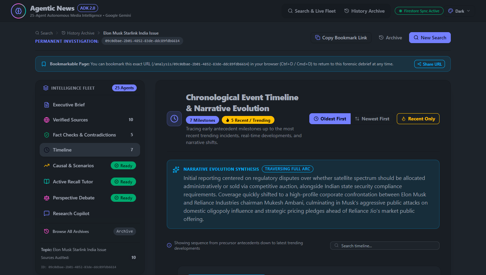
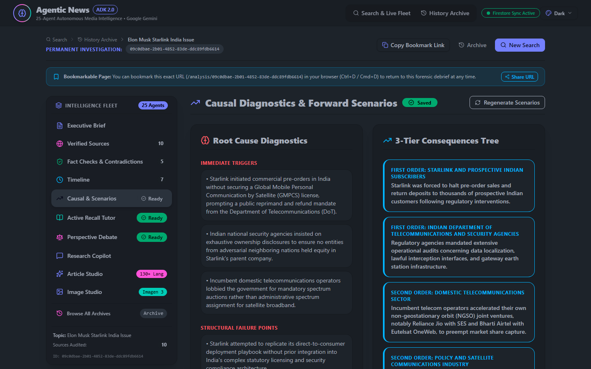
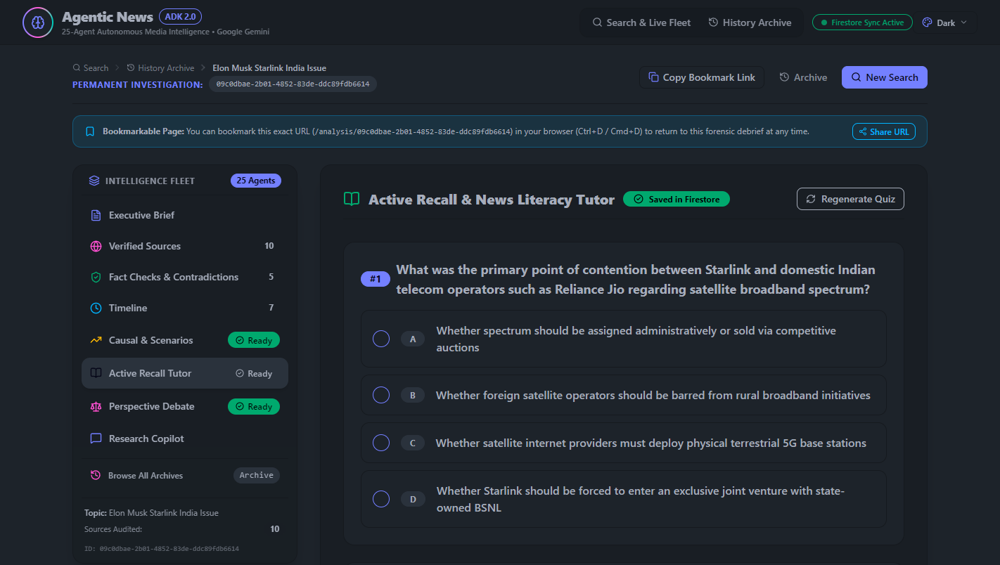
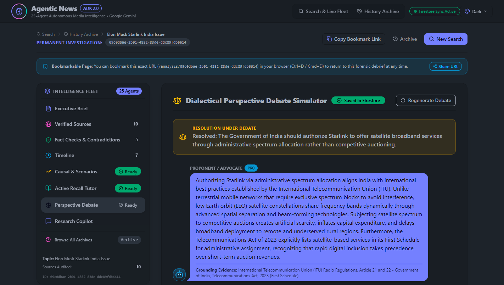
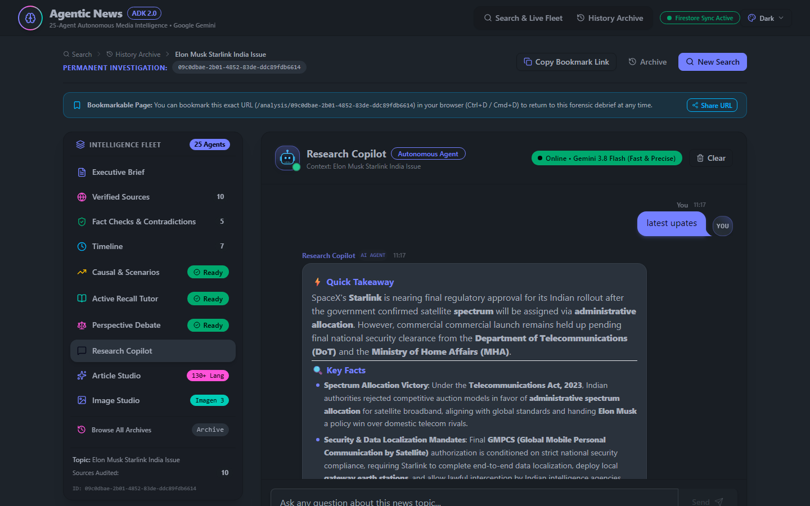

# Document 05: User & Evaluator Guide
## Step-by-Step Evaluator Walkthrough, UI Navigation, Problem-Solving Sections & Visual Media Tour

> **Submission Track**: Google Cloud AI Builder Cup 2026 — *Media, Content & Digital Experiences*  
> **Target System**: [Agentic News Analyser](../../README.md)  
> **Primary Evaluation URL**: `http://localhost:5173/`  
> **Sample Pre-Audited Investigation URL**: [`http://localhost:5173/analysis/09c0dbae-2b01-4852-83de-ddc89fdb6614`](http://localhost:5173/analysis/09c0dbae-2b01-4852-83de-ddc89fdb6614)  

---

## 1. Fast-Track Evaluator Checklist (3 Minutes)

Evaluators and judges can explore the complete live platform in under 3 minutes:

1. **Launch Verification**: Ensure both servers are active:
   * **Backend API**: `http://localhost:8080/` (or run `python backend/api_server.py`)
   * **Frontend UI**: `http://localhost:5173/` (or run `cd frontend && npm run dev`)
2. **Instant Golden Test Case**: Open [`http://localhost:5173/analysis/09c0dbae-2b01-4852-83de-ddc89fdb6614`](http://localhost:5173/analysis/09c0dbae-2b01-4852-83de-ddc89fdb6614) to load the pre-audited intelligence dossier for **"Elon Musk Starlink India Issue"**.
3. **Tab Tour**: Click across the 8 investigation tabs on the left sidebar:
   * **Executive Brief** $\rightarrow$ **Verified Sources** $\rightarrow$ **Fact Checks & Contradictions** $\rightarrow$ **Timeline** $\rightarrow$ **Causal & Scenarios** $\rightarrow$ **Active Recall Tutor** $\rightarrow$ **Perspective Debate** $\rightarrow$ **Research Copilot**.
4. **Interactive Test**: Go to the **Active Recall Tutor** tab and answer Question 1 to see the instant feedback badge and pedagogical explanation.

---

## 2. Animated Platform Walkthrough

Below is a live animated recording showing navigation across the global feeds, the 8-tab intelligence dossier, side-by-side contradiction auditing, and interactive tutoring:

---

## 3. UI Navigation & Global Shell Architecture

The user interface was built to deliver the responsiveness of a high-end financial terminal with the visual polish of a modern media publication.

### Global Header Controls
* **Brain Logo & Fleet Status**: Shows active connectivity to the 25-agent Google ADK fleet.
* **Top Navigation**: Direct access to `Search & Live Fleet` (`/`) and `History Archive` (`/history`).
* **Firestore Sync Indicator**: Real-time badge indicating whether reports are persisting to Google Cloud Firestore or the local emulator.
* **DaisyUI Multi-Theme Switcher**: Instant switching between `Dark`, `Light`, `Cyberpunk`, and `Synthwave` themes.
* **Responsive Drawer**: Mobile-friendly sidebar drawer on smaller viewports.

---

## 4. UI Page Deep Dives: What Problem Each Section Solves

### Page 1: Home Dashboard & Global Breaking Feeds (`/`)

* **Problem It Solves**: In breaking news, users suffer from information silos and delayed awareness of international developments.
* **Key Features**:
  1. **Investigative Search Bar**: Accepts any breaking news topic, contentious claim, or URL.
  2. **8-Country Regional Switcher**: Filter breaking news across sovereign feeds: **United States, United Kingdom, India, Japan, Germany, France, Australia, and Global wires**.
  3. **Trending Intelligence Chips**: Pre-curated, high-stakes topics updated continuously.
  4. **Multi-Agent Pipeline Stepper**: When a new analysis begins, an animated stepper visualizes the 6-stage fleet progress in real time (Ingestion $\rightarrow$ Understand $\rightarrow$ Verify $\rightarrow$ Analyse $\rightarrow$ Synthesis $\rightarrow$ Engage).

---

### Page 2: History & Archive Repository (`/history`)

* **Problem It Solves**: Loss of past research and inability to audit historical claims over time.
* **Key Features**:
  1. **Instant Search & Topic Filtering**: Query past investigations by title or keyword.
  2. **Favorites Bookmark System**: Star key investigations for rapid access.
  3. **Metadata Badges**: Displays source count, contradiction count, and time of analysis.
  4. **Instant Rehydration**: Sub-100ms loading from Firestore cache without re-running models.

---

## 5. The 8 Analysis Report Tabs in Detail

*(Demonstrated using live sample: `http://localhost:5173/analysis/09c0dbae-2b01-4852-83de-ddc89fdb6614`)*

### Tab 1: Executive Intelligence Brief (`#brief`)

* **Problem It Solves**: Readers need an immediate, verified baseline before diving into technical details.
* **What You See**:
  * **Top Metrics Grid**: Audited source count, verified claims tally, consensus score, and reading time.
  * **Executive Summary**: Authoritative journalistic synthesis grounded strictly in facts.
  * **Statistical Baseline**: Numerical figures isolated from reporting (e.g., IPO timelines, market caps).
  * **Consensus Points**: Verified facts agreed upon by all reporting outlets.
  * **Entity & Jargon Glossary**: Interactive primer explaining key people, companies, and acronyms with direct Wikipedia links.

---

### Tab 2: Verified Sources & Media Bias (`#sources`)

* **Problem It Solves**: Selective exposure bias and blindness to ideological framing.
* **What You See**:
  * **7-Point Political Spectrum**: Visual distribution of sources across *Far Left, Left, Center-Left, Center, Center-Right, Right, Far Right*.
  * **Source Reliability Breakdown**: Transparency scores, publisher country flags, and primary author attributions.
  * **Coverage Gaps**: Clear listing of questions left unanswered by the media.

---

### Tab 3: Fact Checks & Contradictions (`#verification`)

* **Problem It Solves**: The dangerous flattening of conflicting figures and unchecked misinformation.
* **What You See**:
  * **Side-by-Side Contradictions Matrix**: Directly contrasts Outlet A vs. Outlet B with divergence classifications (`Numerical Discrepancy`, `Timeline Divergence`, `Fact Negation`).
  * **IFCN Claim Verification Cards**: Atomic claims rated with color-coded badges (`VERIFIED`, `DISPUTED`, `MISLEADING`, `UNVERIFIED`) and confidence percentages.
  * **Manipulation & Propaganda Flags**: Identifies loaded words, sensationalism, and cognitive bias triggers.

---

### Tab 4: Chronological Event Timeline (`#timeline`)

* **Problem It Solves**: In fast-moving events, readers lose track of the sequence of cause and effect.
* **What You See**:
  * **Interactive Milestone Timeline**: Chronological order of events from proximate trigger to latest status.
  * **Narrative Evolution Markers**: Highlights the exact moment media framing pivoted from technical regulation to high-profile geopolitical conflict.

---

### Tab 5: Causal & Scenarios (`#insights`)

* **Problem It Solves**: Traditional news reports focus only on surface symptoms without explaining *why* it happened or *what comes next*.
* **What You See**:
  * **5-Whys Root Cause Diagnostics**: Deconstructs immediate triggers, systemic vulnerabilities, and structural failures.
  * **3-Tier Consequence Cascades**: Models ripple effects across 1st-order (immediate), 2nd-order (industry/market), and 3rd-order (macroeconomic/geopolitical).
  * **Probabilistic Scenarios**: Best-case, Most-likely, and Worst-case forward forecasts with leading indicator signals to watch.
  * **Actionable Lessons**: Concrete prevention and response directives for policymakers, companies, and citizens.

---

### Tab 6: Active Recall Comprehension Quiz (`#quiz`)

* **Problem It Solves**: The passive reading trap where 70% of news is forgotten within 24 hours.
* **What You See**:
  * **Adaptive Multiple-Choice Questions (MCQs)**: Tests understanding of core facts, contradictions, and causal drivers.
  * **Instant Feedback & Scoring**: Highlights correct/incorrect choices with score tracking.
  * **Pedagogical Explanations**: Deep explanations for *why* an answer is correct, citing source evidence.

---

### Tab 7: Dialectical Perspective Debate (`#debate`)

* **Problem It Solves**: Polarization and inability to understand the legitimate arguments of opposing sides.
* **What You See**:
  * **Dialectical Pro vs. Con Arguments**: Steel-manned arguments from competing viewpoints (e.g., Global Satellite Operators vs. Domestic Terrestrial Telcos).
  * **Neutral Synthesis**: Objective arbitration explaining how policymakers reconcile the tension.

---

### Tab 8: Research Copilot (`#copilot`)

* **Problem It Solves**: Users cannot interrogate a static news article or ask follow-up questions.
* **What You See**:
  * **Interactive Investigative Chat**: Ask any follow-up question regarding the event.
  * **Evidence Ledger Grounding**: The copilot cites verified source passages and claims rather than hallucinating external assumptions.

---

## 6. Power Features & Productivity Utilities

* **PDF Export**: Generate a printable, professionally formatted PDF brief of the entire investigation with a single click.
* **Text-to-Speech Audio Reader**: Listen to the executive summary with built-in voice playback.
* **Researcher Notes**: Take private notes directly on the investigation card, saved automatically to Firestore.
* **Direct Share & Bookmark Link**: Share permanent URLs (e.g., `/analysis/<uuid>#verification`) linking directly to specific tabs.
