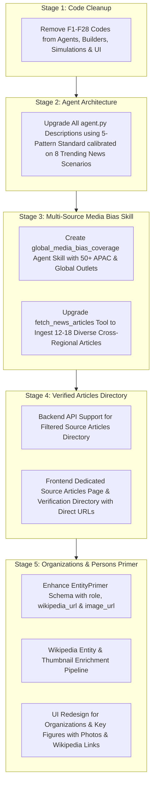

# News Analyser Fleet & UI Enhancements Plan

> **Goal:** Modernize the News Analyser platform by removing legacy feature catalogue codes (F1–F28), upgrading agent descriptions to the 5-Pattern standard calibrated on trending news scenarios, building an APAC & major economies media bias skill with expanded multi-source ingestion, adding a dedicated verified sources directory page, and enriching the entity primer with organizations and key figures featuring Wikipedia links and portraits.

---

## Stage Breakdown & Architecture

---

## Stage 1: Removal of Casual Feature Codes (F1–F28 / F39)
**Goal:** Eliminate all internal feature catalogue code suffixes from user-facing UI labels, agent instructions, and simulation templates.

### Tasks
- [ ] **1.1 Python Agent Instructions & Descriptions**:
  - `adk-web-news/news_analyser/agent.py`: Remove `(F4)`, `(F1, F27)`, `(F2, F29)`, `(F3)`, `(F5)`, `(F6, F30)`, `(F14, F15, F16)`, `(F17)`, `(F18)`, `(F20, F22)`.
  - `adk-web-news/fact_verifier/agent.py`: Remove `(Features F5, F7, F8, F9, F10)`.
  - `adk-web-news/tutor_agent/agent.py`: Remove `(Features F20, F22, F23)`.
  - `adk-web-news/research_copilot/agent.py`: Remove `(Features F21, F39)`.
  - `adk-web-news/perspective_debate/agent.py`: Remove `(Feature F38)`.
  - `adk-web-news/timeline_agent/agent.py`: Remove `(Features F2, F29)`.
  - `adk-web-news/scenario_prediction/agent.py`: Remove `(Feature F18)`.
  - `adk-web-news/shared/agents/*.py`: Clean docstrings and instructions.
- [ ] **1.2 Simulation & Structured Builder Templates**:
  - `adk-web-news/shared/simulation.py`: Remove section header suffixes like `(F4)`, `(F1, F27)`, `(F2, F29)`, etc.
  - `adk-web-news/shared/structured_builder.py`: Clean commentary and section titles.
- [ ] **1.3 Frontend UI Clean-Up**:
  - `web-app/web/src/components/AnalysisReportView.tsx`: Clean titles across all 7 tabs:
    - `"Key Numbers & Statistical Baseline"`
    - `"Who / Where / What Primer & Jargon Buster"`
    - `"Cross-Spectrum Consensus Points"`
    - `"IFCN Forensic Claim Verification Audit"`
    - `"Cross-Source Contradictions & Divergence"`
    - `"Media Framing & Political Lean Spectrum"`
    - `"Chronological Event Timeline & Narrative Evolution"`
    - `"Causal Diagnostics & Forward Scenarios"`
    - `"Dialectical Perspective Debate Simulator"`
- [ ] **1.4 Verification**:
  - Update `adk-web-news/tests/test_workflow.py` string assertions and run test suite.

---

## Stage 2: Elaborate Agent Descriptions & Instructions (Best-Agents Guide Standards)
**Goal:** Upgrade every agent's `description` and `instruction` in `agent.py` to meet the 5-Pattern Standard (Identity, Mission, Methodology, Boundaries, Grounded Output) calibrated against real-world trending news scenarios.

### Trending Scenarios Calibration
1. **Central Bank Monetary Policy & Currency Liquidity Shifts**: Cross-checking rate cut timelines, inflation metrics, and sovereign bond yield divergences across Reuters, Bloomberg, and Nikkei.
2. **Cross-Border Tech Labor Regulatory Directives (PERM & H-1B Freezes)**: Distinguishing executive gazette filings from unvetted headlines; tracking grandfathering clauses.
3. **Semiconductor Export Controls & Global Foundry Supply Chains**: Auditing manufacturing capacity claims, trade restrictions, and bilateral agreements between US, Taiwan (TSMC), and Netherlands (ASML).
4. **Clean Energy Tariffs, Subsidies & Carbon Border Adjustments**: Verifying WTO complaints, subsidy figures, and regional trade impacts across EU, US, and Asian manufacturing hubs.
5. **Multi-Jurisdiction AI Safety Audits & Compliance Acts**: Tracking statutory enforcement dates, transparency mandates, and legal injunction petitions.
6. **Geopolitical Maritime Logistics & Chokepoint Disruptions**: Fact-checking shipping detour costs, insurance premiums, and naval escort operational statements.
7. **Deep Space & Commercial Launch Reallocations**: Auditing budget revisions, flight test readiness, and government audit dockets (GAO/NASA OIG).
8. **Critical Minerals & Processing Monopolies**: Reconciling extraction quotas, domestic reserves, and bilateral trade pact assertions.

### Tasks
- [ ] **2.1 Comprehensive Root Agent Descriptions**:
  - Elaborate descriptions in `news_analyser/agent.py`, `fact_verifier/agent.py`, `tutor_agent/agent.py`, `research_copilot/agent.py`, `perspective_debate/agent.py`, `timeline_agent/agent.py`, `scenario_prediction/agent.py`.
  - Include specific inputs, evaluation rigor, evidence thresholds, and exact output commitments.
- [ ] **2.2 Sub-Agent Fleet Calibration (`shared/agents/`)**:
  - Ingestion Layer: `source_collector`, `claim_extractor`.
  - Understand Layer: `context_builder`, `timeline_agent`, `knowledge_graph_agent`, `stakeholder_map_agent`.
  - Verify Layer: `fact_verifier`, `source_reliability_agent`, `contradiction_analyst`, `bias_analyst`, `manipulation_detector`, `coverage_gap_agent`.
  - Analyse Layer: `root_cause_agent`, `consequence_tree_agent`, `future_scenario_agent`, `lessons_learned_agent`.
  - Synthesise Layer: `report_synthesizer`, `perspective_debate_agent`.

---

## Stage 3: APAC & Major Economies Media Bias Skill & Multi-Source Ingestion
**Goal:** Build an AllSides-style multi-region media bias skill covering 50+ reputable outlets across APAC and major global economies, and expand article ingestion to 12–18 diverse cross-spectrum sources.

### Media Bias Directory Coverage
- **APAC Outlets**:
  - **Japan**: *Nikkei Asia* (Center-Right / Financial), *The Japan Times* (Center / Independent), *NHK World* (Center / Public Broadcaster), *The Asahi Shimbun* (Center-Left).
  - **India**: *The Hindu* (Center-Left / Broadcaster), *The Indian Express* (Center / Investigative), *Mint* (Center / Financial), *Times of India* (Center / Mainstream).
  - **Australia**: *ABC News Australia* (Center / Public Broadcaster), *The Sydney Morning Herald* (Center-Left), *The Australian Financial Review* (Center-Right / Business).
  - **Singapore**: *The Straits Times* (Center / Institutional), *Channel NewsAsia (CNA)* (Center / Regional Wire).
  - **South Korea**: *The Korea Herald* (Center / English Daily), *Yonhap News Agency* (Center / National Wire).
  - **Hong Kong / Greater China**: *South China Morning Post (SCMP)* (Center / Pan-Asian), *Caixin Global* (Center / Business).
  - **New Zealand & SE Asia**: *Radio New Zealand (RNZ)* (Center / Public), *The Jakarta Post* (Center / English Daily).
- **Major Global Economies (US, UK, Europe)**:
  - **Global Wires**: *Reuters* (Center / Wire), *Associated Press* (Center / Wire), *Agence France-Presse (AFP)* (Center / Wire), *Bloomberg News* (Center / Financial).
  - **United States**: *The Wall Street Journal* (Lean Right / Business), *The New York Times* (Lean Left / National), *The Washington Post* (Lean Left), *The Hill* (Center), *NPR* (Lean Left / Public).
  - **United Kingdom**: *Financial Times* (Center / Global Business), *BBC News* (Center / Public), *The Guardian* (Left), *The Telegraph* (Right), *The Economist* (Center / Editorial).
  - **Continental Europe**: *Deutsche Welle (DW)* (Center / Germany), *France 24* (Center / France), *Politico Europe* (Center / EU Policy).

### Tasks
- [ ] **3.1 Create Agent Skill Directory & Metadata**:
  - Create `adk-web-news/skills/global_media_bias_coverage/SKILL.md` specifying media bias methodology, spectrum classifications (`LEFT`, `LEAN_LEFT`, `CENTER`, `LEAN_RIGHT`, `RIGHT`), regional quotas, and cross-source reconciliation.
  - Create `adk-web-news/skills/global_media_bias_coverage/references/news_outlets_directory.json` containing structured metadata for 50+ outlets (Name, Country, Region, Lean, Reliability, Home URL, RSS/Query pattern).
- [ ] **3.2 Ingestion Tool Upgrade (`adk-web-news/shared/tools.py`)**:
  - Expand `fetch_news_articles` to ingest articles across multiple geographic and editorial buckets (Wires, Financial, APAC Regional, North America, Europe).
  - Expand output payload to include `country`, `region`, `editorial_lean`, `reliability_tier`, and verified `url`.
- [ ] **3.3 Structured Report Ingestion**:
  - Update `shared/structured_builder.py` and `shared/simulation.py` to populate 10–18 articles across diverse regions and outlets.

---

## Stage 4: Dedicated Verified Source Articles Directory & UI Page
**Goal:** Give users a full-fledged directory page to inspect every single analyzed article, its origin country, editorial bias rating, publication date, and direct clickable URL to independently verify claims.

### Tasks
- [ ] **4.1 Frontend Routing & Navigation**:
  - Add navigation item / tab for Source Articles.
  - Create `web-app/web/src/pages/SourcesPage.tsx` or `web-app/web/src/components/SourceArticlesDirectory.tsx`.
  - Accessible directly at `/analysis/:id/sources` and via a prominent tab / button in `AnalysisReportView.tsx`.
- [ ] **4.2 Source Articles Directory UI**:
  - Filter by Region: All, APAC, North America, Europe, Global Wires.
  - Filter by Lean: All, Center, Lean Left, Lean Right, Left, Right.
  - Card & Grid layout displaying:
    - Outlet name with country flag (🇯🇵, 🇮🇳, 🇦🇺, 🇸🇬, 🇺🇸, 🇬🇧, 🇩🇪, etc.)
    - AllSides-style colored bias badge with tooltip
    - Article title and publish date
    - Concise excerpt / extracted findings
    - Prominent **"Verify at Source ↗"** button opening the direct URL in a new tab.

---

## Stage 5: Organizations & Key Figures (Persons) Primer with Wikipedia Links & Photos
**Goal:** Upgrade the Who/Where/What Primer so that both key Organizations AND key Persons (leaders, officials, spokespeople, judges) are richly highlighted with roles, direct Wikipedia links, and portrait/logo thumbnails.

### Tasks
- [ ] **5.1 Schema & Data Model Updates**:
  - Update `EntityPrimer` in `adk-web-news/shared/schemas.py`:
    - Add `role_or_title: Optional[str]`
    - Add `wikipedia_url: Optional[str]`
    - Add `image_url: Optional[str]`
  - Update `types.ts` in `web-app/web/src/types.ts` to mirror fields.
- [ ] **5.2 Wikipedia Resolution Pipeline**:
  - In `adk-web-news/shared/tools.py` / `shared/structured_builder.py`, add `resolve_wikipedia_entity(entity_name, entity_type)`:
    - Queries Wikipedia API / Wikidata to fetch the canonical Wikipedia page URL and thumbnail image URL.
    - Caches results to maintain sub-second performance.
- [ ] **5.3 Primer Builder Enrichment**:
  - Update `build_stage_brief` and `build_structured_intelligence` to generate:
    - **Organizations**: Regulatory agencies, courts, tech consortia, central banks.
    - **Key Persons**: Named government secretaries, chief justices, corporate executives, lead plaintiffs, chief economists.
    - Attached Wikipedia link and official portrait/logo image.
- [ ] **5.4 UI Redesign in `AnalysisReportView.tsx`**:
  - Split Primer into clear visual categories:
    1. **Key Figures & Leaders (Persons)**: Visual avatar/portrait cards with name, role, 2-line impact summary, and Wikipedia button.
    2. **Key Organizations & Institutions**: Cards with logo/badge, mandate, historical context, and Wikipedia button.
    3. **Jargon Buster & Policy Terms**: Clean definition accordions.

---

## Execution Checkpoints & Testing Strategy
- **Stage 1 Verification**: `python -m unittest discover -s adk-web-news/tests` (0 F-code regressions).
- **Stage 2 Verification**: Test agent loading and live Gemini generation with updated 5-pattern instructions.
- **Stage 3 Verification**: Unit test `test_tools.py` verifying multi-outlet APAC + global article fetching.
- **Stage 4 Verification**: Frontend Vite build + visual check of the Source Articles directory page.
- **Stage 5 Verification**: End-to-end test verifying Wikipedia URL and image thumbnail resolution and UI rendering for persons and organizations.
